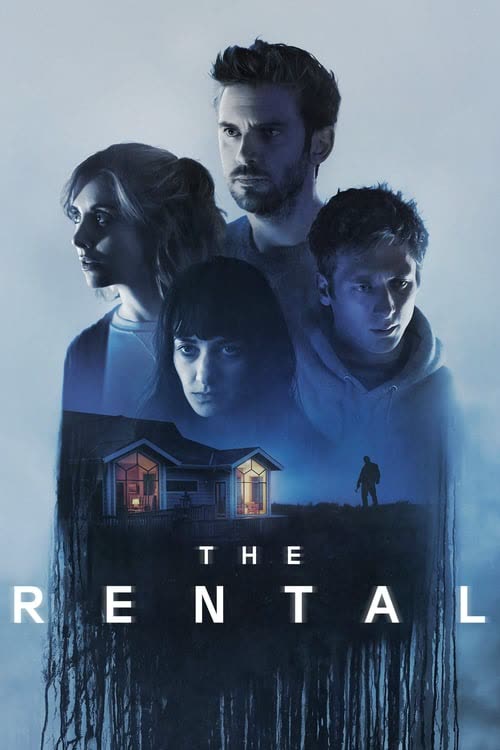
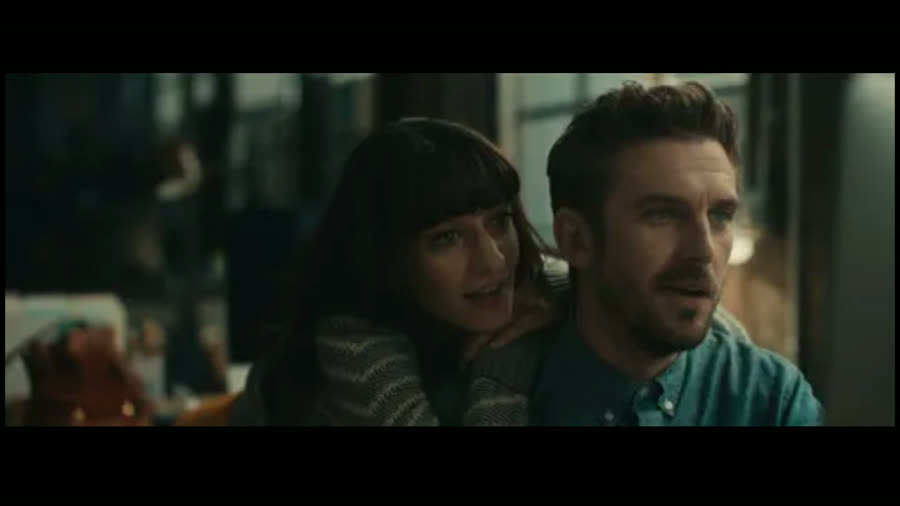
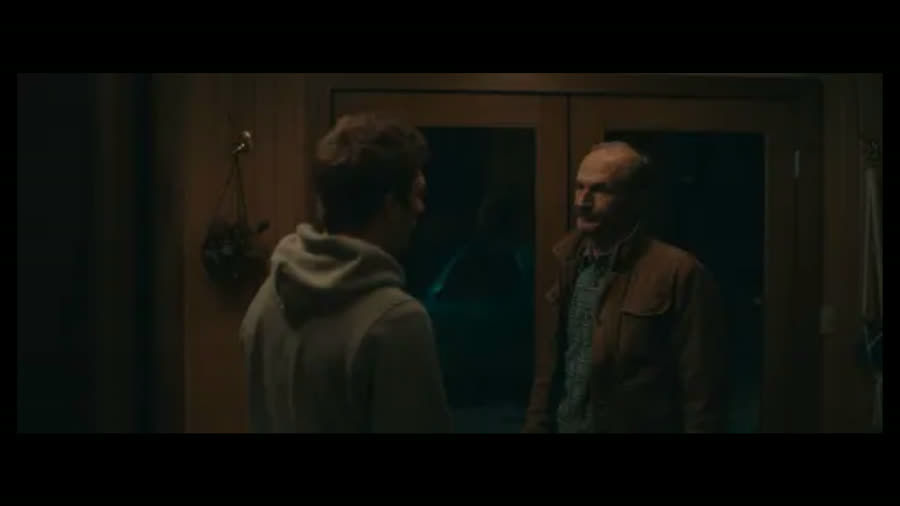
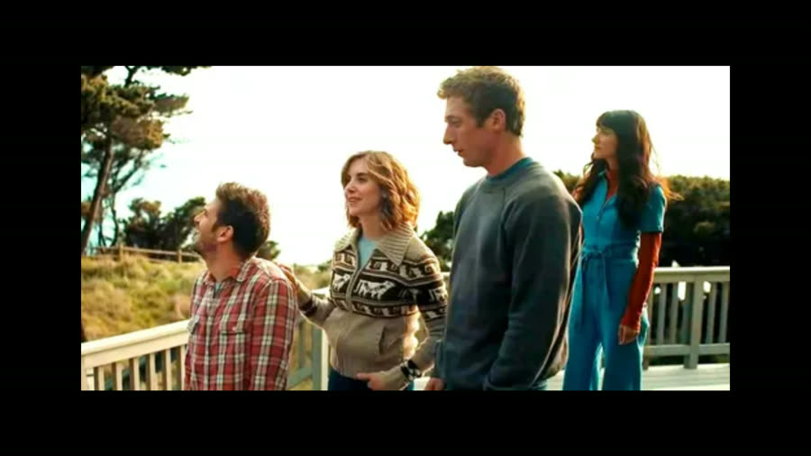
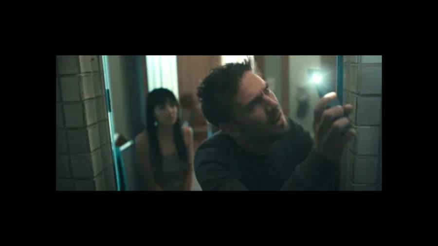
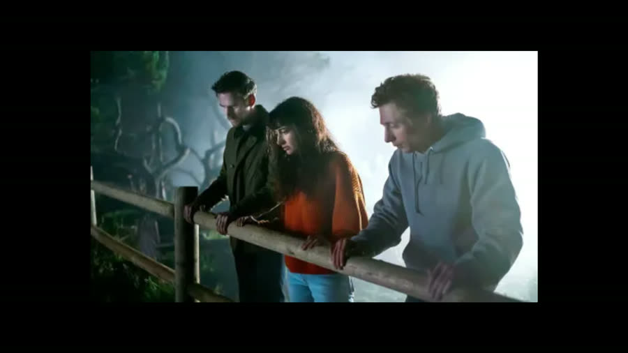
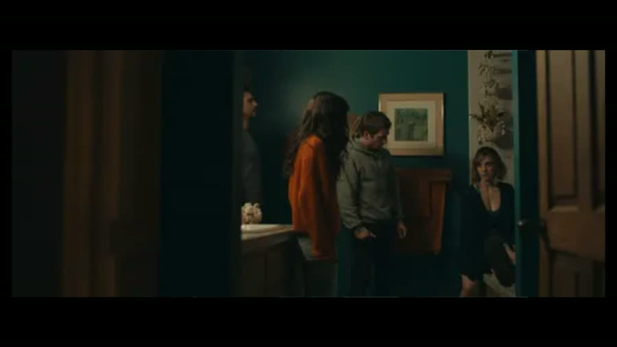

## The Rental (2020): Stare at the Shower Head First

{: style="float: right; max-width: 30%; height: auto; margin: 0.25em 0 0.9em 1.1em;"}

This vacation goes wrong because of a denied booking, a dog that was not supposed to be there, and a shower head nobody stared at soon enough.

*The Rental* opens our "Home Is Where the Horror Is" theme: a couples' weekend that slides into infidelity, hidden cameras, a bad cover-up, and a killer who was never the obvious suspect.

No homework was done going in. Still, Jeremy Allen White is recognizable as Josh and Alison Brie as Michelle, plus the rental guy, seen in a million things without anyone learning his name.

### Draped Over the Wrong Brother
{: style="clear: none;"}

{: style="float: left; max-width: 45%; height: auto; margin: 0.25em 1.1em 0.9em 0;"}

The movie opens in an office, where a woman draped over a man's shoulder helps him scroll through photos of a stunning cliffside rental. They wince at the price, book it anyway — then another man walks in and she gets up and kisses him. That is her boyfriend. The man in the chair is his brother.

Names, which the movie withholds for a while: Charlie, Mina, and Josh the boyfriend. Charlie and Mina have just landed seed funding for a business the movie never explains. Settle it this way: they write postcards. The best postcards ever.

The plan becomes a couples' weekend with Charlie's wife, Michelle. That night she admits she is surprised they are going at all: Josh has a sketchy past — jail time, a near-fatal fraternity fight — but Mina has been good for him. Charlie pooh-poohs it: two night classes do not mean he is back in school, Mina is the full package, and his brother is a rideshare driver who got kicked out of school. A real negative Nancy, this one.

Morning brings rule one broken: Josh brings his dog, Reggie, though the listing says no pets, figuring they will hide him.

### Denied, Then Approved an Hour Later

{: style="float: right; max-width: 45%; height: auto; margin: 0.25em 0 0.9em 1.1em;"}

On the drive, Mina raises something strange: she tried to book the house for the same dates and was rejected; an hour later, Charlie was approved. Her profile shows no red flags. She is Middle Eastern, with a very Middle Eastern last name, and her suspicion is not subtle. Charlie brushes it off: not everyone is a racist prick. That is his whole outlook: always look on the bright side of life.

The house is gorgeous, exactly as pictured. Charlie calls the contact number and hears it ring behind him: Taylor, who handles the place for his brother, greets them like an audit. He was expecting them an hour ago.

The tour is lovely and awkward. Michelle wishes she had brought a telescope, and Taylor lands the weekend's worst joke: what do you need one for in the city, unless you are a peeping Tom? Nobody laughs. He insists on bringing his own over later anyway, and asks Mina how she got mixed up with this family — very snarky.

As he leaves, Mina confronts him: why was she denied? Taylor shrugs — lots of people get denied — and points her to the cancellation policy. She seems to be picking a fight, angling for a reaction. She does not get one. Taylor stared in through the window with a look straight out of Eustace from *Courage the Cowardly Dog*, then peeled out.

Settling in, Mina finds a photo of Taylor in a bathroom drawer, and Josh finds a small door under the deck — a crawl space with an electronic push-button lock. It gives Mina a creepy vibe. Josh punches in 666 three times, joking it would be creepy if that worked. It does not. File that door away.

### A Telescope Walks In by Itself

{: style="float: left; max-width: 45%; height: auto; margin: 0.25em 1.1em 0.9em 0;"}

At the beach, the group splits into the wrong pairs. Charlie and Mina walk ahead in work talk. Behind them, Josh tells Michelle he is afraid Mina will leave him — she is smart and talented, and he wants to be on her level. Michelle's advice is gentle: maybe Mina needs someone who does not take up the same space as her work partner, just someone supportive and caring.

Back at the house, the telescope is already inside — Taylor let himself in to leave it, which bothers only Mina — and the night pivots to Michelle's surprise: a pouch of ecstasy, which looks like dark sand. The standing assumption was that it came in pills.

Michelle, exhausted, wants to save it for tomorrow's hike. She overrules Josh: go ahead tonight, just save enough for everyone together tomorrow — the important part. The other three take it, while she sleeps and the camera lingers on the ceiling vent above her, a little red glow coming through the grate. Read: a camera in that vent, creepy precisely because the movie does not announce it.

Outside, Charlie offers Mina the telescope; she jokes about being a big-city peeping Tom and drops down claiming someone is looking back — a joke. Underneath it the moment turns charged, then into a long look Mina breaks by checking on Josh. He is passed out on the couch, mumbling that he is coming. He is absolutely not coming. She heads back out, where Charlie is taking the cover off the hot tub.

### Sharing the Jets

Mina joins Charlie in the hot tub. She wants the jets too — and fair enough, there is more than one set in a hot tub, usually — but they end up sharing them, side by side. Charlie picks this moment for feelings, always the start of a bad idea: Mina is brilliant and makes him better. She returns it: a real partnership. Two seconds of looking, and they are making out, while the camera pulls back to someone in the woods, watching.

Reggie interrupts, barking, and Mina goes inside and showers. A silhouette appears through the curtain. Charlie gets in with her, and they have sex. Nobody is surprised.

Morning: Mina and Charlie look like death, and Mina cannot face Michelle's hike. Josh offers to stay; she refuses to let him ditch a thrilled Michelle. They leave, and Mina and Charlie have The Conversation: she loves Josh, it can never happen again. Once that seal is broken, good luck putting the genie back in the bottle. You cannot unring that bell.

On the hike, Josh calls Mina and Charlie's meet-cute the best story ever. Michelle laughs: one person disagrees. When she met Charlie, he was still with Jen. Josh helpfully adds Charlie was also with Zoe when he met Jen. Both relationships started as overlaps — a pattern Michelle now sees, while behind them in the woods someone watches, and moves when they move.

### Stare at the Shower Head First

{: style="float: left; max-width: 45%; height: auto; margin: 0.25em 1.1em 0.9em 0;"}

Back at the house, Mina takes another shower — her second in a few hours; this girl loves showers. Afterward she stands staring at the shower head, which is, of course, what everyone does. Except something is off. She shines a phone light on it: that is a camera. The other bathroom's shower head has one too.

Here is the movie's lesson: stare at the shower head first. Now they cannot call the cops: the footage would show Michelle and Josh everything. Charlie's panic-math: threatening Taylor gives them no leverage, and Taylor will never show anyone anyway, because filming guests is illegal.

Michelle comes home frosty for a different reason: the pattern. She refuses to sulk through the last night: TV off, they are doing drugs, per the plan. Mina and Josh opt out, so she doses alone, finger in the bag — another method, because apparently that is a method.

Then everyone realizes Reggie is missing, forgotten by Mina and Charlie amid everything else. Michelle, pleasantly high, cannot get the hot tub working — so she calls Taylor to fix it, which lands like a brick.

Taylor arrives, denies taking the dog, asks after "the white girl" who called — completely unnecessary — and fixes the tub, which was stuck on cleaning mode. By his truck he tells Mina the no-dog rule is his brother's, he will not rat them out, and, mysteriously, he knows how to keep a secret.

Mina lures him back in and threatens him: use that footage and they go to the cops. Taylor looks up into the shower head and recoils — he had nothing to do with it, and he will call the police himself. Mina, bluffing, grabs for his phone. Everyone was quick to assume about this poor guy. The sharper distinction: he is racist, but that does not mean he is creepy. Josh, passing the window, sees Taylor shove Mina, bursts in, and beats him into the tub. Charlie has to pull him off.

### The Plan Gets Worse From Here

{: style="float: right; max-width: 45%; height: auto; margin: 0.25em 0 0.9em 1.1em;"}

Outside, Mina tells Michelle about the camera, while someone watches live footage of them on a phone. Cut to the bathroom: Taylor is alive in the tub, and a figure in black suffocates him until he stops breathing.

It was never Taylor.

Michelle wants an ambulance, which is the sane impulse. Charlie's objection is the tape: it does not look like self-defense. Then he checks Taylor and comes back yelling for her to stop dialing. No pulse. Taylor is dead.

Michelle says the only sane thing: call the police. Charlie refuses — Josh goes straight back to jail. His plan is to stage an accident: Taylor was drunk and slipped off the cliff. How that explains the punch marks all over the man's face is left as an exercise. Michelle does not want to live knowing they killed a man and did nothing; Charlie's approach is to throw some dirt on it and walk it off. They do it anyway — body out, bathroom cleaned, toolbox loaded with bare hands, fingerprints everywhere. They do not watch enough *CSI*.

At the cliff they drop the body over the fence — and it lands on a big rock. Charlie hurls a rock at it and misses. Inside, Michelle follows a phantom sound of running water up to the loft and finds a TV playing shower footage: Charlie and Mina. Josh climbs down the cliff himself, slips partway — which actually helps, since it looks like a fall — and shoves Taylor into the water.

Michelle drives off. Charlie runs after her assuming she is fleeing a corpse: I saw you, she tells him. And Mina. He apologizes, then asks, first off, where she found the footage — sarcastically, the important part, and also the final straw. She says she does not know who he is, and goes.

A pop, a swerve, a tree. Michelle finds the tire flat, starts walking back, and finds the cause: a spike strip. She retreats to the car and texts for help — and for one flash, someone is at her window. Charlie runs, follows her ringing phone into the trees, and trips over her body, bloody and still. Then someone beats him down with a metal pipe — possibly the god pipe.

### Sent From Charlie's Phone

{: style="float: left; max-width: 45%; height: auto; margin: 0.25em 1.1em 0.9em 0;"}

That leaves Josh and Mina under the deck, trying combinations on that electronic door — cracking the case. Josh finally kicks the handle off, super easy, which raises the obvious annoyance: why not do that first?

Inside is no control room — just clutter and Polaroids Josh says Mina does not want to see, and we never see them again. Josh spirals, asks for a minute alone, and gets a voicemail from Charlie's phone: a recording from that morning. We're smarter than this. This can never happen again.

Then a still: Mina in the shower. Then the full footage, while she begs him not to look. Josh is stuck on why Charlie is sending him this — playing dumb, apparently. A door slams; Josh storms through the house yelling he will kill Charlie, watched through the house's own cameras. One closet door has a man behind it who looks like the dad from *Everybody Loves Raymond*. He clocks Josh, who grabs his leg, trips him, and gets a hammer, claw side, in the head. That was rude. It was, in fact, rude.

Mina does the smartest thing in this movie: she hides upstairs and plants her shoe below the balcony to fake a jump. Full props: smarter than your average horror movie girl.

It costs her. She sneaks down, finds Josh, grabs something sharp from her purse, and meets the killer at the door. She stabs him in the face, he shoves her down the stairs onto her shoeless foot — safety first — and she limps into absurdly foggy woods, running, falling, face-first into a tree, hiding, running again…

…and straight off the side of a cliff, into the ocean.

It lands beautifully, partly because the cliff had been forgotten as an option until the exact second it mattered. Fuck yeah, that's awesome.

Cleanup time, and the killer is thorough: spike strip retrieved, Taylor's hammer put neatly back in the toolbox, every camera removed — shower heads, light switches, one in a plant, one in a smoke alarm. He forgets none of them — an impressive sweep; anyone else would have needed a map. The receiver? In the attic the whole time. Everybody runs upstairs — but not far enough.

He peels off the mask in a bathroom mirror; we never see his real face. Reggie trots back in, gets petted, and is left behind — which split the hosts. Dan liked the killer for being nice to the dog; Talon thought dropping him at a shelter would have been nicer. How is Reggie supposed to eat?

Then the movie explains him: he rents a place, rigs the rooms while he stays, leaves, and watches whoever rents it next. The credits roll over a montage of groups he apparently only watched — he must wait for a group he wants. Last shot: someone asleep in bed. He enters. Cut to black.

### The Verdict

Dan has a love-hate relationship with this one. He had seen it once before and misremembered it — he was sure the dog died, so Reggie's return was a surprise. It is entertaining: if it is on TV, he will watch it; he will not seek it out. Too many little things irritated him — Mina's accusations, everyone blaming everyone without talking first, and Josh pressing all those buttons before just kicking the door in.

Dan gives *The Rental* **6 cents out of 10**.

Talon did not hate it, and loved Mina's cliff fall because she did not see it coming. She even pitched a sequel: Mina survived and is hunting him, sabotaging his rigs and driving him crazy. Dan was open to it.

Her other deduction was thumbnail-only: she was convinced the woman against the tree was Judy Greer, waited for her, and Judy Greer is not in this movie. It loses points for that. The acting she thought was fine — she loves Alison Brie and Jeremy Allen White, who reminds her of Gene Wilder.

Talon gives *The Rental* **6 to 6 and a half cents out of 10**.

So: two sixes, give or take half a cent, a dog who survives everything, and one piece of advice for every rental.

Stare at the shower head first.

**Stuff we use / support the show:**
- Own it on physical media via Gruv: https://www.tkqlhce.com/click-101633208-15032169
- Watch with Plex: https://www.kqzyfj.com/click-101633208-15734677
- We record this show with Riverside: https://riverside.sjv.io/4aR7A9
