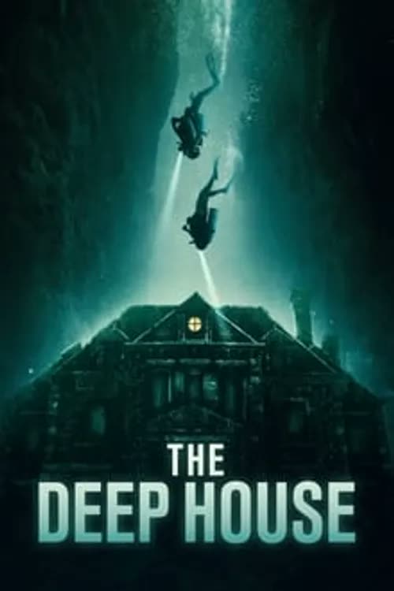
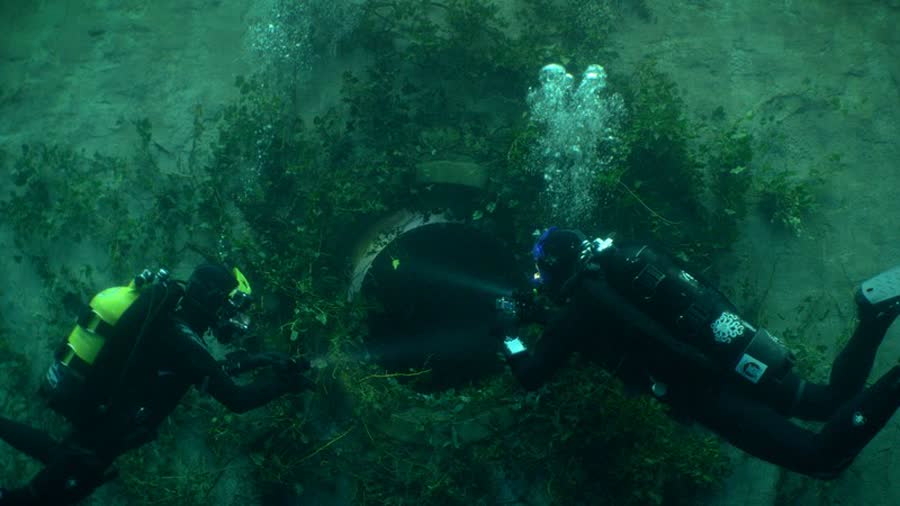
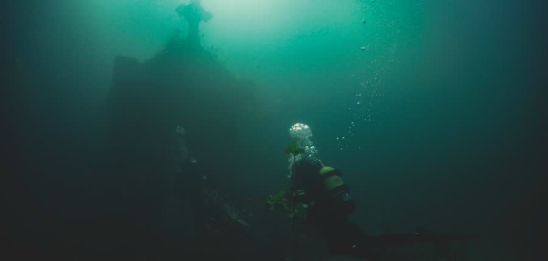
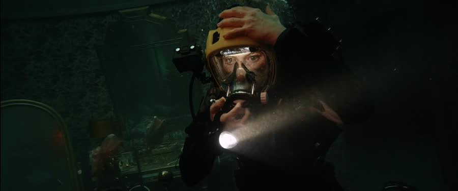
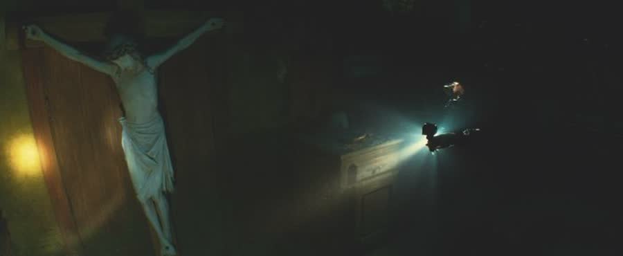
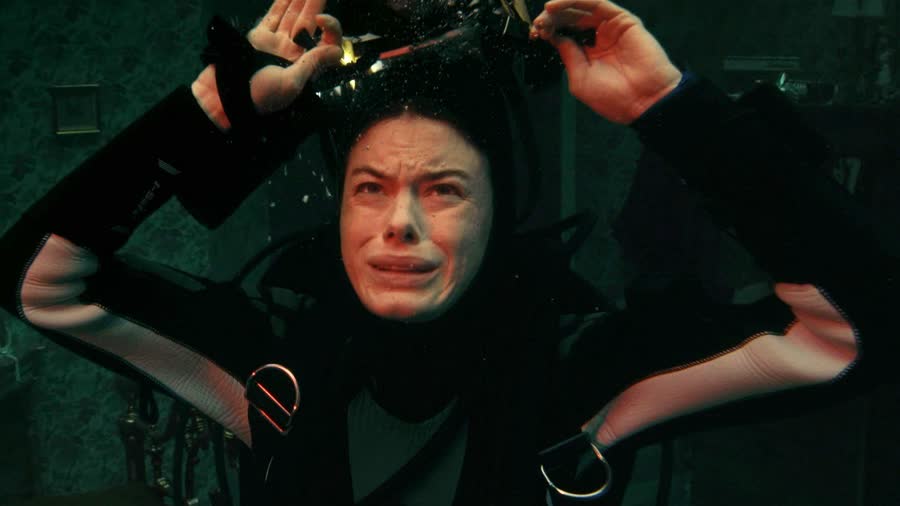

## The Deep House (2021): Satan's Basement Is Underwater

{: style="float: right; max-width: 30%; height: auto; margin: 0.25em 0 0.9em 1.1em;"}

Some people go looking for a haunted house.

Ben and Tina go looking for one at the bottom of a lake, on a limited supply of air, because Ben would like to be internet famous.

*The Deep House* asks a simple question: what's scarier than a basement full of ghosts? A basement full of ghosts underwater, while your oxygen runs out. Call it swimming into Satan's basement, and the movie is not overselling itself: the house, the ghosts, and the dwindling air are all real.

### A Nurse, Seven Kids, and Just the Wind
{: style="clear: none;"}

{: style="float: left; max-width: 45%; height: auto; margin: 0.25em 1.1em 0.9em 0;"}

The opening is a warm-up haunting: an abandoned mansion, explored with a drone named Tom — short for Peeping Tom. Ben narrates the legend as they wander: a nurse poisoned seven children, and her ghost still haunts the place looking for more victims.

Tina hears a noise. Ben says, immediately and way too fast, that it's just the wind. Objection: if you have deliberately walked into a place that is supposed to be haunted, why is your first assumption weather? One alternative is allowed — maybe he meant his own wind. Maybe he's gassy.

Then Ben disappears ahead, ignores Tina calling his name, and jumps out of the dark to scare her. That is a bit much. It also sets the pattern for the whole movie: Tina is scared, Ben thinks it's content, and Ben is kind of a dick. Not abusive. Just a dick.

### Three Minutes (It Was Not Three Minutes)

Back home, Tina trains in the bathtub, holding her breath for a trip the title gives away pretty quickly. She surfaces and announces her time: three minutes.

Liar.

The clock says about a minute and a half, and there is no getting past lying about this particular skill — not when you are about to be deep in a lake depending on exactly that ability. It is the classic lie about size: claim three, deliver one and a half. The lie matters, too: it is the movie quietly pointing a gun at its own ending.

Ben is disappointed even by the fictional three minutes. He sells Tina hard on the trip while she smokes in the truck, which will definitely help the breath training. On the drive, Ben also films Tina while she is in the bushes taking a piss; the first thought is the dead cow scene from *June 9*, and the relief that it was only that is real.

### So Much for the Super Secret Spot

The destination is southwest France, a dying town Ben narrates like a travel YouTuber, because the dream is to do this professionally and get rich. Tina is along for the ruins; the fame is his.

Ben has been promised a super secret spot. They arrive to find a lake full of swimmers. Tina is bitchy about it and relieved about it, and both reactions make sense. Ben, meanwhile, is defeated because an old video of theirs only has 50,000 views.

Then a stranger in a chair solves everything, in the way strangers in chairs never should. His name is Pierre. Tina begs Ben not to invite him for a drink. Ben returns with the news anyway: their town is underwater and gone, but Pierre knows another part of the lake, deep in the woods, with a perfectly preserved house under the water.

Pierre drives them out, creepily staring at Tina, explaining that in 1984 the lake flooded the whole town for an electric water plant. In the van, Tina and Pierre talk in French while Ben, in the back seat, understands none of it and eventually asks if he needs to pay for subtitles — a familiar war, since the captions keep announcing "speaking in French" directly on top of the actual English translations.

At the lake, Pierre compliments Tina's peace-symbol sticker — and Ben, unasked, announces it is actually a symbol of the death of Christendom that the hippies misunderstood. That is bullshit, for the record. It means peace; the man who designed it designed it to mean peace. What an asshole. Then Pierre quietly recites a family motto in French — that is not dead which can eternal lie — and calls the sticker a good omen.

Nothing about this man is a good omen.

### It's Only Going to Be an Hour

{: style="float: right; max-width: 45%; height: auto; margin: 0.25em 0 0.9em 1.1em;"}

Ben reminds Tina of her training — all three minutes, minute and a half of it — and promises the dive will only take an hour. It is always an hour. He may as well have said "just the tip," which brings the three-inches joke back for an encore. Pierre tells them to go down the stairs — an instruction that stays confusing all movie, because at the house there are no stairs outside it, while they keep going upstairs.

Down they go. Tina's fin gets stuck almost immediately, and they laugh about it, which is a terrible use of air: this podcast, recorded underwater, would be dead in ten minutes. They find a car on the lake bed in near-perfect condition. Why hasn't it rotted? Cars that aren't underwater rust from rain, after all. Ben's answer: no salt water, and it was probably made in Britain, like him.

They pass a small mausoleum in the garden that Ben opens despite Tina's objections. The fish have vanished, and their music feed picks up static that should not exist down there.

At the house, the front door is locked steel. Who locks their door underwater, and what are they afraid of? Tina knocks anyway. Ben suggests splitting up; whether they actually did or the movie forgot is left unconfirmed.

They slip in through a small window near the top, and a huge fish bursts out straight at the drone. It lands as a proper jump scare, mostly for anyone who just put their phone down and looked up at exactly that second.

### Don't Explain It Away

{: style="float: left; max-width: 45%; height: auto; margin: 0.25em 1.1em 0.9em 0;"}

They send Tom in first. Inside, everything is wrong in the way a house flooded forty years ago should not be: messy, but intact. Furniture, paintings, a rotary phone like Tina's grandmother's — a model that has not gone extinct in the real world either.

A floating figure resolves into a doll with a strange symbol on its forehead, which is somehow not better. It is exactly the kind of doll that terrorized childhoods at grandmothers' houses, the kind cousins treated like Annabelle.

The house keeps offering evidence, and Ben keeps filing it under nothing. A distorted voice comes through their headsets where no radio interference should reach. A wiped-clean painting reveals the family name — the Montagnacs.

In a bedroom, they find another marked doll and a sheet hanging from the ceiling with something person-shaped inside it. Ben sees it, freaks out, calls Tina over — and by the time she looks, it is gone. Probably just a shadow, he says.

Shadow of what? The question stands. That is still the same problem.

Downstairs they open the front door from inside and find a wall built across it, covered in scratch marks, as if someone had been trapped clawing to get out. A piano plays somewhere; Ben's whole contribution is "I don't know," repeatedly. In the dining room, Tom detects movement he should not — he is programmed to ignore the two of them. Ben blames fish in the chimney, and a snapped string for music that sounded like playing.

Tina is tired of him explaining everything away, and the evidence lists itself back: the figure at the bed, the clawed wall — why try so hard to stay? Ben admits it is weird, insists there is no such thing as haunted houses, and guilts Tina into going further. She relents. Theme of the movie.

### The Kitchen, the Jesus, and the Last Room

{: style="float: right; max-width: 45%; height: auto; margin: 0.25em 0 0.9em 1.1em;"}

Past missing-person posters of children, they reach the kitchen, where Tom cuts out again — expensive-looking, able to follow them on his own, and a piece of shit for how often he dies on them.

The kitchen holds an enormous statue of Jesus on the crucifix. Kitchens are the creepiest room in an abandoned house: a kitchen is where families gather, where the life of a house happens, so a desolate one gets in deep. The only follow-up that matters, apparently, is whether anyone was barefoot.

Behind Jesus is a hidden door. They move the statue — it topples, very disrespectful — and Tina negotiates: this is the last room. The storage room beyond holds bikes, fishing gear, mannequin heads, and film reels. Then Tina turns and yells. Chained up in the room are two people — a man in farmer's clothes, a woman in a red dress — wearing masks over their eyes, mouths and noses. Underwater since 1984, and pristine. The first thought is that they have to be mannequins. Their masks come off during the examination — an easy detail to lose track of, and it matters in about five minutes.

On the floor is a pentagram, which Ben identifies as satanic; he would know, given his peace-symbol expertise. Behind another door, alone, Ben finds body parts in jars and heads — and tells Tina there was nothing but small cameras.

They run. Tina wants the police; Ben says no, because the police will take their memory cards. Then they reach the way they came in.

It is bricked over.

### Fuck Is a Universal Word

{: style="float: left; max-width: 45%; height: auto; margin: 0.25em 1.1em 0.9em 0;"}

Now the movie is an oxygen problem with ghosts attached. Tina panics, and panicking burns air; all film long, her levels have run lower than Ben's. Ben talks her breathing down. She looks past him and sees a figure with white eyes and its mouth hanging open, right behind him. He turns. Nothing there.

The windows will not break under thick vines. Something swims past — a fish, they convince themselves — and Tina follows it as their only hope, back toward the chained couple, past the Jesus statue, whose eyes are now open. They were closed before. Below, the couple is gone. Tina gets tangled in their chains, takes a hook through the leg, and gets dragged down screaming until Ben frees her — and shows her the couple, right there, as if they never left.

So Ben, angry now, rips the masks off the couple. Nothing happens. Then both of the dead open their eyes, lift their heads, and come for them.

The chase ends in a chimney, the only way up left. They take their tanks off to climb — and the chimney starts collapsing. The sequence is genuinely confusing. One survival tip does survive it: midway through, Ben yells "fuck," and the crashing stops. It is a universal word for stopping things. Avalanche? Fuck. Okay, it's not.

Afterward they are separated. Tina wakes on the floor below; Ben wakes somehow in an upstairs bedroom — their best theory is he fell out of the chimney sideways, and she fell all the way down. His tank is off, and Tom's light keeps switching from green to red. Tom is pissed.

In the bedroom, Ben finds the family motto and family tree, and puts it together: Pierre is the son of the family in this house, and the dead couple are his parents. Then the woman of the house stands over Tom, and the ghost child lunges at Ben.

### There Was Never a Way Out

Tina finds Ben standing with his back to her, his mask cracked. Asked if he is hurt, he answers flatly that he is better now — monotonally, on the second try, having led with "monetarily."

Ben has 12 percent oxygen. Tina has 8, which is less — a point that apparently needed stating. Ben tells her they are out of danger. He spots a snake inside her mask and tells her to open her mouth — a typical guy move: telling her to swallow. She lets it out while Ben explains that the house knows their fears, and soon there will be nothing to fear.

He leads her into a den, where a family video plays. The family's hobby was kidnapping children from local farms and sacrificing them, the father cutting into a body while young Pierre watches. Sarah — the ghost child, evidently Pierre's sister — is in it, until locals come for revenge and kill her in her bed. Pierre escaped, grew up, and now drives tourists to the lake.

The couple's masks, Ben says, were masks of shame. The screen rips open; Sarah is there. Ben, speaking French, repeating the motto, tells Tina to join them. She refuses and escapes through the torn screen — where Ben grabs her. He cannot stay without her, so he will kill her so they can be together: if I can't have you, nobody will, which files neatly under some asshole shit right there. He tries to stab her; she blocks him and stabs him instead. Then, horribly, he comes back to himself, confused — just in time for Sarah to stab him through the heart. Poor Ben. And that's meant.

Tina tears off her suit to escape the ghosts and swims for the surface on empty while Tom watches — no loyalty, that drone; he belongs to the house now. She can see the sunlight. She takes her mask off, passes out, and drifts back down. If she had not lied about the three minutes, that extra minute and a half might get her to the top.

Stay through the credits — worth it — and Pierre is there again, bringing two more young women to the lake. Mom and Dad needed some friends. The circle of life.

### The Verdict

Talon gives *The Deep House* **5 cents out of 10**.

It was not fantastic and it was not horrible, and she struggled to say much more definitive than that. The beginning was a slow build that lost her to her phone, and the chimney sequence confused her outright, but she could not point to big plot holes. The acting was good. The kitchen was creepy. If it were on again she would watch it — as long as it was already at the house; anything before that, fast-forward. Her one regret: she would absolutely have taken that old film with her, because she would need to know what was on it.

Dan gives *The Deep House* **five and a half cents out of 10**.

He had seen it before and liked it then. The things they picked at — the perfect car, the preserved house, the intact bodies — get answered through context as the movie goes; he cheerfully admitted his own son had to point some of it out to him. For him it is a decent take on the haunted house movie precisely because it is underwater, the drowning clock adding real intensity, largely thanks to Tina never calming down. His one wish was an alternate ending: Tina makes it out, and Pierre is right there waiting for her.

So: a five and a five and a half, and a haunted house with a flooding problem.

Never lie about how long you can hold your breath. The lake will check your math.

**Stuff we use / support the show:**
- Own it on physical media via [Gruv](https://www.tkqlhce.com/click-101633208-15032169)
- Watch with [Plex](https://www.kqzyfj.com/click-101633208-15734677)
- We record this show with [Riverside](https://riverside.sjv.io/4aR7A9)
