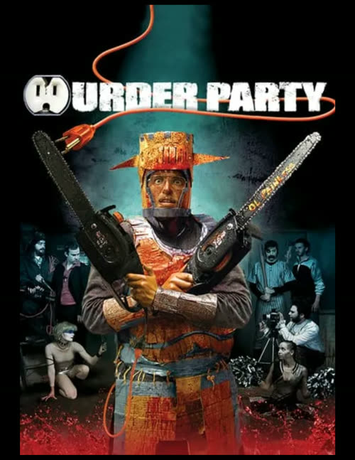
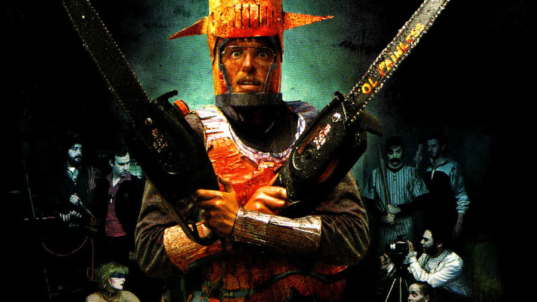
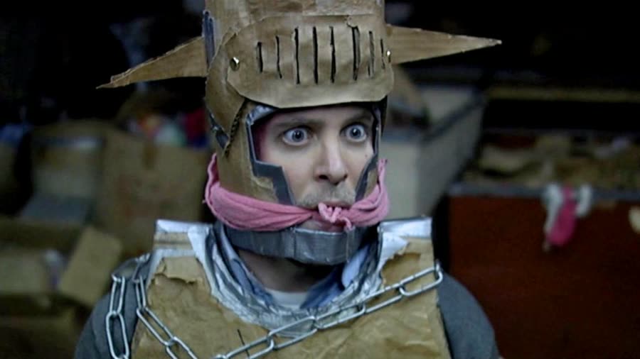
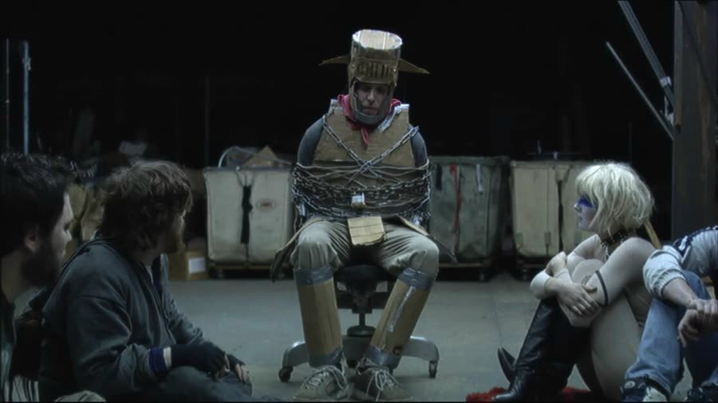
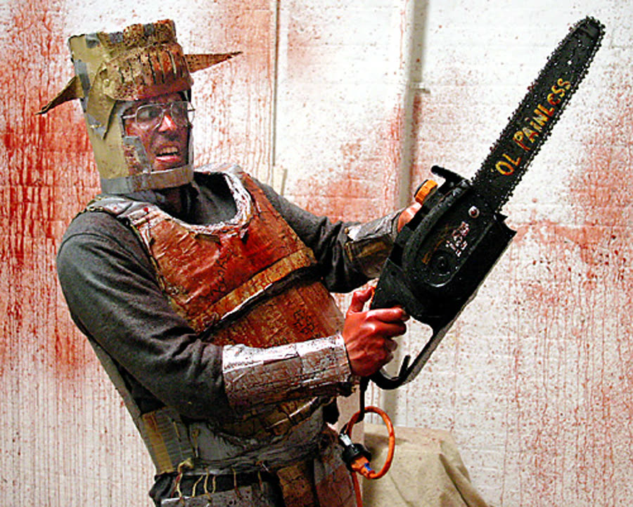

# Ratings are the hosts' actual ratings from the episode (found in the transcript).

## Murder Party (2007): You Are Bread

{: style="float: right; max-width: 30%; height: auto; margin: 0.25em 0 0.9em 1.1em;"}

Chris spends Halloween following a black envelope to a warehouse full of art students who want to kill him for a grant that does not exist.

*Murder Party* is a no-budget horror comedy — and "no budget" is meant literally: no studio backing, everything paid out of pocket, the actors doubling as the crew. Impressive. It also leaves one mystery behind: what year it was.

### Sir Lancelot Wins the Chair
{: style="clear: none;"}

The movie drifts through Halloween suburbia at sundown while a man in his thirties picks out three horror VHS tapes: *Scare Wolf*, *Zombie versus Unicorn's Horn*, and something spelled X-A-N-T-H-A-C-H-R-O-I-D. The VHS tapes say eighties; the flip phones later say late nineties, early 2000s.

On the street, a black envelope skims along the sidewalk on the wind, and credit where due: that envelope takes a corner perfectly. The explanation is simple. The envelope was trained. The man steps on it, his watch beeps, and he takes a pill. Inside: an invitation to a murder party, an address on Shore Street, come alone.

At home he finds the smashed pumpkin was his, dumps two bags of candy corn in a bowl, and tries to watch *Scare Wolf* — except his cat, Sir Lancelot, is in the good chair. Chris asks politely. They stare. The cat does not budge, because he is a typical cat. So Chris bakes the pumpkin into a raisin loaf and builds a cardboard knight costume — pure Black Knight from *Monty Python*. He leaves the candy corn on the stoop with a note saying please help yourself. The correct protocol: tell the kids to take one, then load your own bag when nobody is watching.

### Welcome to Your Murder

{: style="float: right; max-width: 45%; height: auto; margin: 0.25em 0 0.9em 1.1em;"}

Chris reaches a deserted warehouse. Inside, toward loud music, he finds the party: a guy with a werewolf mask pushed up on his head; a guy who spends a long stretch as the colonial horseman, carving a pumpkin; a zombie cheerleader on an iPod; a quiet guy in face paint straight out of *The Warriors* as a Baseball Fury; and a girl on the floor next to dominoes and three lines of coke, who shrieks with delight when she spots him.

Chris says he thinks he made a mistake. The werewolf snatches the invitation and says he did not. Paul — the horseman — says he is just early and lights the invitation on fire in his face. That is when Chris clocks the room: chainsaw, sledgehammer, axe, duct tape, plastic sheeting, a chair with rope. Not typical party favors — unless your parties run to birthdays, Christmas, baby showers, and bar mitzvahs with a theme. Some people have clearly been going to the wrong parties.

The first attempt fails on a technicality: the werewolf swings the axe and catches it in the dangling chain of a light, yanking the light on instead of splitting Chris in half. Chris is tied to the chair and welcomed to his murder. The group are artists — Macon, Paul, Lexi, Skye, and Bill, so quiet on his phone he is easy to forget entirely — planning to kill whoever showed up as an art piece to impress a man named Alexander and land a grant. Skye points out none of them thought anyone would be dumb enough to come. Macon counters that the invitation literally said murder party. Lexi asks if Chris is a Republican; Paul shuts her down — this is about art, not politics — and her reply, that there is nothing more political than art, says everything. Not just psychos. Pretentious psychos.

### You Are Bread

{: style="float: left; max-width: 45%; height: auto; margin: 0.25em 1.1em 0.9em 0;"}

Skye brokers a compromise — violent enough to count, nobody dies — and then, mid-pitch, pulls something from her mouth. Are there raisins in this? Chris nods. Are they organic? He shakes his head. She is allergic — not to raisins, to the preservatives in non-organic raisins, which mostly make her dizzy. A distinction impossible to get past, because it is still a raisin. Skye refuses 911 — which the tied-up Chris is nodding for enthusiastically — sits on boxes Macon drags over, falls straight off, and smacks her head on a metal pipe. She pops up laughing, blood running down her face, says it smells like cut grass, shows everyone the gash in her skull, and collapses dead.

Nobody grieves — regular movies pretend for at least a scene, but Lexi's flat eulogy is that Skye just died. Chris does his best work gagged, with mostly his eyes. That calm carries the comedy.

Macon blames the bread, tries to shove a chunk of the smashed loaf off the floor into Chris's mouth, and produces the episode's favorite subtitle error. The captions spelled your as Y-O-U-apostrophe-R-E. You are bread. Pure Facebook grammar. Then Macon pours a jug of supposed acid over Chris, stops dead mid-screaming, and collapses into instant repentance — I am so sorry, I did not mean to do that. The acid is acetic acid. Vinegar. Paul's verdict: great, we can pickle him to death. With Alexander coming, they roll Skye in the plastic meant for Chris and stuff her in a chest freezer.

### Alexander the Great Pretender

Alexander arrives with plastic vampire teeth, a man named Zyko, and a part-dingo dog named Hellhammer. He asks Paul what he is supposed to be — a nineteenth-century vampire, which finally retires “colonial horseman” — and orders him to take his fangs out. When Paul hesitates, Zyko pulls a gun. Paul goes from leader of the pack to nobody in a second. What follows is a full public stripping, down to khaki “vampire pants” and flashy thong underwear.

Hellhammer whines at the freezer, so Lexi fakes an allergy sneeze and rushes him outside — quick thinking. Alexander demands pitches. Macon promises to cut Chris in half, unravels into multimedia installations, and lands on sticking a pancake on Chris's face and throwing him in front of the G train so nobody will know him. Run with it: staple a pancake to your face, rob a bank, take the pancake off — perfect crime, either direction. Bill contributes his pitch: cut Chris's dick off and set him on fire. Objection, on Chris's behalf — what did the man's dick do to anybody?

Alexander's offer: a grant of over $300,000, and a plan — wait for the witching hour, then everyone stabs Chris together. The act is the artwork; the coroner's cause of death will read art. It is a stabbing with a waiting period, and the stringing-along is annoying. There is also a scheduling objection: the witching hour is 3 a.m., not midnight. Losers. During the group's endless dinner debate, Chris works his hands free — but the escape is brief, and he is caught in seconds and upgraded from rope to chains and padlocks.

### Extreme Truth or Dare

{: style="float: left; max-width: 45%; height: auto; margin: 0.25em 1.1em 0.9em 0;"}

While Macon fetches pizza and a cake for Chris, Alexander hooks up with Lexi against a picture window — which Macon figures out from the makeup smeared on Alexander's face. Then Zyko produces the entertainment: truth serum, needles, and a game Alexander calls Extreme Truth or Dare. Lexi fears needles, gets injected in the butt anyway, and the serum works — one-word review: FAST. Alexander fakes his dose into a pizza crust, which only Chris notices.

What follows is a pun barrage, in a movie where the word dildo is said some five hundred times by one count; blame the budget — they could only afford so many words. Chris, foot-tapping for attention, gets his gag pulled and delivers two puns of his own — he has had a crazy night, night with a K, and he does not think he should be punished — and the room cracks up. Chris also gets injected.

The truths are better. Asked who the best artist is, everyone shouts themselves, except Macon, who admits he would rather be home watching a DVD with his mom and dad. Paul blurts out that he is bisexual and confesses he once wrote Santa a letter asking not to be Jewish. Zyko confesses that he makes sex with a pillow. And Chris confesses that he once got stuck in an elevator at his cousin's wedding, soiled himself, and then walked through a model airplane convention and up six flights of stairs feeling it run into his shoes. His job, it turns out, is not cop but civilian NYPD traffic enforcement — a rewatch detail: the woman tearing up a ticket in the opening credits was yelling at Chris, who took it with his usual calm. He slumps over, and the party rolls on until Bill is sent to check on the barking dog and calmly calls Hellhammer a stupid dummy — which is genuinely offensive on the dog's behalf. Inside, the others trash Bill's painting in smug art-speak, and Bill walks in, fists clenched, in time to hear it.

### One Down, Three to Go

Alexander stalls by reciting *The Raven*, interrupted by an assistant Paul secretly called in. Outside, Macon pulls his werewolf mask down and lights a cigarette deep inside its snout. Called it: dude, you are going to set yourself on fire. He sets himself on fire, instantly and completely.

Inside, Paul turns on Alexander — where is the application, where is this renowned work — while Lexi, with no urgency whatsoever, collects fire extinguishers and puts Macon out. Chris frees Hellhammer, the dog goes straight for the freezer, and Alexander opens it on Skye. Lexi drags the still-smoking Macon past: that was an accident. Alexander closes the lid: one down, three to go. Paul stabs him in the neck with the leftover truth serum.

Under it, Alexander unravels. He is a fry cook. His name is Tim. There is no grant — not $300,000, not the half a million he upgraded it to while lying. Their work sits at his grandmother's house in New Jersey, next to a sketchbook containing her shopping list — Centrum Silver, Metamucil, arthritis meds, *CSI: Miami* — a page worth pausing on for the laugh. This guru is just a regular dude running errands. He admits his plan for Lexi's art was to kill her and sell it, because art is worth nothing until you are dead. Lexi speaks for the room: ugh, I let you fuck me.

Then Zyko returns with a bag of crank, Alexander orders Paul shot, and Paul — shot clean through the head — stays upright long enough to call it unbelievable, twice, takes two more rounds, and still gets the last word in on Zyko's stupid shoes before he dies. The assistant is shot too. Hellhammer tears into the crank. Macon, charred and half-melted into his mask, revives for Lexi, grabs his beloved electric chainsaw, and slowly — so slowly, because it is electric — saws into Zyko's leg while Bill's phone game announces that everybody dies. Lexi breaks free and, in the night's most shocking twist, runs not for the door but to Chris, and unlocks his padlocks. Nobody saw it coming. She is unwinding his chain when an axe comes down into the back of her head. Bill has arrived, chanting everybody dies, apparently axing Alexander over and over — except when the shot widens, Bill has been axing the cake. It was a white cake. Probably gross anyway.

### Art, With a Question Mark

{: style="float: right; max-width: 45%; height: auto; margin: 0.25em 0 0.9em 1.1em;"}

Chris tears the loosened chains off, finds his glasses, and runs — up a conveyor belt, flipping it to send Bill back down, which is very funny. On the roof Chris pees at heroic length — nobody should have to hold it this long — before Bill strolls out, because the conveyor goes back up.

He reaches a party on the next roof and screams that a murderer is coming, and nobody believes him — it is Halloween, and blood is just a costume tonight. Halloween is the best night to kill somebody. Chris begs for a phone, passes a man dressed as a giant cell phone — the movie's commitment to the bit never wavers — and hides, visibly, behind a pumpkin stand in a room of naked body-painted people under a sign reading “art” with a question mark. Bill finds the room, smashes the pumpkin, and massacres everyone in it while Chris stays in the corner screaming why instead of leaving, which makes no sense at all. Outside, Cicero hears screams and lets the audience in.

Macon drags himself to the roof, spots Christmas lights — electricity — plugs in the chainsaw, raises it in triumph at the roof's edge, and falls off backwards, straight past the window behind Chris. Chris grabs the dangling chainsaw, Bill lunges and misses, and Chris holds the little electric saw in Bill's head, muttering that this is gross, for as long as an underpowered chainsaw takes. Then he slaps a pumpkin over Bill's mangled head — an eye twitches under it, a second-watch detail — and tells the corpse he just ruined the party. Ruining the party is, of course, the only reason Chris is alive.

Chris stumbles out past the arriving audience, who admire the carnage as performance art, dials 911 on a borrowed phone, and tells the doorman: it's real. At the subway he has no money, so he walks home. At dawn he looks at his pills — the label refuses to be read; the best guess is anti-anxiety — and throws them away. At home, Sir Lancelot is in the chair. Chris, still covered in blood, asks politely. And this time, the cat gets down. Chris sits, takes off the cardboard helmet, eats a candy corn, and presses play on *Scare Wolf*.

### The Verdict

Dan gives *Murder Party* **7 cents out of 10**.

He was surprised he liked it. Made for essentially nothing, it looked better to him than plenty of movies with real budgets, and the awkwardness worked — it is a dark comedy wearing a horror movie's clothes, and played straight, none of the silly machinery would have held together. Chris made it for him: the expressions while tied up and gagged, and that impossible calm all night, are where the humor lives.

Talon gives *Murder Party* **7 and a half cents out of 10**.

Her first watch started with her thinking it looked homemade and rough, and it won her over completely — all the more so given that the cast paid for it and crewed it themselves. She loved Chris the same way, and could not decide how much of the art people's pretentious back-and-forth was scripted or improvised, because some of it is too unhinged to have been typed. It is not scary, but there is enough gore to keep it in the genre honestly — more so than one other movie that shall not be named. For her it had the same high-energy fun as *Villains*.

Worth watching if you enjoy low-budget ingenuity, art-school villains getting exactly what they pitch, and a hero whose superpower is being too polite to die.

**Stuff we use / support the show:**
- Own it on physical media via [Gruv](https://www.tkqlhce.com/click-101633208-15032169)
- Watch with [Plex](https://www.kqzyfj.com/click-101633208-15734677)
- We record this show with [Riverside](https://riverside.sjv.io/4aR7A9)
