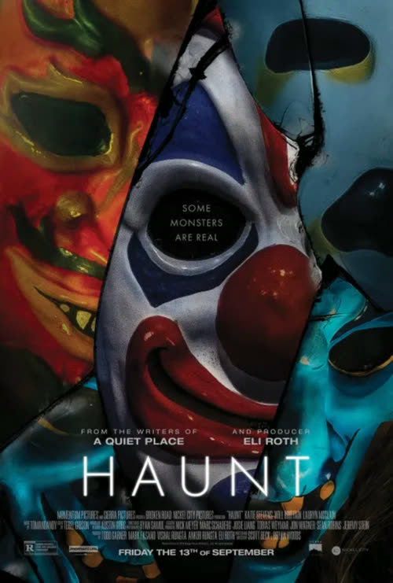
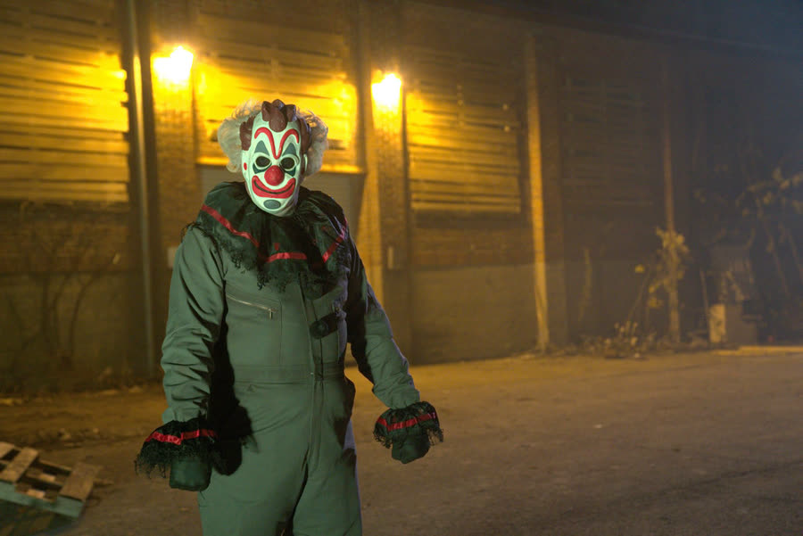
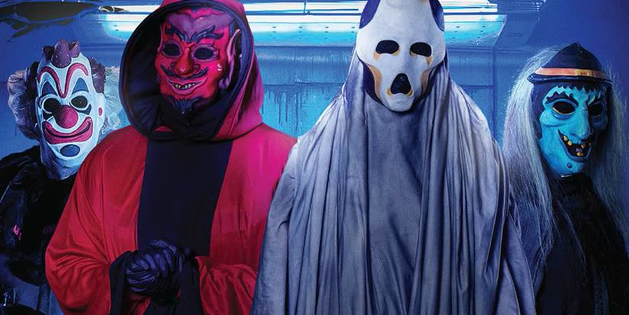
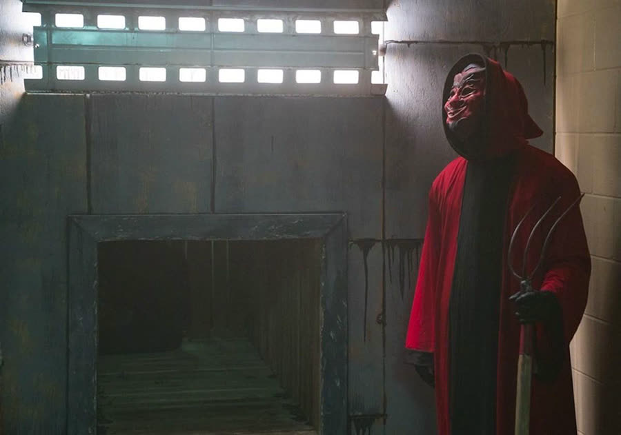

## Haunt (2019): Nothing Says Happy Halloween Like Funding Your Own Murder

{: style="float: right; max-width: 30%; height: auto; margin: 0.25em 0 0.9em 1.1em;"}

Some haunted houses scare you for twenty minutes and send you home.

This one makes you sign a waiver, lock up your phone, and then tries to actually kill you, which is at least honest about being extreme.

*Haunt* opens the way all trustworthy attractions open: a man alone drilling and welding traps, with a wall of masks behind him and a printer spitting out flyers for an extreme haunted house. One mask is a clown, because of course one is a clown. Clock it as an '80s preparation montage, except the preparation is a tripwire.

Then it cuts to Carbondale, Illinois, and to Harper, who has bigger problems than a haunted house.

### A Black Eye and a Break-Up Text
{: style="clear: none;"}

A pumpkin smashes against the front door. Harper's roommate Bailey, in a cat costume, opens it, while upstairs Harper is putting makeup over a black eye.

Her boyfriend Sam is an alcoholic, angry she is not answering him, and Bailey has already typed the break-up text: it's over. Harper just has not sent it. Other explanations are available, including untreated sleep apnea, flailing in his sleep, and flashbacks from Nam.

Bailey saw the bruise the night before, when she came in to borrow Harper's mother's ring. The verdict on that outfit: she was not dressed as a cat, she was dressed as a cat burglar.

Friends Mallory, a medical student dressed ironically as a nurse, and Angela arrive to drag Harper out. The obvious solution: leave the makeup off and pretend the black eye is the costume, like a boxer.

Harper sends the text while *Night of the Living Dead* plays — a classic, no notes.

### Worst Costume Wins a Mystery Bag

At the bar the girls are doing shots of spider vodka, with a tarantula in the bottom like a tequila worm that got ambitious. Nobody looks up whether it is real. It might be the same spider from *Fever Lake*; probably it is in SAG and likes to party.

Bailey introduces Harper to Nathan, in a plain baseball uniform, who has just won worst costume and a big bag of prizes nobody ever sees again. A genuine bummer, that bag. It joins Sam's unexplained costume photo on the list of unsolved mysteries that keep a person up at night.

Nathan was not even waving Harper over. He wanted another drink. Then Evan starts punching drinks because two partners bailed on his human centipede costume and he was supposed to be the head. Everyone understands why nobody volunteered for the other positions.

Outside, in an alley scene that serves no earthly purpose, a man in a red robe stares at Harper through a gate and vanishes. Nathan says his scariest moment was taking a line drive to the temple — you cannot tell, and Harper says so. Asked for hers, she claims a really good childhood, and the movie flashes a white picket fence house. Nobody believes her.

Evan finds a flyer. Half the group says no, half says yes, there is no persuasion scene, and suddenly they are all driving to the haunted house anyway, followed by the same truck that peeled away after the pumpkin throw.

### Sign the Waiver, Surrender Your Phone

{: style="float: left; max-width: 45%; height: auto; margin: 0.25em 1.1em 0.9em 0;"}

There is no line. On Halloween night. For a place printing that many flyers, there is one car and one small group ahead of them, which is suspicious in exactly the way the characters do not find it.

The greeter is a silent clown. He holds out empty hands for a pick-a-hand trick, then pulls the key from behind Bailey's ear. Keys live in a hook behind the ear, apparently. Body modification is a storage solution.

The key opens a lockbox full of waivers: do not touch anyone, you cannot sue if you get hurt. Their phones go in the box too. Then they walk in to laughter, fake webs, and a spinning vortex room — the kind you go through without holding the rails, letting your body bend in half over it. Everybody has their kinks.

The first performance seems fake: a witch drags in the girl from the group ahead of them in a tarp and pushes a hot poker toward her face. Smoke, screaming, then both vanish.

It is not fake for much longer.

### Safe, Not Safe, and Nobody Picks Well

At a maze split marked Safe and Not Safe, Nathan — for reasons nobody can defend — appoints himself group divider. Harper, Evan and Mallory go Not Safe. Bailey, Nathan and Angela go Safe.

Not Safe has real spiders and three coffins that are a puzzle: close a coffin door and a hidden door opens elsewhere. Evan goes first, Harper — who appears claustrophobic on top of everything else — gets through, and Mallory gets stuck while a hatch opens and spiders rain down on her. She is terrified of spiders, something she had mentioned back at the bar, in public, where anyone working the haunt could hear her. Evan later finds a receipt for purchased spiders and tries to comfort Angela by insisting they are not real.

Safe is not safe either. It is hung with huge bags of oil, oil dripping down the walls and onto Nathan's shirt. Bailey works out it cannot be fake paint, because oil is not cheaper than paint and there are gallons of it.

Then comes the arm-hole room, where someone is required to pretend something grabbed them. Angela does the fake grab. Nathan pulls out a grape and eats it without knowing where it has been, whether it is laced, or whether it has been up someone's rectum. Of all the things not to do in that house, eating the food tops the list.

Bailey reaches in, loses Harper's mother's ring inside the wall, and pulls her arm out with a clean razor cut on it. Behind that wall are razor blades.

Harper's group rides a slide down to a chainsaw man — call him Walmart Leatherface — whom Evan shoves while announcing his safe space. The groups reunite, and the witch returns with a second tarp.

This one is Mallory. The poker goes straight through her head, the curtains close, and everybody finally understands this is real.

### Mitch Seems Nice, Which Is the Problem

{: style="float: left; max-width: 45%; height: auto; margin: 0.25em 1.1em 0.9em 0;"}

Evan tries to pick a door lock with a bobby pin. It snaps. He can pick lockers; this is a double lock, and the real emergency exit is upstairs past the slide anyway.

Nathan takes the enormous lockbox key as a weapon, and a burst of steam startles it out of his hand and down a grate. Pause here, because the crew cannot just be prepared: they have contingency plans for the contingency plans for the backup plan that also has a contingency plan. Props, even if it is far-fetched.

In a room of sheet-covered mannequins, one figure is a person: Mitch. Kind voice. Seemingly helpful. He has keys. While Angela, guided by Evan's moral-support-only coaching, reaches through a fence for that fire poker and gets her hand stomped flat by a boot, Harper tells her real story: she grew up hiding under a bed while her father threw her mother across the floor, knocking that same ring off her hand. In her recurring dream her mother says Dad is gone and the house is not haunted anymore. Dad was the ghost. The Scooby Gang does not pick that one up.

Mitch leads them to the emergency door, which opens onto brick. His backup plan is backtracking through a crawl tunnel one at a time, because a trick door triggers if too many people are in it. Nathan decides the order again, Harper last with Mitch's keys.

Evan goes through and immediately wanders off alone, earning a full yell at the television. Mitch goes through, stands up Jason-style, and hammers the tunnel shut. Nathan falls through the trap door Mitch warned them about. Harper locks a yellow door with the yellow key, because the colors match, while the obvious gets yelled at full volume: Mitch is obviously not the only person with keys.

The Devil bursts in and puts his pitchfork through Angela's head, in a kill so similar to Mallory's that the lack of variety is flagrant. Harper breaks a key off in the red door trying to keep him out. It does not matter. He comes through anyway, pulls his mask up after she begs Sam not to hurt her, and reveals a tattooed, spiked, modified face underneath. He is the Dollar Tree Darth Maul. Back at the phones, the clown answers Harper's phone, tells Sam he is too late, and microwaves three phones. There is a word for Sam by then: “confifft,” confused plus miffed.

Outside, Mitch tells Evan his own home address, pulls the hammer out of Evan's head, and uses it to rip the skin back off Evan's face. Mitch's own pale, modified face looks like a child Jason Voorhees.

So much for the kind voice.

### Pop Goes the Weasel, Out Comes a Shotgun

Harper fishes a flashlight out of a bucket of decaying animals by, in the subtitle's word, glopping around in it — a new word, learned from this movie, when dumping the bucket over was right there. Nathan, hiding backstage, finds the ring and the razor blades that cut Bailey, and uses Harper's phone to send Sam a location ping before Mitch attacks him and he escapes.

Harper steps on a floor of nails, tears her hands open pulling them off a super-sticky fly trap, and beats a swinging knife door that would have pinned her where the knives came down.

Then she barricades herself in a pink child's bedroom full of dolls, which is obviously a trap. Backwards writing tells her, via a mirror she just happens to have in her pocket, to find the key to escape. The writing reads fine without the mirror, frankly. Behind a newer patch of wallpaper: dolls see all. She finds a note inside a doll's face — there is something under the bed — and crawls the whole length of a very tall bed from the foot instead of reaching in from the side.

Under it is a music box shaped like a decrepit house. Pop Goes the Weasel plays, and a funky key pops out, which is instantly, obviously not only for a door.

The Devil comes in hunting her, triggering the full flashback: little Harper under the bed, her father throwing her mother down the hallway, the ring flying off where Harper can grab it. The ring Bailey lost, from an abusive house, carried into an abusive relationship — which is why Sam, who had nothing to do with this haunt, was a red herring the whole time.

Harper stabs the Devil in the eye with that key. He saw that coming. Then she unlocks a door marked The End while standing directly in front of it, another decision worth objecting to at volume, and a rigged shotgun fires to Pop Goes the Weasel and catches her in the chest. The Devil chokes her, and stares long enough for her to push her thumb into his empty eye socket and lift his head into the next blast, which takes the top of his head off.

### They Were Coming for You

{: style="float: left; max-width: 45%; height: auto; margin: 0.25em 1.1em 0.9em 0;"}

Backstage, the clown sends a slow-walking figure in a skeleton mask through the haunt like a final boss. There is no understanding why anyone is still walking creepily when there is nobody left to scare. Harper knocks it out and stabs it with the Devil's pitchfork.

It is Bailey, tied up and dressed as a haunt worker. Bailey had been completely forgotten since the tunnel, which is why it lands. Apparently she was the secret head of the operation. Bailey's last words are that they are coming for you, and she dies without ever getting an apology — strong feelings about that.

Sam arrives following the ping, determined to be the knight in shining armor, which is infuriating given he is the abusive boyfriend. He trips the opening wire, takes a massive screw through the neck, and the clown golf-swings a sledgehammer through his head. Sam is definitively not part of this, and not the hero either.

Nathan saves Harper from Walmart Leatherface with a nail gun, Harper loads the haunt's shotgun — its barrel helpfully sawed shorter by the chainsaw — and blows Leatherface away, then cracks Mitch before he can hammer Nathan's mouth open as he did Evan's. The witch asks Harper if she thinks she is the only one who has made it this far, gets yanked down by Nathan, and has her head slammed in the escape hatch lid four or five times.

The clown sets the oil room on fire. At the fence, a worker shoots Nathan in the stomach; Nathan charges anyway and caves his head in with the baseball bat from his costume. They steal Sam's truck, drive out at dawn to sirens, and land in a hospital holding hands — movie logic, or, in the blunter version, trauma bonding.

The movie could have ended there. It should have.

Instead Harper dreams of her mother, wakes to a nurse who has already broken HIPAA by reporting Nathan is fine, and gets handed release forms to sign. Release forms. She connects it instantly, and the real ending is Harper waiting at her mother's house, rigged with the haunt's own tricks: flypaper, floor nails, and the shotgun missing from the wall. She tells the clown to lift his mask and shoots him, over an acoustic Dragula cover that is not horrible, just very strange.

### The Verdict

Talon gives *Haunt* **three and a half to four cents out of 10**.

That range is the review. She did not hate it, but the holes wore on her: a crew that predicted every move, down to Nathan dropping that key through that grate, a Sam plot that went nowhere, and an ending she called stupid when the movie had a good one driving away at dawn. She thought the version where the night was Harper's picture of her abusive relationship would have been better. What she did love was finally seeing the rest of the haunt instead of backtracking out the tunnel.

Dan gives *Haunt* **four and a half cents out of 10**.

He did not hate it either, and liked it better than most Eli Roth movies — surprising, given how little gore this has for a Roth production. His frustrations were the copy-paste deaths for Mallory and Angela, random quick shots to nowhere, and characters like Angela and Sam who could be cut without changing anything. He loved a revenge ending in principle — citing the *I Spit on Your Grave* remake, where the revenge is deliberately different from what was done to her — but not one placed after the natural ending and built from the haunt's same tricks.

The shared bottom line: neither would go looking for it, but if it was on TV while flipping channels, it stays on.

Worth watching if you enjoy extreme haunts, escape rooms trying to murder you, and yelling at a woman to stop standing in front of doors.

Just do not eat the grape.

**Stuff we use / support the show:**
- Own it on physical media via [Gruv](https://www.tkqlhce.com/click-101633208-15032169)
- Watch with [Plex](https://www.kqzyfj.com/click-101633208-15734677)
- We record this show with [Riverside](https://riverside.sjv.io/4aR7A9)
