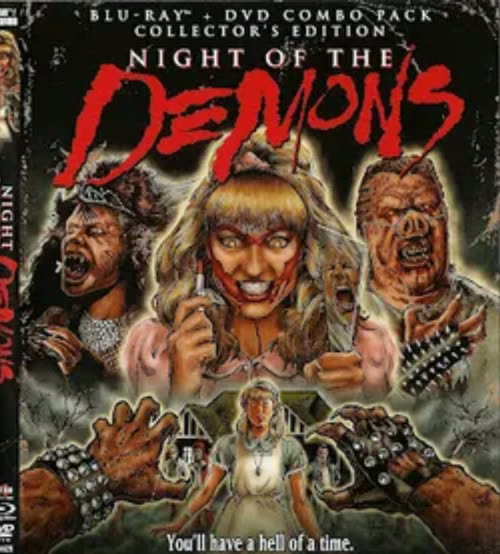
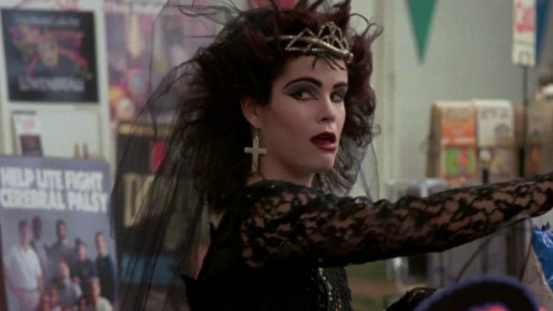
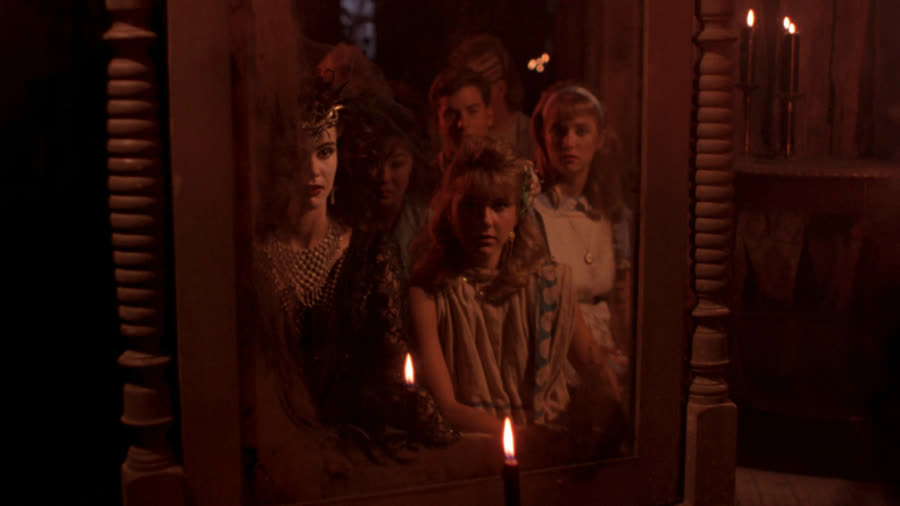
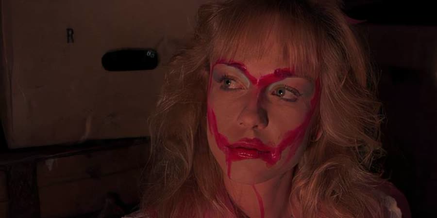
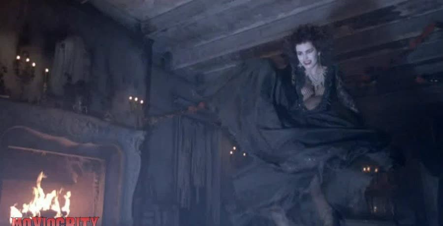
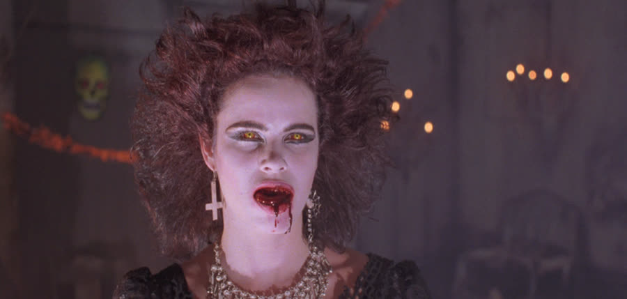

## Night of the Demons (1988): Hide Your Lipstick

{: style="float: right; max-width: 30%; height: auto; margin: 0.25em 0 0.9em 1.1em;"}

Some Halloween parties end with a noise complaint.

This one is held in an abandoned funeral home, so the complaints department is already dead.

*Night of the Demons* is Talon and Dan's pick for a month of Halloween movies that don't involve a certain Shatner-masked babysitter enthusiast: a cult classic about ten teenagers, a seance, and Hull House, a former mortuary with a reputation for murder and evil spirits. The hope going in was real, precisely because it is a cult classic.

That hope does not survive the opening credits.

### Three and a Half Minutes of Skeletons
{: style="clear: none;"}

Before there is a movie, there are the credits — roughly three and a half minutes of 2D animated ghosts and skeletons, with no film playing underneath them at all. Most movies run credits over the action. This one makes you just sit there and watch the cartoon.

It would have worked as the opening to a children's Halloween movie, but attached to an adult horror film, it plays like a dare — the credits dare you to quit watching before the movie even begins. Fast-forwarding just to confirm there is actually a movie attached is a reasonable response; they are the longest opening credits ever. Without the podcast, quitting would have won.

When the film finally starts, it's Halloween night. Judy, our sweet, naive final girl, is getting ready for a date with Jay, who is already working on her to ditch the school dance for Angela's party at Hull House — a party she doesn't want to attend, with people she thinks are assholes.

She should have trusted that instinct completely.

### The Obligatory '80s Everything

{: style="float: right; max-width: 45%; height: auto; margin: 0.25em 0 0.9em 1.1em;"}

Judy's introduction comes with the movie's first truly shocking scene, and it has nothing to do with demons. She's changing in her bedroom when her little brother pops out of her closet in a scary mask and starts making jokes about her breasts. He's maybe eleven or twelve. She still has a lacy bra on, but you can see straight through it.

It is really creepy, and the '80s were full of rapey, pedophilic, incestuous jokes like this. Possibly that's why Gen X turned out the way it did.

Then there's Judy's sweater. Alone in her room, she pulls her pants and underwear off under a long, heavy sweater, then pulls the sweater up — and when it falls, pulls it up again. The question stands: if you're alone in your bedroom, who are you doing that for? Nobody. You're doing it because the director needs the audience to see your ass again.

Across town, Angela and Suzanne are at a convenience store. The introduction is Suzanne bent way over, fluffy petticoat-style layers on full display, holding the attention of the two clerks while Angela stuffs stolen snacks into a huge bag and walks right out past them. The bent-over girl reads as Judy at first, because the fluffy underskirt matched what Judy had just put on. The clerks are the quintessential nerdy-looking guys of the '80s — oily, greasy, glasses.
### Stooge Is Exactly Who You Think He Is

{: style="float: left; max-width: 45%; height: auto; margin: 0.25em 1.1em 0.9em 0;"}

Then the movie introduces Stooge, and the hatred is instant.

There is a whole '80s thing where the greasy, awful, relatively abusive fat guy always ends up with a sweet, innocent, cute girl, and it amounts to false advertising for anyone who grew up on it. One correction, though, and it matters: Stooge is not relatively abusive, he's straight up abusive — Talon's amendment, and Dan co-signed it one hundred percent. He calls his girlfriend a bitch and yells at her constantly while she's doing nothing. A complete and total piece of shit — and if that's what the director was going for, they did a fantastic job. He is presumably on the football team, which is the only reason anyone treats him as cool: big guy, shaved sides with stripes, and a mullet. The look is Joe Exotic, only bigger, and without the mustache.

Everybody converges on Hull House, where Angela proposes the obvious activity: a seance in front of a mirror. Something looks back. The mirror cracks — after falling over very, very slowly, in a shot that plainly shows someone off-camera gently lowering it so it wouldn't actually break: it was on a string, and a real one probably wasn't in the budget. When they lift it, the broken pieces are face-up when they should be face-down, which is ridiculous.

Stooge then goes completely ballistic on his girlfriend, blaming her for the mirror falling while she sits there apologizing for something she didn't do — she was just sitting there, like everyone else. The poor girl definitely needs a new boyfriend, and how the cutest girl in the group — the only one who actually looks like a teenager, maybe nineteen — ended up with him is a mystery.

Meanwhile, Helen and Roger try to leave and hit the invisible you're-stuck-here wall around the property. Nobody is leaving. The party just doesn't know it yet.
### Hide Your Lipstick

{: style="float: right; max-width: 45%; height: auto; margin: 0.25em 0 0.9em 1.1em;"}

Suzanne is the first one possessed, and she gets the scene this movie is famous for — a scene Dan experienced in the worst possible order. He'd fallen asleep a couple of times during the film and woke up to a girl shoving a lipstick into her breast with no context whatsoever: what the hell is going on, what did I miss, and why is this happening? It did not make more sense with context.

Suzanne — who Angela has already needled for constantly checking herself in her mirrored compact, and who should be worried about how she looks — locks herself in the bathroom. Her lipstick is already drawn wide outside her mouth and up her face almost like clown makeup. Then she runs it down her chest, around her breast, and pushes the whole lipstick into her nipple. The question is simple: why? What's this for? There is no blood, and it's plainly a prosthetic markup of her body, with the hand angled wrong to even be hers — a weird-looking one.

Jay — Judy's date, who earlier failed to get Judy to do anything more than let him hold her, because somebody in an '80s slasher has to stay a virgin and live — walks in. He does not see the lipstick trick. He does see lipstick all over her face and body, and he is not appalled or even curious. All he knows is this girl is going to let him get what Judy wouldn't. Suzanne keeps screaming at him not to look at her face, asking if she looks pretty, her face goes demonic, and she digs her thumbs into his eyeballs and kills him.

There is also a completely random moment where Suzanne lifts her dress and is wearing no underwear at all, for no reason. Porn and regular movies should not mix; these lines should not cross.
### A Dance That Refuses to Die

{: style="float: left; max-width: 45%; height: auto; margin: 0.25em 1.1em 0.9em 0;"}

Angela is possessed next, and her possession is announced by a dance — part Flashdance, part satanic ritual, and one hundred percent way too long. Asked if he managed to stay awake during it, Dan admits he dozed off a couple of times. Like the credits, the dance just goes on forever, with Angela pulling her dress up unnecessarily high, which is the entire reason the scene exists.

Watching her is Sal, the uninvited guest. Sal is set up as the bad guy — the greaser-looking would-be rival for Judy who showed up at Judy's house and pressured her little brother into revealing where the party was. A slimeball, just not as much of an asshole as Stooge. Why he doesn't leave during the most boring thing ever filmed is a mystery.

Possession, it turns out, spreads here by kissing: Suzanne kisses Angela, Angela kisses Stooge, and part of the demon moves into Stooge. The diagnosis is herpes. Mid-episode it becomes clear what this movie actually is: a PSA for STDs.

Stooge, now possessed, kills Max and Franny — who decided the best place to hook up in a haunted mortuary was inside a coffin. They seemed to be competing for an award for the most creative place to die. And everybody knows the rule they broke: in the '80s, if you're having sex, you're definitely going to die.
### Sal Gets His One Good Scene

Sal, the slimeball, turns out to be the closest thing this party has to a rescue plan. Upstairs, he comes in and saves Judy from Angela — and Angela backhands him across the entire room and out a window. The physics are stunning: a little slap that sent a grown man flying the full width of a room. He doesn't die there, though. He dies later, in a second fight with Angela on the roof, when she pushes him off and he lands on a stake — or some metal pipe sticking out of the ground.

And waiting for him, somehow, is a headstone that already says Sal Romero, with his birth date and, apparently, that he died today, or tonight. The deductive reasoning the moment the name lands: Romero is an homage to George A. Romero.

So Sal redeems himself for exactly one scene, gets launched out of it by a slap, and then gets impaled under his own pre-carved headstone. Decency is not rewarded at Hull House.

### Check for Gas Leaks by Lighting Them

{: style="float: right; max-width: 45%; height: auto; margin: 0.25em 0 0.9em 1.1em;"}

Judy, meanwhile, completes the standard final-girl evolution: meek and prim and proper at the start, setting demons on fire by the end. She and Roger — still here, still terrified — hide in the crematorium, where Judy opens a door onto an oven and pulls out a skull.

With Angela and Stooge banging on the door, Judy grabs a pipe off the oven to use as a weapon — and gas starts pouring out of it. She sits there with a lighter trying to light it, while anyone watching braces for the whole room to blow up. The ruling stands: that's how you check for gas leaks — you smell gas, you start throwing matches at it. Roger is no help: balled up in the fetal position while Judy flops the barely-burning pipe around and Angela and Stooge spin on fire.

Then she needs the gas off, and the valve is literally a foot from Roger, who looks around for it like it's hidden, then turns it with one arm casually braced against the wall. It took him so long the shouting starts: just turn the valve. Why an abandoned crematorium still has gas service at all is a fair question. It slows the demons down. It does not finish them.

The last escape is over the property wall, through barbed wire Roger climbs the correct way — hands between the barbs. Burnt Stooge grabs Judy's leg after a completely unnecessary two-second slow-motion run. Roger falls off the wall one way, lands facing another, then is suddenly back on top, pulling Judy up with a violent one-armed swing from a man who could not turn a valve. Who choreographed this?

What saves them is the narrow stream under the wall: the demons can't cross the water, even though it's still dark. It's all about plumbing. Demon rules are weird. And Roger — a Black character in a 1988 horror movie, terrified and fairly useless until he He-Manned Judy over that wall — walks out alive. A final guy.
### Just Desserts, With Razor Blades

Judy and Roger walk home in daylight, past the house of the old man from the opening — the one Stooge mooned, who muttered that they'd get what they deserve. His Halloween plan, was to put razor blades in apples for trick-or-treaters.

That opens the list of things '80s kids were sure would kill them: stop, drop, and roll; quicksand; and poisoned or razor-bladed Halloween candy. There is no documented evidence the razor-blade thing ever actually happened, that it became a thing because of a scene in *Halloween 2*, and that you'd have to be a complete moron to bite into an apple with a slit in it — a razor blade is ridiculously huge to hide. The panic never died, it just updated — a couple of years ago it was fentanyl in Halloween candy, dismissed on pure economics: nobody gives that much product away free.

The last scene is the old man's wife serving him apple pie for breakfast — made, cheerfully, with his razor-blade apples. Nobody knew he had a wife until this scene, and the logistics are impossible: when did she bake a pie without him smelling a warm apple pie in his own house? Somehow he chews without noticing the blades until they shred through his throat — which would slice his esophagus, not burst through his neck like a Freddy Krueger glove, because razor blades are not trying to escape. It has nothing to do with the demons at all.

It's just revenge on a miserable old man who didn't like kids — and the gladness that they put it in is real, because he was a dick, and without it the movie just ends with two kids walking down a sidewalk. It's the best scene in the film. It is not about demons.
### The Verdict

Dan gives *Night of the Demons* **0 cents out of 10** — his first zero ever.

He thought it was absolutely terrible on every level: the music was awful, the acting was terrible, and the special effects were god-awful — he likes practical effects, but these were done horribly. There was nothing redeeming about it. He would never watch this again. The only scene that interested him as horror was the old man's razor-blade death, and he said he'd rather watch a movie based on that guy.

Talon gives *Night of the Demons* **1 cent out of 10**.

She's not going much higher than Dan. She agreed the music — written specifically for this movie, in a would-be '80s hair-metal ballad style — was terrible, and the acting was awful and over the top, Judy especially, trying so hard to come off sweet and naive it became put-on; the only decent performances anyone could name were Stooge's girlfriend, who is barely in it, and the old man. Talon was genuinely hopeful going in because it's a cult classic, and her conclusion is that it must be a cult classic because of how crazy bad it is — horrible choreography, horrible direction, horrible everything. Her one cent is for the fact that it's a movie she could tell people is so awful they'd watch it to see for themselves.

Worth watching if you enjoy: three-minute cartoon credits, a demonic dance recital that refuses to end, and a lipstick scene that should come with a warning label — or if you want to watch the movie Dan finally gave a zero.

Hide your lipstick.
**Stuff we use / support the show:**
- Own it on physical media via [Gruv](https://www.tkqlhce.com/click-101633208-15032169) (Gruv carries the Collector's Edition Blu-ray and 4K UHD of this one — Talon: swap in the movie-specific Gruv link here if you have one)
- Watch with [Plex](https://www.kqzyfj.com/click-101633208-15734677)
- We record this show with [Riverside](https://riverside.sjv.io/4aR7A9)
