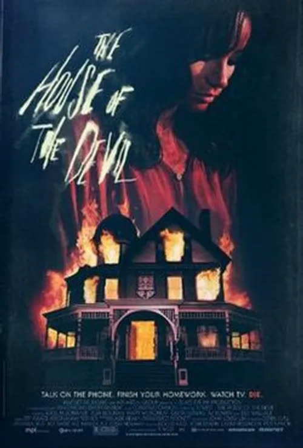
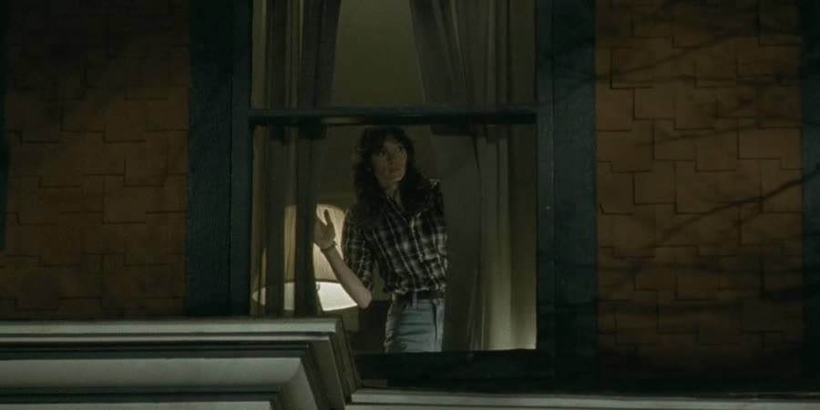
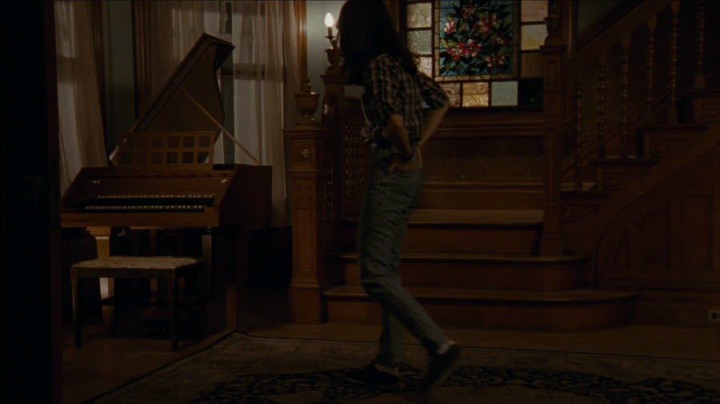
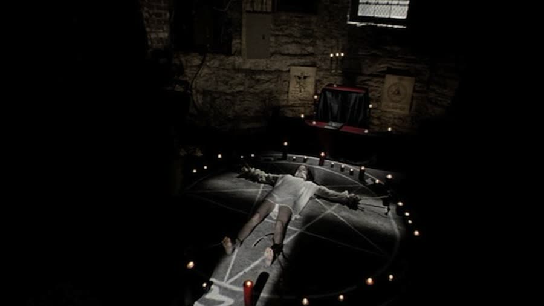
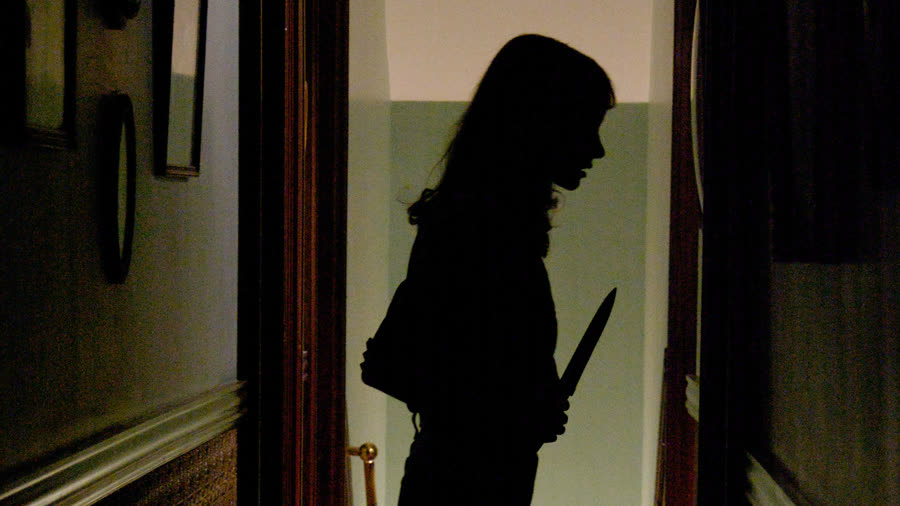

## The House of the Devil (2009): $400 to Sit in a Chair and Absolutely Nothing Else

{: style="float: right; max-width: 30%; height: auto; margin: 0.25em 0 0.9em 1.1em;"}

Some babysitting jobs come with a curfew and a list of emergency numbers. This one comes with a remote mansion, a lunar eclipse, and employers who smile like they're waiting for you to stop asking questions.

*The House of the Devil* is Ti West's slow-burn trip back to early-80s satanic panic, when every babysitter in horror was one bad decision away from a blood ritual. Call it proof that easy money just means you're underpaid for the possession that follows.

### Satan Was Under the Couch Cushions
{: style="clear: none;"}

The movie opens with a warning card reminding us that in the 80s, everybody believed Satan was hiding everywhere. Apparently he was lurking under the couch cushions. West commits to the era immediately — the music, the clothes, and the pure 80s misery of the wallpaper.

News reports keep returning to a rare total lunar eclipse happening that night. Back then, there was no constant barrage of news, so it glued everybody to the television. It plays as a science story. It is quietly also the cult's deadline.

Then we meet Samantha Hughes (Jocelin Donahue), a college student counting coins like she's auditioning for a Depression-era musical. She has agreed to rent a house for $300 a month because she cannot stand her messy roommate. The landlady is Dee Wallace — *Cujo*, most memorably — in a cameo brief enough to still earn a title credit. And the math matters: Samantha has $82, no job, and owes the first month's rent by Monday. It is Wednesday. Why did she think she could move into a place of her own?

That worry is essentially the entire first act, and the movie splits in two here. The slow burn works once it becomes a horror slow burn, but the first 25 minutes are not tension at all. There is no scary tension in them, only I'm-broke tension: Samantha walks around campus, worries about rent, and waits to arrange a job. Without the podcast, it would have been turned off — unfortunate, because the movie worth wanting starts later. At least half of that stretch could be cut — call 12 minutes good — and tell the same story. What goes unfaulted is how it looks: a genuine early-80s, maybe even 70s, movie, well enough that the cast must be in their fifties by now. They are not. West just nailed the period.

### Ghosted at the Student Center

Desperate, Samantha spots a babysitting ad and does the logical horror-movie thing: she calls the creepy stranger on it. This required some period technology: the payphone, explained for younger listeners — a little box you fed coins — and, from the same vanished world, the pay toilets at Kmart and Ames.

Mr. Ulman answers politely, with a definite buries-bodies sort of energy, and offers her the job practically on the spot. What follows is a scheduling farce: she waits at the student center until she falls asleep on the steps, and he never shows. He ghosts her, before ghosting was a thing. The whole missed-connections exchange is pointless.

Samantha's friend Megan (Greta Gerwig) comes along — all vibes and no caution, the perfect horror sidekick.

### Red Flag City, Population: Two

Megan drives, because Samantha doesn't have a car, and the house makes its own introduction. It is Red Flag City: a huge mansion, dark, isolated, far back in the woods, with nobody else around. You can tell Mr. Ulman was put off by Megan being there. The look translates: great, you brought a friend, thanks for ruining everything.

Mr. Ulman is played by Tom Noonan, and he is — to borrow the giggly, unfinished assessment — a very tall individual. More directly: tall, slender, almost Slenderman-like. He could play Slenderman. He is soft-spoken and unsettlingly calm, a man who should read as welcoming and instead reads as a warning. Mrs. Ulman is auditioning for the Stepford Wives, all creepy smiling.

Inside, Megan asks the questions a person should ask, starting with what Mr. Ulman does for a living. He answers none of them — he changes the subject every time — right up until he asks to speak to Samantha privately. In the kitchen, he explains he couldn't pay two babysitters. Samantha explains Megan was only the ride. And then, finally, he explains the job.

### No Baby, $400, What's the Catch

{: style="float: right; max-width: 45%; height: auto; margin: 0.25em 0 0.9em 1.1em;"}

There is no baby. There is no child at all. The job is to sit in the house for four hours and keep an eye on his elderly mother-in-law, who is upstairs, can get around on her own, and will not be any trouble. Just watch television. Samantha hesitates — she knows nothing about looking after old people — so Mr. Ulman starts bidding against himself. The pay climbs through $100, $200, and $300, until it lands at $400 for four hours of sitting in a chair. Nothing weird about that at all.

Stop the story on the arithmetic. This man can pay Samantha $400 to watch his mother-in-law, but he cannot pay two babysitters $50 apiece? That was not a red flag? The theory for the secrecy is simpler: most babysitters hear what he actually needs and leave, and he is desperate to land somebody for this particular night.

Megan, to her credit, called it what it was: weird as hell. Samantha, thinking like a broke college student with $300 due Monday, ignored every red flag and took the job anyway. That acceptance is the first nail in the coffin, the calm before the ritual.

On his way upstairs to fetch his wife, Mr. Ulman promised to be back in two shakes of a lamb's tail. The phrase is recognizable from *The Clovehitch Killer*, where another unsettling man said the same thing. The conclusion stands as a public service: that is what creepy guys say. It's the creepy guy slogan.

### The Longest Night Ever

{: style="float: left; max-width: 45%; height: auto; margin: 0.25em 1.1em 0.9em 0;"}

The Ulmans leave, and Samantha is officially the world's highest-paid non-babysitter. Especially for the 80s: $400 then is the equivalent of a couple thousand now.

West shoots the waiting well. The camera stays close enough that it feels like it is practically breathing down her neck, like the house itself is watching her. There is a locked door that will not budge, and everyone knows the rule: that is where evil lives — a lesson carried over from *The Deep House*. Samantha keeps poking around anyway. House Hunters: Hell Edition.

Before leaving, Mr. Ulman had been almost insistent that she order a pizza, mentioning it three or four times in a very nonchalant way: oops, did I mention that already? She eventually does, and puts on her cassette Walkman, and that object nearly steals the episode. One hasn't been seen in decades; the bulk of it, the sound of the tape clicking in, is a straight shot back.

So she dances through the empty house, one thing blissfully leading to another, and breaks a vase. The accounting is instant: well, there goes your $400. Samantha sweeps it up and throws it away, which is not the endorsed move. Superglue was not fixing that; the alternatives are rebuilding it and hoping they never notice until she is gone, gone, gone — or paper-mâché.

Her exploring turns up a closet of photographs of strangers. The suspicion lands: those people used to live here, they are gone now, and the Ulmans never really lived here at all.

The most confusing moment of the viewing comes at a bedroom door. Samantha almost opens it, calls out to check on the supposed mother-in-law, and the camera passes through into a room full of bodies on the floor. Samantha then walks off, unbothered. It takes three furious rewinds to sort out. Why is she not running? This is creepy sign number ten. Eventually it clicks: Samantha never actually opened the door. Only we saw it, which is worse.

She plays pool, and tries calling Megan, who doesn't answer, for reasons Samantha doesn't know yet. She also has an emergency number for the Ulmans, written in the center of the rotary phone — the favorite production detail of the night: it is a real phone number, not a 555 number, with a New York area code. It does not get called. By now Samantha has worked herself into a state, knife in hand, hearing noises everywhere, and the movie plays it carefully: an old house, settling sounds, an old woman upstairs. It almost feels like Samantha is freaking herself out. Almost.

### Cemetery Parking Is Never Parking

Megan, meanwhile, never left. Angry, and thinking the whole arrangement was weird, she pulled into the cemetery next to the property to wait out the four hours and smoke. The verdict is instant: horrible idea. It's dark out. Zombies live there. And there's an eclipse coming. You realize you're in a horror movie, come on, girl.

Her lighter won't work. A man appears, offers her a light, seems perfectly normal, chats with her while she gets snippy with him, and then asks if she's the babysitter. She starts to say she isn't, and before she can finish the sentence, he shoots her in the head.

Nobody saw it coming, and the brutality impresses: a clean shock, West's way of announcing that no one is safe, not even Greta Gerwig. The man then gets in the car and finishes Megan's cigarette, which is funny in the bleakest possible way. The defense is purely economic: you don't want to waste a cigarette.

Because that man is also the pizza delivery guy.

When he rings the doorbell — an old, super-loud, jarring one — Samantha, already near-frantic with her knife, throws $20 at him for an $8 pizza, tells him to keep the change, snatches the box, and slams the door. Then she slumps to the floor against it, holding the pizza box vertically. That cannot be let go. That pizza is going to be a disaster. Somehow it survives, possibly because it took so long to arrive it had set. She eats a couple of slices. They taste horrible. She throws the rest out and drinks a lot of water.

The pizza was drugged. Her vision blurs, her limbs give out, and she collapses on the floor just as the eclipse reaches its peak outside. Mark the moment plainly: we are done with dread, and we are heading straight into hell.

### You're Both Going to Be Fine

{: style="float: left; max-width: 45%; height: auto; margin: 0.25em 1.1em 0.9em 0;"}

Samantha wakes on the floor in the middle of a giant pentagram: candles, symbols, the whole satanic starter kit, the kind you can order in bulk. Outside, the eclipse is in full swing.

The Ulmans are back in ceremonial robes. The man who shot Megan and delivered the pizza is with them: he is their son. And then the mother-in-law finally appears. Whatever she is, she is barely human, her face like a dried apple with teeth. She slits her own wrists, lets the blood drain into a goat skull, and the Ulmans pour it into Samantha's mouth while they chant, racing the eclipse. Review of the beverage service: after that pizza, blood is not the choice to cleanse a mouth with. There is also a mark on Samantha's forehead, describable only as a W. Best guess: it stands for winner.

Nobody expected what came next: the assumption was a straightforward sacrifice. It never dawns that they are trying to impregnate Samantha, even though, with these movies, it is always one of the two — the same read, right up until it very much wasn't.

Samantha does not go quietly. She tears herself loose with the strength of the Hulk, stabs Mr. Ulman, fights the son, jams her thumb into his eye — owie — and gets away, and then does the thing that makes Talon crazy: she runs upstairs. Dan defended her on genre grounds: that's just what you do when you're scared.

Getting there means passing Megan's body, dragged inside and lying in the blood on the floor. The son comes up the other staircase with a gun and shoots her in the shoulder. Standing over her, he seems ready to finish her, which makes no sense, since his father didn't want her dead — maybe he was angry enough to scrap the plan and start over. Instead, Samantha reaches out from the floor with a knife nobody can account for her having, and slashes his throat. It is a stretch. Charitably: maybe she's limber.

She kills Mrs. Ulman upstairs too, wig gone, practically hairless, grabs the dropped gun, and runs out into the cemetery, with Mr. Ulman, stabbed and still impossibly calm, behind her, pleading like a disappointed guidance counselor: hon, let's not do this. Samantha points the gun at him, and instead of shooting him, turns it on herself. She survives that too. Sum up her evening without mercy: not only did she fail at life, she failed at death too.

Cut to the hospital. A nurse leans over the unconscious Samantha and tells her she's going to be fine. Then the nurse touches her stomach and corrects herself. You're both going to be fine. The ritual worked. Name the ancestor immediately: it is the *Rosemary's Baby* ending. The spawn of Satan is officially on its way.

And the speed of it is the one shared complaint about the back half: once Samantha is drugged, it goes boom, boom, boom — the ritual they spent the whole movie approaching is over almost as soon as it starts. Some of those first 25 minutes should have been spent here.

{: style="float: right; max-width: 45%; height: auto; margin: 0.25em 0 0.9em 1.1em;"}

### The Verdict

Dan gives *The House of the Devil* **6 cents out of 10**.

It got a little slow for him, and he could tell this was one of West's earlier works, but it never crossed into actual bad. It wasn't fantastic, but it wasn't bad either.

Talon gives *The House of the Devil* **6 cents out of 10** as well.

Outside of the first 25 minutes, which she did not enjoy, she thought the rest was good: the cinematography, the nostalgic texture, and the tension that builds once Samantha is in the house and possibly scaring herself as much as the house is scaring her. She liked that, if you ignored the opening card giving the game away, the son could almost read as a random predator rather than one cog in a cult. And she thought the ritual itself was rushed.

So: two sixes, one for a movie that spends an hour making a house feel watched, and about four minutes on the devil. Worth watching if you enjoy slow-burn 80s horror and a babysitter who looks at $400, a mansion, and a missing baby, and hears opportunity.

Do not pull into the cemetery to wait it out.

**Stuff we use / support the show:**
- Own it on physical media via [Gruv](https://www.tkqlhce.com/click-101633208-15032169)
- Watch with [Plex](https://www.kqzyfj.com/click-101633208-15734677)
- We record this show with [Riverside](https://riverside.sjv.io/4aR7A9)
