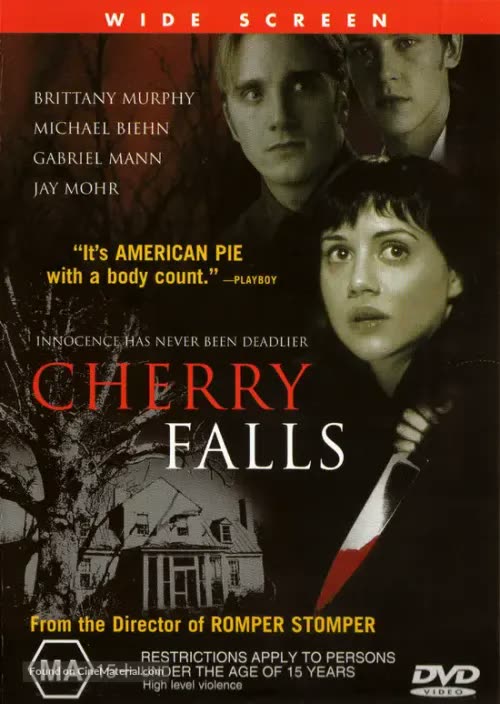
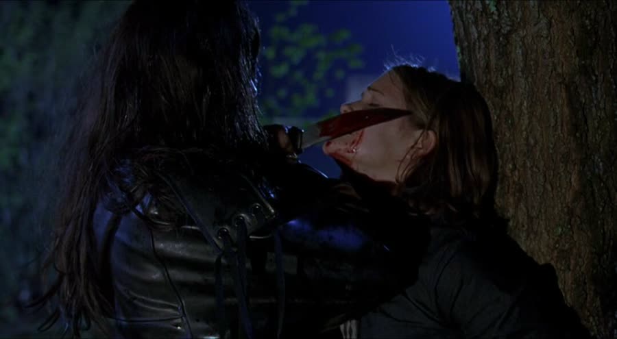
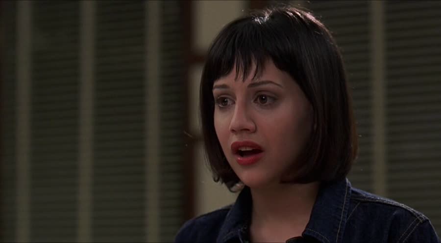
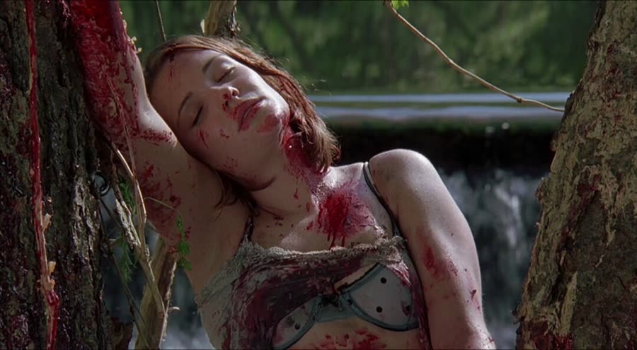
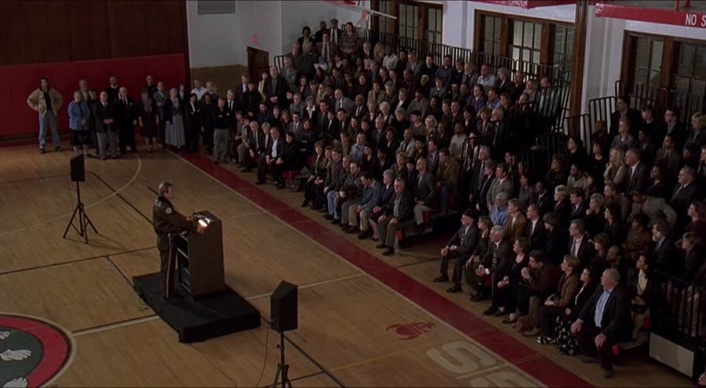
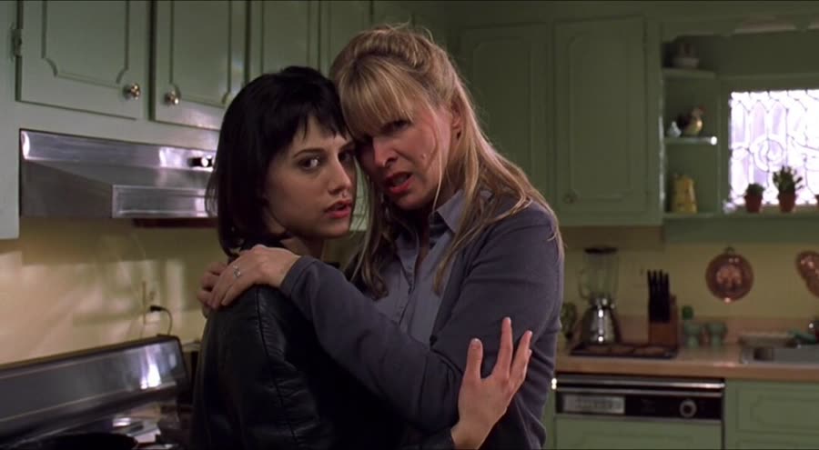
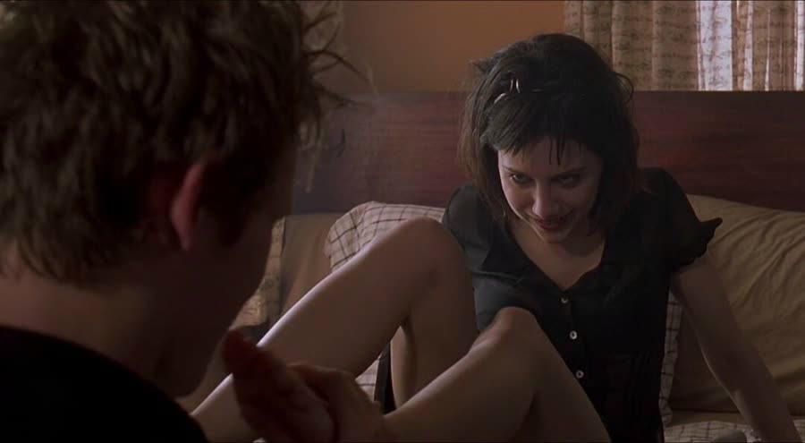
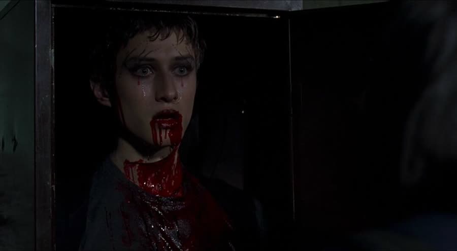

## *Cherry Falls (2000)*: Pop Your Cherry or Die Trying

{: style="float: right; width: 30%; margin: 0 0 1em 1.5em;"}

Cherry Falls has a public service announcement for the teenagers of America: have sex, or a man in a wig will carve the word VIRGIN into your thigh.

This is a real slasher movie, released into the world on purpose. It takes the oldest rule in the genre — the virgin lives; she's the final girl — and flips it: here, the virgin is the *target*. And the town's response, once it finds out, is to throw a party about it. A big one. With a flyer.

It's Kills Like Teen Spirit month: high school horror, questionable morals, and adults who absolutely do not think their choices through. Nobody in this movie thinks anything through. That is the movie.

### A Supernova of Bad Decisions
{: style="clear: none;"}

{: style="float: left; width: 45%; margin: 0.4em 1em 0.6em 0;"}

The movie opens in the woods, Rod and Stacy making out in a parked car. Rod's seduction strategy is astronomy — celestial beings, ancestors, a vaguely cosmic case for why they should be having sex. He's committed to the bit: his license plate reads SUP NOVA, and the car is not even a Nova. The man has a theme.

Stacy is not buying it. She scratches his face, storms out, and he follows with the oldest closer there is: he wants his first time to be with her. She melts and climbs back in.

That's when the dark car sitting in the trees behind them rolls up, headlights blazing. Rod gets out calling names — Ben? Mark? — sure it's friends messing with him. It is not friends. A figure with long, scraggly hair comes out door-first, knocks him down, and stabs him far more times than a person should survive. Stacy does the smart thing and locks the doors — manual, push-button locks, roll-down windows, real commitment — right up until a badly hurt Rod crawls to her side moaning her name, and she unlocks them. Don't unlock that damn door. He's already gone. She's dragged out against a tree, the knife across her face, blood smeared on her lips — and the killer leans in like he's going to kiss her.

Fade out. Welcome to Cherry Falls. Warm and friendly.

### Goodbye or Goodnight?

{: style="float: right; width: 45%; margin: 0.4em 1em 0.6em 0;"}

Jodie Marken, played by Brittany Murphy, faces the same situation with better lighting: parked outside her parents' house, fifteen minutes past curfew, shutting her boyfriend Kenny down. Kenny shares his medical theory that guys can die if they stay virgins too long. Jodie's review of the research: that's right up there with global warming. Kenny breaks up with her instead. A year of dating, he's got nothing. Put up or shut up.

Headlights — except this time it's her mother. Pam Marken bums a cigarette off her daughter's boyfriend — she can't smoke in the house; it's her one guilty pleasure, a claim the rest of the movie will not support — and flirts with Kenny in a way that can only be called predatory, right in front of Jodie. It's a double entendre. It goes nowhere. Much of this movie is a double entendre that goes nowhere.

Inside, her father is waiting in her room: grounded, two Fridays, because not every sixth grader is the sheriff's daughter — which is how we learn Dad is Sheriff Brent Marken, played by Michael Biehn. Yes, that Michael Biehn. How this cast happened is one of the movie's better mysteries.

At 3:30 in the morning the phone rings and the sheriff leaves for a crime scene. And Jodie rises. Arm straight out like a sleepwalker, she drifts to the window, parts the curtains, watches him drive off, turns to the camera, eyes closed, murmurs "daddy" in a voice best described as sultry, opens her eyes, and breaks the fourth wall. What the fuck was that for? Nobody knows. It's never explained. File it — this movie asks that question again and again.

Meanwhile, the sheriff takes until daylight to reach a scene he left for at 3:30 a.m. His jurisdiction must be the size of Texas. Rod is face-down in the water by the falls; Stacy is strung between two trees, one arm nailed up, blood pooled beneath her — positioned, and killed slowly.

### Carved In

{: style="float: left; width: 45%; margin: 0.4em 1em 0.6em 0;"}

School runs on grief and gossip in equal measure. Timmy — fast-talker, gossip columnist for an actual paper, not the school one — needs the deets from Jodie's dad. In English, Mr. Marlston (Jay Mohr) leads an open discussion from atop his desk; a girl dissolves because in eighth grade she told Rod to go away and die, and now look. The chessboard: Sandy, Jodie's best friend, watching her crush Mark eat chips out of a bowl with his tongue, mesmerized. Mark's sarcastic bestie Ben. Cindy, who wants the killer fried. J.B. Qualls, the nerd.

Lunch produces Annette, who storms the cafeteria swinging at a boy who's been telling the school she gave him a hummer. The boy considers it a compliment. As Ben explains, Annette thinks fellatio is a Shakespeare character.

Cut to: hands with red fingernails, sharpening knives. The nails are red; the hands attached to them are not, let's say, dainty. Remember that.

That night, a woman's voice at Annette's door claims to be her mother's friend, Lorelei Sherman, just hoping to leave a note. Annette opens up — and it's instant: door onto her head, bam, bam, bam. Her drunk parents come home to the blood and sober up fast. Annette ends up tied to a wagon wheel mounted on the ceiling: a character with exactly one scene of setup, promoted straight to ceiling decoration.

The sheriff teaches Jodie self-defense, a lesson that ends with him falling directly on top of her at a distance no father-daughter lesson has ever required — saved by the phone ringing. Phew. The morgue delivers the premise: VIRGIN, carved into the inside of the thigh of every victim, both girls confirmed virgins, Rod harder to be certain about — in a movie that says "hymen" more times than anyone involved had ever heard it said. The killer's selection method is perfect and unexplained. He just knows.

So the sheriff goes home, wakes his daughter in the night, and awkwardly asks if she's still a virgin. She is. Is he disappointed? She laughs out loud. Of course not. She's still his little girl. All very normal and fine.

### The Town Meeting Goes Great

{: style="float: right; width: 45%; margin: 0.4em 1em 0.6em 0;"}

Jodie drops a paper off after school and ends up reciting T.S. Eliot in unison with Mr. Marlston, weirdly romantically, which progresses — as poetry does — to the two of them walking the empty halls holding hands. On and off. Holding, stopping, holding again. Why. In the dark cafeteria he finds a crushed-out cigarette beside a combat boot with four white squares in a diamond on the toe. The camera makes absolutely sure you memorize this boot. Then the boot moves. Someone's in it. Marlston has to go — there's a meeting. Her dad's meeting.

The sheriff has decided to tell the parents everything. Principal Tom tries to stop him — tell these parents a killer is targeting virgins and "we're gonna have a fuck fest on our hands" — but the sheriff would take that over a pile of dead teenagers. The two snipe about how they know what it's like to walk away from responsibilities. Foreshadowing, at full volume.

For a town just outside Richmond, Cherry Falls is small enough that every parent fits into one section of bleachers. The announcement lands; a parent asks if he's supposed to lock his daughter in the basement; another says that guy doesn't need to worry about *his* daughter; a full brawl breaks out while the sheriff does nothing, like a doofus. Jodie, watching with Timmy from the gallery grate, goes to reclaim her borrowed phone — down into the dark locker room, pulling open a locker with VIRGIN carved into it. Timmy falls out. Dead.

The chase is the movie's best sequence. Knocked out, Jodie wakes in the most over-equipped science room in American education, where the killer sets down his regular knife and selects his special one. Every kitchen has the set: paring knife, chef knife, virgin knife, bread knife. He starts the V; she wakes, kicks free, finds a box cutter, and slices the wire on the classroom's hanging shark. It swings down and knocks him into a terrarium. She runs — and nearly stabs her own father in the hallway. The killer is gone out the window. The sheriff sends no one after him. Great job at this.

At the station, her composite sketch comes together into a face that visibly bothers her father. He says he doesn't recognize her. He's lying, and proves it within the hour: he faxes the sketch to Principal Tom — doesn't that look like Lorelei Sherman to you? Lorelei Sherman, missing twenty-five years. Jodie, listening in on the other phone, hears the name, and her father does not act like a man with nothing to hide.

### Sex Ed, Apocalypse Edition

{: style="float: left; width: 45%; margin: 0.4em 1em 0.6em 0;"}

The teenagers have the news anyway, and their response is unanimous: a giant party to lose it, all of them, together, for safety. Sandy makes the pitch like it's a flu shot — you just need a floor big enough. Jodie would like her first time to be with someone special. Sandy would like her alive.

A theory forms around here and never leaves: that this script was written for a different genre entirely — an adult one — and somebody pulled it off a stack and shot it as-is. The deputy offers to keep an eye on Jodie, delivered like she's auditioning for a very different kind of movie. It was 1999. It was not this bad.

At home, Pam tracks the crisis her way: a bottle of Jameson, the news, and a sheet of the worst-burned cookies ever made. She hugs Jodie, pours her a glass of water — and drinks it herself. Never gives it to her. On brand.

Jodie sneaks to the library for the microfilm — the spool, the big opaque screen, the whole pre-internet ritual — and finds the tiny article on Lorelei Sherman, and then finds her mother, who followed her and loses her mind at full volume. In the library. The truth, at last: Lorelei said she was raped by a group of high school seniors. Nobody was prosecuted. Good kids, good families, star football players. Two left town. One of the others is the principal. The last, cried out of Pam, is her dad — who, Pam insists, was so drunk he basically passed out and didn't rape her. The scene plays like Nancy asking her mother about Freddy, and it's no more reassuring here.

The sheriff, meanwhile, has driven to West Virginia, where Lorelei was last known to live — three hours away, mid–killing spree, because there's something he has to do. Her house is a rotting wreck. He skips the whole building and goes straight to the basement, as one does: a crib, a rocking chair, chains hanging from the ceiling, a weird baby-room dungeon setup. The lump under the crib blanket is just a doll. He leaves. Behind him, a long-haired figure steps into the doorway and watches him go.

### Bite It Harder

{: style="float: right; width: 45%; margin: 0.4em 1em 0.6em 0;"}

Jodie goes to Kenny's, feet up on his chest, freshly furious at her parents for running her whole life on lies — and the camera shows us his boot. The boot. Four white squares. Cafeteria. Our killer, identified by footwear.

Then comes the scene this movie can never explain. Jodie puts her big toe in Kenny's mouth and instructs him to bite it. Harder. Harder — slapping him with the other foot — until he spits it out in disgust, because there's a limit to how hard you can bite a toe before you're simply taking it off. She climbs on top of him, shirt off, declares it's happening — and Kenny, the boy who opened this film with a breakup ultimatum and a theory about dying a virgin, stops her. She only wants this because she's mad at her parents. He wants her to want him because she wants him. The role reversal is total, and she storms out past an ultimatum of his own: leave now, and you can never come back.

That night, the sheriff arrives at the school to find Principal Tom dead at his desk, VIRGIN NOT carved into his forehead. Somebody steps out of the dark and knocks the sheriff cold.

### Class Dismissed

{: style="float: left; width: 45%; margin: 0.4em 1em 0.6em 0;"}

The secret party is at a hunting lodge the size of a small hotel, its location known to every living soul in Cherry Falls including the police, who ring it with a perimeter to protect the virgin kids while they fix that. There's a banner. There's a bonfire. Inside it's an end-of-the-world prom: slow dancing, kids pairing off to save their lives, Sandy finally getting her dance with Mark. Kenny, having now turned down two girls in one day, puts on his cape and leaves to go get his woman back.

His woman is helping her English teacher haul a trunk into his basement. "What's in the trunk?" "Your dad." Beat. "Or maybe mine." Inside: Sheriff Marken, taped up and beaten — plus the wig and the disguise gear. The teacher, the whole time. He decks Jodie, hard — possibly the most convincing moment in the movie — and straps her to a table while her father, tied to a chair, is ordered to tell the story.

Jodie already knows it. Her mom told her. Spoilers, Mom.

The flashback: four seniors, a girl broken down at the roadside. Three of them put Lorelei Sherman on a picnic table and raped her. The fourth — Brent, passed out drunk — was picked up by his friends and laid on top of her while they moved him. Brent's confession, screamed through tears: even drunk, even barely conscious, he still knew what he was doing. Intercut with it, Marlston becomes her — makeup, wig — and give the devil his due, Jay Mohr carries it. Soft features, contoured within an inch of his life: the first makeup tutorial, years before YouTube existed to hold it.

Because here's the twist inside the twist: Lorelei was in love with Brent. Her son grew up in the crib in that basement, beaten with a belt while she told him the story, living with a mother who loved and hated the same face he saw in the mirror. So he came home to punish everyone the elegant way: killing their perfect, virginal children.

He goes to finish the V on Jodie's thigh — his earlier work got stitched up half-done, rudely interrupted by a shark — and the doorbell rings. Who stops mid–serial killing because the doorbell rang? This guy. He tapes their mouths, removes the wig, and answers in a robe, where Kenny asks the only question that matters: why are you wearing lipstick? "Because it makes me feel pretty." Kenny punches him, runs in, and locks the door — actually locks it, a historic first for this movie — and frees Jodie. Marlston axes back in. The sheriff lands a punch, takes a knife in the neck, and gets axed for his trouble. Bye-bye, Sheriff Marken.

Jodie and Kenny flee — not to Kenny's car, which is right there — into the woods, reaching the lodge in record time, since apparently everything in this town is next to everything else. The door cop radios it in but can't help: he can't leave his post. He can't just split. The axe splits his head open. *Split.* A joke the movie absolutely did on purpose.

Inside: a stampede of half-dressed teenagers, and Marlston in the doorway — "Class dismissed." The staircase bottlenecks; the railing breaks; Kenny takes a slash across the chest. Jodie runs straight into Marlston, gets choked — and finally uses her father's move. Arm grabbed, twisted: through the French doors, across the balcony, over the railing, onto the broken posts below. Impaled. Surely dead. Mark pulls the wig off anyway. The eyes snap open; he grabs Mark; and the deputy — the nameless, faithful deputy — arrives with two guns, akimbo, firing nonstop, and somehow does not hit Mark.

Afterwards, the FBI questions Jodie like she might be an accomplice until her mother shuts it down. Across from the station she sees him — Marlston, in the wig, as Lorelei — for one second, until a school bus passes and he's gone. There is not going to be a Cherry Falls 2, thank God. Final shot: the falls themselves, the water creeping blood red in the worst digital coloring 1999 had to offer.

### The Verdict

Dan gives *Cherry Falls* **3 cents out of 10**.

His review is the short one: a poorly written piece of shit. The adults are all far too invested in the kids' sex lives, the virgin-killer idea is dumb, and the story isn't thin — it's absent. He doesn't blame the actors, who can only do what they're directed to do; the directors and screenwriters fucked this one up, and unlike Fever Lake — which had a real story that better execution could have saved — this has nothing redeeming in it at all. Its one achievement is basic watchability, at least the second time through, having slept through the first; even at full attention it stayed confusing. (Ask him about West Virginia sometime. There's a whole scene. He missed it entirely.)

Talon gives *Cherry Falls* **two and a half to three cents out of 10** — right in there with Dan.

She likes the idea. The flip is a good idea: decades of slasher morality said the good girl lives, and turning it so the virgin is the one in danger could have been a sharp, serious twist. It just wasn't executed. It aims for serious and lands shy of even campy, like a satire that doesn't know it's one; the jokes done on purpose don't land on purpose; the innuendo is everywhere and goes nowhere. The acting is fine except where the direction isn't — Brittany Murphy gets directed into the big eyes, the sultry pout, the breathy "daddy," and it's too much, and it probably isn't her fault. How the killer keeps his victim list so accurate is left unexplained; the working theory is that he's a teacher, and kids will say absolutely anything in front of a teacher, which any substitute can confirm — though Annette alone breaks the math. Lake Mungo was better than this. For sure. Absolutely.

Worth watching if you enjoy: the final-girl rulebook fed into a shredder, small-town secrets with a body count, a slasher stopped by a hanging shark and a doorbell, and a cast — Biehn, Mohr, Murphy — that deserved a better movie than the one it was handed.

**Stuff we use / support the show:**
- Own it on physical media via [Gruv](https://www.tkqlhce.com/click-101633208-15032169)
- Watch with [Plex](https://www.kqzyfj.com/click-101633208-15734677)
- We record this show with [Riverside](https://riverside.sjv.io/4aR7A9)
