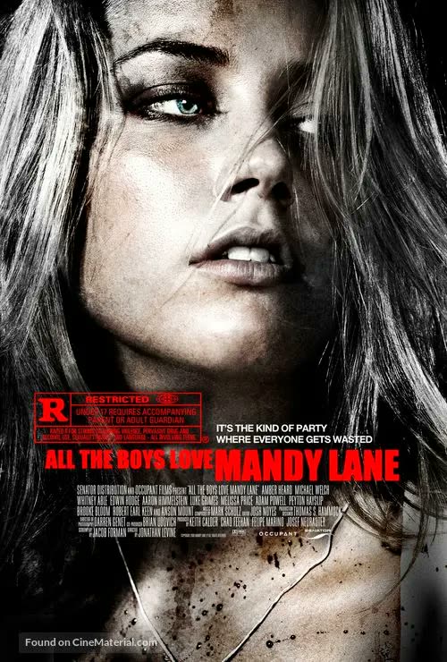
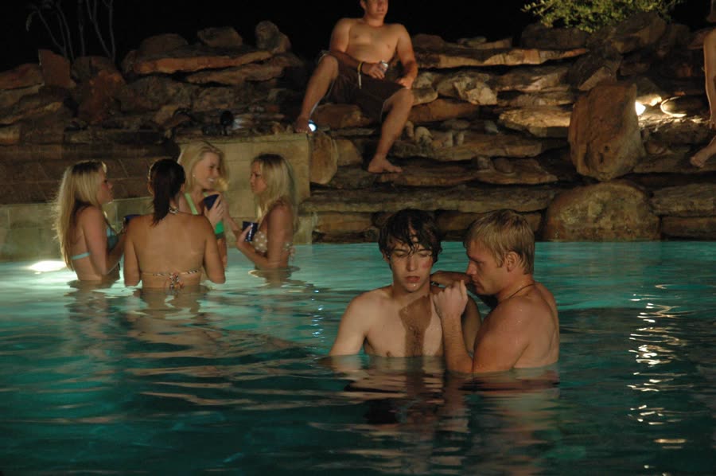
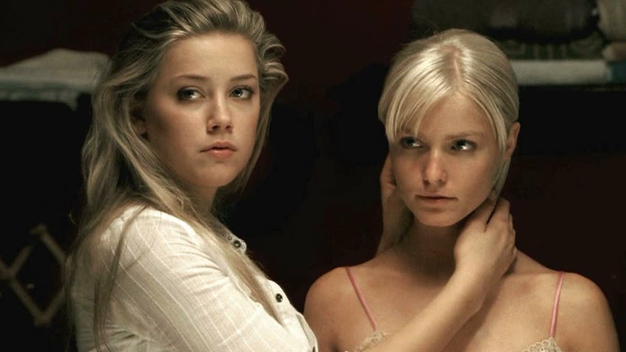
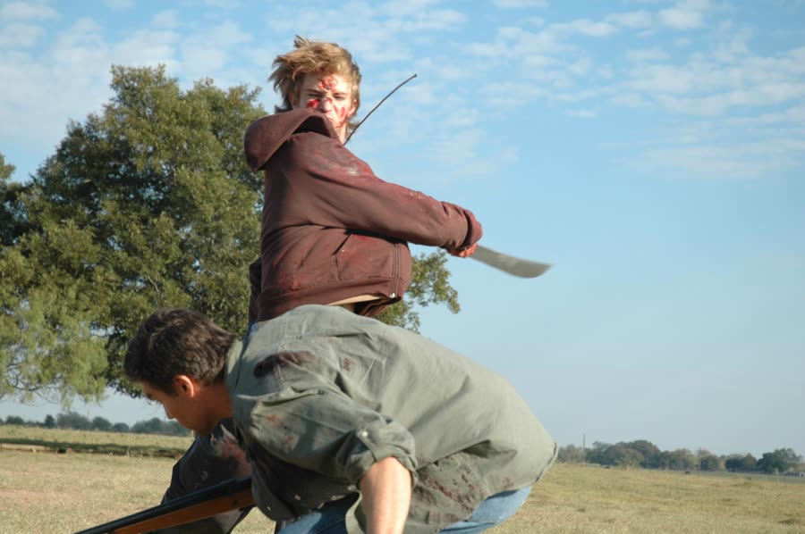
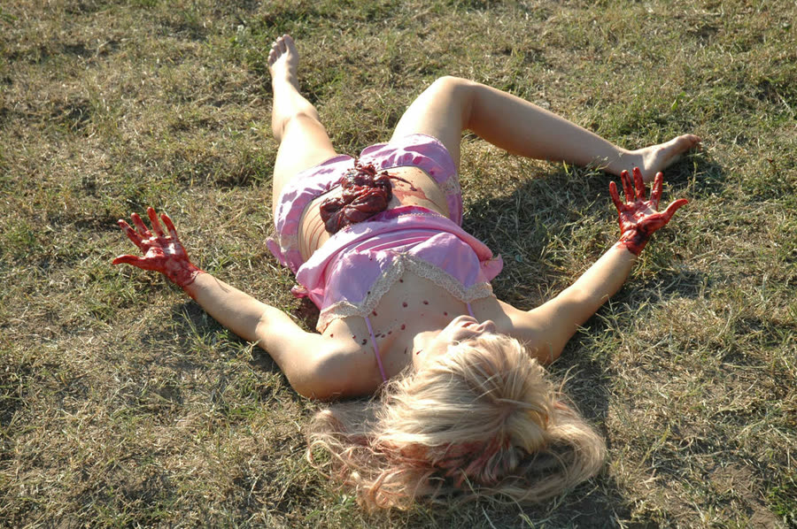
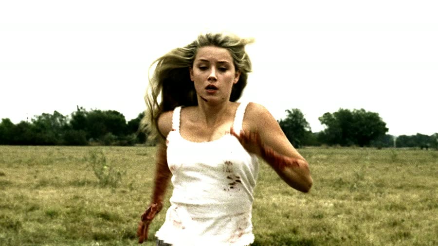
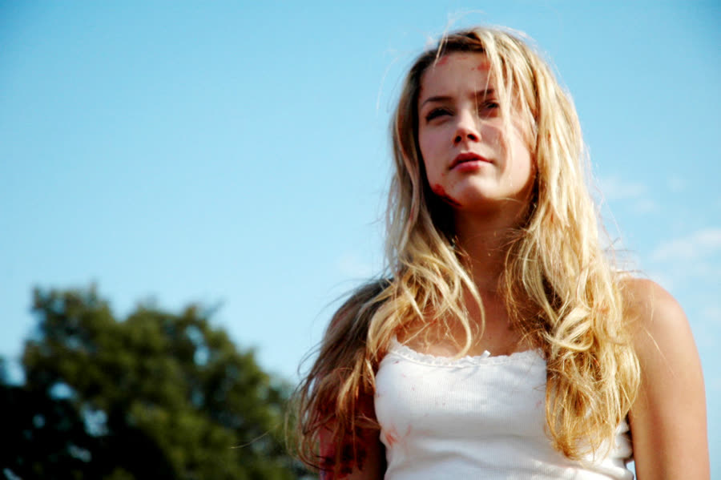
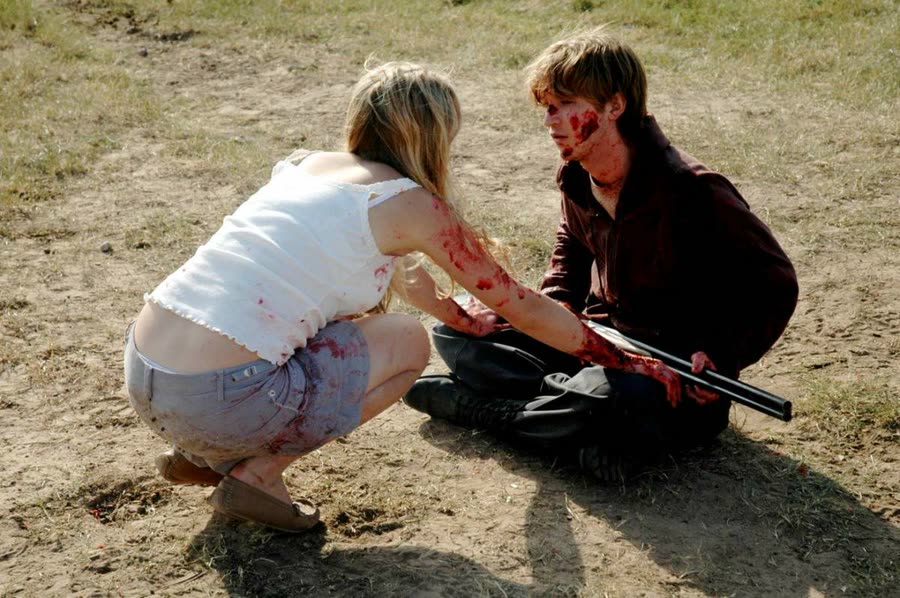

## *All the Boys Love Mandy Lane (2006)*: Loved to Death

{: style="float: right; width: 30%; margin: 0 0 1em 1.5em;"}

Some girls come back from summer break with a tan.

Mandy Lane comes back with a body that turns her entire school into a safety hazard.

*All the Boys Love Mandy Lane* is a slow-burn slasher about obsession, jealousy, and what happens when being universally admired becomes a full-time job with a body count. Mandy (a young Amber Heard, stunning before the movie even starts insisting on it) is the girl every boy wants and nobody can have — assumed to be a virgin, which only turns the wanting up. The movie's whole engine is that assumption: untouched, untouchable, and treated like a prize instead of a person.

### The Glow-Up Heard Round the School
{: style="clear: none;"}

Mandy's best friend is Emmett, and "best friend" is doing heavy lifting. Emmett trails along beside her like a minnow swimming behind a shark, hoping for scraps — the classic arrangement where he accepts the friend zone because the friend zone is at least in her orbit. One hundred percent zoned, and he knows it, and he stays anyway. Remember that. It matters.

Popular jock Dylan drives by with a car full of popular kids and invites Mandy to a party at his house. She agrees — but only if Emmett can come. Dylan is reluctant in the way a boy is reluctant when the girl he wants sets terms, and he gives in, because of course he does. Everyone gives in. That's the movie in miniature: Mandy sets a condition, and the world rearranges itself around it.

### Jump Off a Roof for Me

{: style="float: left; width: 45%; margin: 0.4em 1em 0.6em 0;"}

The party is already out of control when they arrive — music, beer, chaos — and Mandy mostly stands off to the side of it, smiling, watching, never really joining. She's not a party girl. She's an exhibit.

Emmett, meanwhile, is standing in front of a mirror in his underwear, feeling insecure next to all the jocks — which raises the fair question of why he came to a pool party with no pool clothes. Poverty is one theory. Dylan aggressively hits on Mandy; Emmett sprays him in the face with a water gun, because that always ends well, and Dylan clocks him and drags him into the pool for a beating while Mandy tells them to stop — and they stop, instantly, the second she speaks. Note that, too.

Later, Emmett is up on the roof above the pool, gathering himself, when Dylan climbs up to make peace. The peace talks deteriorate. Emmett, who has just been humiliated in front of the girl they both want, starts working on Dylan's ego instead: if you want Mandy to like you, jump. Dylan is completely, floor-is-optional drunk. And apparently roof-jumping is a legitimate dating criterion — every girl loves a guy who'll jump off a roof, do you jump off roofs, okay, you're mine — so Dylan laughs, and jumps.

He misses. Or hits wrong — either way, he surfaces floating, legs up, blood spreading around his head, and just like that the party, and two boys' lives, are over. Emmett gets pulled off the roof. Mandy watches.

### Nine Months Later, Same Obsession

{: style="float: right; width: 45%; margin: 0.4em 1em 0.6em 0;"}

Nine months pass, the way nine months pass in high school movies — a tragedy on Monday, normal programming by Friday. Mandy has been absorbed into the popular crowd, and the tragedy has only polished her image: poor Mandy, he did it *for her*. She's handled like a porcelain doll now, and the boys still stare.

Interestingly, the other girls don't aim their cattiness at her. Chloe and Marlin snipe at each other instead — Marlin shows off a new belly-button ring and Chloe goes from "you can barely see it" to flat-out calling her fat, which is a bold claim about a girl who is not fat by any stretch of anything, and doesn't take it to heart, thankfully. Maybe the girls have simply done the math: stay in Mandy's orbit and you collect the strays.

Then there's Red, who is less a character than a delivery mechanism. Red is desperate to know if Mandy's coming to the party at his father's ranch, and Red exists, functionally, because the movie needed a house in the middle of nowhere and somebody had to own it. Somebody did. It was Red's dad.

### All the High School Girls Love Garth

{: style="float: left; width: 45%; margin: 0.4em 1em 0.6em 0;"}

The group road-trips out to the ranch in two cars — isolated land, no neighbors, and one ranch hand: Garth, somewhere in his late twenties or thirties, who watches them arrive with an unease the movie very much wants you to notice.

Chloe leaves her car at the end of the long driveway to save her tires, so Mandy gives up her seat and walks the rest of the way with Bird — the group's other hopeful. Bird delivers the standard speech: everyone else wants to get with you this weekend, but he's different, not like the rest. He asks to hold her hand; she reluctantly allows it. He asks for a kiss and gets turned cheek. Then Garth rolls up in his truck offering a ride, and Bird's different-guy campaign dies on the spot, because Mandy has googly eyes like everyone else. Honestly, the movie could be retitled *All the High School Girls Love Garth, Ranch Hand* — every girl there makes eyes at the grown man on the property, which is a writing choice that gets creepier the longer you sit with it, daughter-having age especially.

At the lake, the group swims and drinks; Mandy comes back from a run and undresses to join them; and Garth shoots a water snake headed their way. Mood killed, safety restored, ominous ranch hand stock up another point.

### Truth or Dare

{: style="float: right; width: 45%; margin: 0.4em 1em 0.6em 0;"}

Back at the house, a drinking-game version of truth or dare produces the night's first casualty: pride. Asked who has the smallest penis in the group, Marlin points at Jake — and so does Chloe. Jake, whose other contribution to the evening is claiming he's slept with a girl in every state he's visited and is up to forty (in reality terms: one — not one per state, just one), storms off. Marlin follows him to the barn and offers comfort of a very specific kind. He accepts, declines to return the favor, and walks away whistling while she screams names at his back.

Alone, scared, she starts to leave — and gets knocked over the head.

What happens to Marlin in that barn is the movie announcing it has a mean streak after all. A shotgun barrel is forced into her mouth and driven down until her jaw cracks open and hangs off to the side, and she's left slumped by the pond, barely alive, for Jake to find later. It's the film's signature gore moment, and it lands: nasty, lingering, and far uglier than anything the slow first half promised.

### A Generator, a Truck, and a Reveal at Halftime

{: style="float: left; width: 45%; margin: 0.4em 1em 0.6em 0;"}

Jake returns to the house; the power goes out; Red sends Bird out to start the generator. The generator, it should be said, sits roughly a mile from the house and up against a tree, which is a fascinating place to keep a generator — unless what you actually need is a teenage boy alone in the dark, far from help, which is exactly what the movie needs. Out there, Garth materializes like a jump scare with a chore list and points out the generator was never going to work: the house runs on the grid, somebody cut the power, and did anyone check the breaker box? Bird storms back furious at Red. There is a great deal of pissedness in this stretch of the film.

Jake, rejected by Mandy — because Jake also takes his turn propositioning her — responds logically: whiskey, a shotgun, the truck keys, and stripping down to his underwear to go find Marlin, who is easy, instead. He finds her slumped at the pond, yells her name, offers her a drink, gets no answer, and then sees her ruined face. He freaks and goes into the water.

And the man with the rifle steps out. It's Emmett. No speech, no monologue — Jake gets shot in the water, boom, done.

Which is *early*. The reveal lands around the halfway mark, and the first reaction is disbelief — it can't be Emmett, not because it doesn't fit (the friend-zoned shadow, the roof, of course it's Emmett) but because why show it this soon? The hooded figure's hair even invites other theories along the way — long enough to wonder about Garth, or about Dylan, who the movie never actually confirmed dead on screen. A Dylan who'd spent nine months laid up, unvisited, with a grievance? There's a story there the film leaves on the table.

Bird gets his proof in person. After a mysterious truck — assumed to be Jake's — shoots fireworks at the house, Bird runs it down on foot, somehow, and finds a blood-covered Emmett inside, taunting him. Bird drags him out and beats him down, demanding to know how he could kill people — and Emmett slashes him across the eyes, a rough-looking cut, then stabs him to death on the ground while he tries to crawl away.

### Blood in the Hair, Gone by Morning

{: style="float: right; width: 45%; margin: 0.4em 1em 0.6em 0;"}

Chloe, who earlier did some coke, saw a figure outside, and went upstairs to trim what Marlin had called a forest down there — high school cruelty is thorough — has a genuinely sweet bonding scene with Mandy, who comforts her about her looks. Chloe also slips Mandy pills, which becomes important: Mandy is trying to stay awake.

It doesn't entirely work. In the kitchen, Garth comes in to clean his rifle and their eyes keep meeting, the movie still nudging its red herring even though the audience already knows better. Mandy finally sleeps at the table — and while she's out, Emmett comes in, strokes her hair, and talks to her, leaving her hair full of blood. Garth wakes everyone at sunrise, sees the blood, and says they have to leave now. Except that one hallway later, the blood is simply gone. Hair: washed, dried, styled, continuity be damned.

Garth gets shot in the arm as they're leaving. Chloe and Red run for Chloe's car — the one parked a mile away at the end of the driveway, except when it isn't — and on the dirt track they find the bodies of Jake and Marlin. Chloe screams. Red comforts her. And then, surrounded by their dead friends, they lean in and kiss, because death makes you horny, apparently — if Friday the 13th taught anything, it's that stopping for that kiss is how you die. Emmett shoots Red mid-moment. Lesson delivered.

### The Hug

{: style="float: left; width: 45%; margin: 0.4em 1em 0.6em 0;"}

Garth sends Mandy to his cabin for his truck keys. There she finds a bloody knife and picks it up — keep that in mind — then sees Chloe being chased by a figure in a car. Mandy signals her over. They embrace. Everything's going to be okay.

Chloe steps back with her eyes huge. The knife is in her abdomen. *Mandy* put it there.

And the whole movie rotates. Mandy and Emmett greet each other like colleagues clocking out: this was their plan all along — kill the popular kids, stage a murder-suicide, and frame Garth for all of it. The final piece is the pills. Emmett gives Mandy a set he's kept for her; the arrangement is that she takes them, and shoots him in the heart, and it all points at the ranch hand.

Mandy holds the pills, looks at them, and dumps them out. She would never do that. Whatever Emmett thought they were to each other, she has decided otherwise — possibly around the time a certain ranch hand entered the picture.

She calls out to Garth, who appears and shoots Emmett — and Emmett, because killers in these movies run on different physics than their victims (one crack of a jaw kills Marlin; Emmett absorbs bullets and knives like a subscription), lunges and stabs Garth anyway. Mandy stabs Emmett. Emmett gets up *again* and chases her, and the fight ends in a mud pit full of dead cows — a Dead Cowpool, if you will — where she finally overpowers and kills the boy who trailed her like a minnow all those years.

Garth, miraculously, is still alive. Mandy gets him to a car, and as they drive away from the ranch, he thanks her for saving his life. Sure. That's one way to describe the weekend.

### The Verdict

Talon gives *All the Boys Love Mandy Lane* **3 to 3½ cents out of 10**.

It is a slow burn — she'll grant that slow burns are allowed — but this one drags in a way that isn't tense, just long; halfway through, the main question was how much time was left in this fucking movie. The gore, when it comes, is genuinely good — the jaw, the eyes — and the twist she half-saw coming (of course Emmett was involved; the reveal still felt too early) before the real surprise, Mandy turning on Emmett, which she did not expect. Against that: continuity that waves goodbye (blood in the hair, gone by the hallway), logic gaps, and a pace that made her relieved when it ended. The acting is fine throughout. She considered a second watch to catch what she'd missed and decided she couldn't get through it again — and since Lake Mungo, a good drama wearing a horror costume, got four cents from her, this one can't go higher.

Dan gives *All the Boys Love Mandy Lane* **5 cents out of 10**.

He liked it — enjoyed it, even — while being clear it's a watch-once movie: for a physical-media collector stocking up against the death of physical media, this one doesn't make the shelf. The acting wasn't terrible, the kills commit, and the bones of a good slasher are there. His complaints are about the writing around the edges: the girls' collective crush on Garth reads creepy no matter the context, Emmett's reveal comes too early, and Dylan would simply have been the better killer — nine months laid up, never visited, "you moved on without me" — a motive with a story attached instead of the obvious friend-zone answer. What we got is what we got, and what we got is a five.

Worth watching if you enjoy: slow-burn slashers that save their mean streak for the second half, gore that commits to a broken jaw and a pair of ruined eyes, a twist that turns the title into a threat, and a ranch weekend where the most dangerous thing there isn't the grown man with the rifle — it's the girl everyone came for.

**Stuff we use / support the show:**
- Own it on physical media via [Gruv](https://www.tkqlhce.com/click-101633208-15032169)
- Watch with [Plex](https://www.kqzyfj.com/click-101633208-15734677)
- We record this show with [Riverside](https://riverside.sjv.io/4aR7A9)
