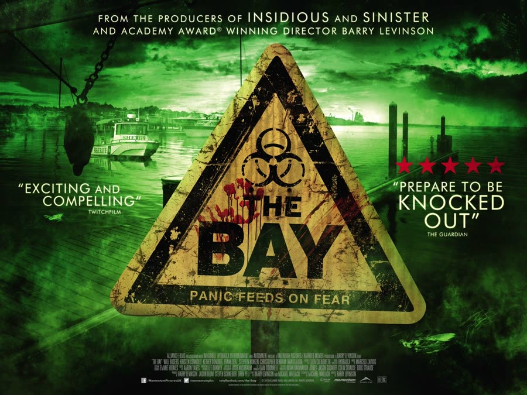
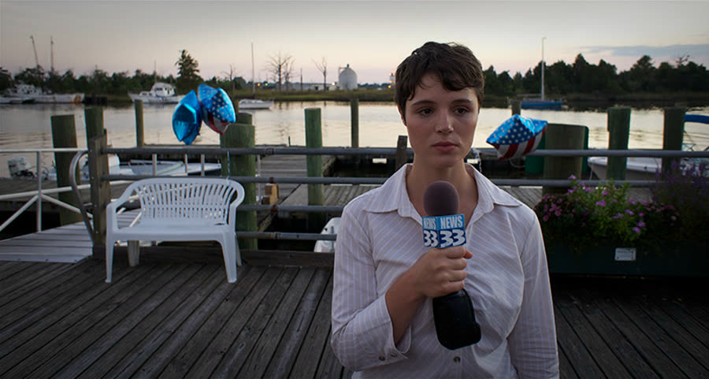
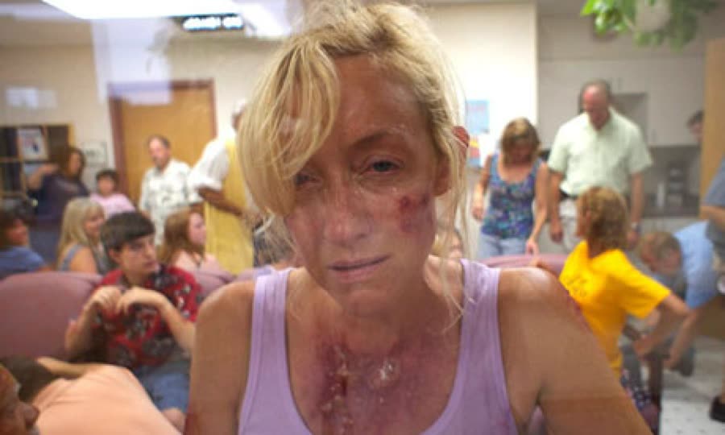
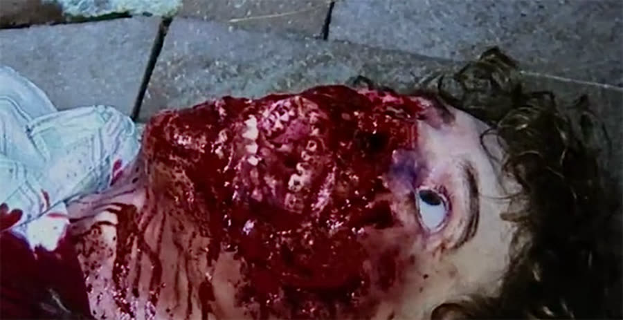
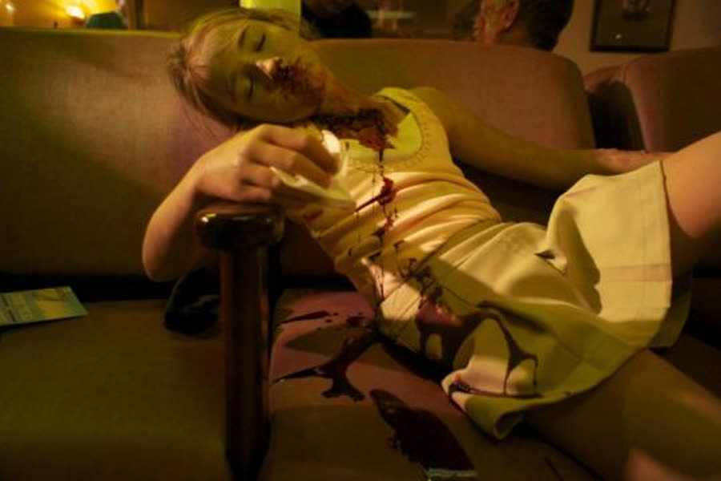
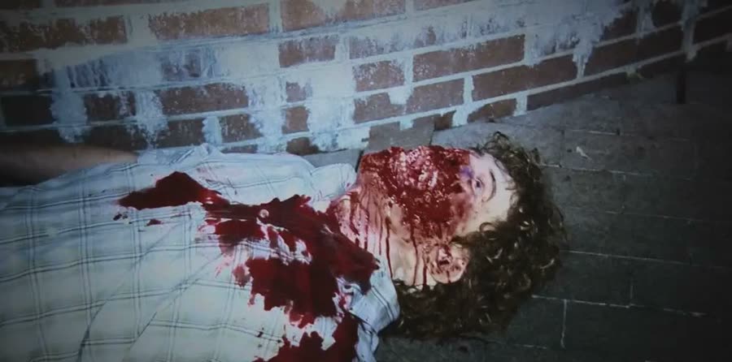

## *The Bay (2012)*: Everything Is Fine, Says the Mayor

{: style="float: right; width: 30%; margin: 0 0 1em 1.5em;"}

Some horror movies open with a monster.

This one opens with the local news: millions of fish washing up dead, blackbirds dropping out of the sky, crabs crawling ashore to die. A lot of that montage looks like real news footage, because events like it really happened — which is the movie's whole trick. A title card explains that the incidents were covered by the media, but this story has never been told. Then the footage turns shaky and chaotic — appropriate for a *You Make Me Sick* pick, since the camera work alone nearly manages it.

### The Story That Was Never Told
{: style="clear: none;"}

{: style="float: left; width: 45%; margin: 0.4em 1em 0.6em 0;"}

Everything is framed by Donna Thompson, nervously telling the story on a video call years later, half-convinced something will happen to her for talking, and unable to live with staying quiet.

Donna grew up in Claridge, Maryland, and started her career there as an intern — a terrible one. The old footage shows her getting names wrong, getting facts wrong, and asking the bald mayor whether his hair dries fast. (It does.) Mayor Stockman, an ex-vacuum salesman, will matter later: Donna notes, only in hindsight, how culpable he was in everything. She also has a narrator's habit of spoiling people as she introduces them — this is the doctor, he treated hundreds of patients, he died that night. Thanks, Donna.

And her tongue keeps doing something strange through the whole interview, slipping out at odd moments. In a movie where tongues start going missing, that feels less like a quirk and more like foreshadowing.

### Brackish

The first signs came six weeks earlier, when two oceanographers studying bay pollution disappeared and were found dead of unknown causes, their injuries chalked up to shark bites. The water is *brackish* — a word this movie says so often it should be a drinking game — and bull sharks do come up into brackish water, so everyone nods and moves on.

The oceanographers' footage tells the real story: alarming toxins, runoff from the local chicken plants, tens of thousands of tons (or pounds — the exact number is its own argument) of chicken waste feeding the bay, riding the currents straight toward Claridge. At a town meeting, one furious resident shouts about the dumping while a neighbor pushes back: everyone's kids grew up swimming in this bay and they're fine. Right. Nothing to worry about just because Jimmy has three fingers growing out of his forehead now — that nuclear waste went in five years ago. Move on.

The mayor's answer is the desalination plant, which pulls bay water, removes the salt, and makes it drinkable. Everyone simply assumed the filters also removed the bad stuff.

That was wrong to assume.

### Everything Is Fine

{: style="float: left; width: 45%; margin: 0.4em 1em 0.6em 0;"}

Claridge's Fourth of July is pure postcard — until a bleeding woman stumbles into the street screaming for help, for her husband, for anyone to take her to the hospital, and the crowd backs away from her like she's the toxic-waste guy from *RoboCop*. At the pool by the bay, kids start screaming, covered in huge welts and boils. At the crab-eating contest, one person throws up, and then everybody throws up — whether from sickness or sympathy is left as an exercise, but it's pure *Stand By Me* either way.

Dr. Jack Abrams calls the CDC having already seen thirty patients with the same symptoms. The CDC runs a screening checklist — sun exposure, livestock contact — while the town falls apart around him. Nobody at any doctor's appointment has ever been asked about livestock, but fine. By 12:42 p.m., the police are looking at the first death.

Meanwhile, Stephanie and Alex — she's a lawyer now, he's a dentist, they have a baby — are sailing the seven hours from Wilmington to Claridge for the fireworks, filming everything. And a young girl FaceTimes her friend to show off the blisters covering her body. She's been trying to reach her parents. Their phones go straight to voicemail. According to her, her parents saw what was happening and left. Without her.

### Something Eating In, Something Eating Out

{: style="float: right; width: 45%; margin: 0.4em 1em 0.6em 0;"}

The oceanographers scope inside an infected fish's mouth and find parasite larvae like nothing they've ever seen. The video gets sent to the mayor. The mayor never responds. Their other discovery: fish with their tongues simply gone. That part, horrifyingly, is real biology — a genuine parasite enters through a fish's gills, eats its tongue, and then *lives in its place*, the fish using the parasite as a replacement tongue. Nature wrote this monster; the movie just scaled it up.

Her partner, meanwhile, spends the collapse of the ecosystem correcting her pronunciation. She says "mutilated" with a French accent; he mocks it, repeatedly, like he's cutting a blooper reel instead of documenting a dying bay. It is very easy to root for his death, and the movie eventually obliges.

On land, the attacks get misread as murders — bodies with their guts open and tongues missing, the local news confidently inventing connections to fill airtime. Dr. Abrams sends the CDC a video of a patient's ruined leg and lays out the shape of it: something is eating its way in from the outside while something else eats its way out from the inside. Mayor Stockman goes on the radio to calm everyone down — warm weather increases bacterial growth, some rashes, some digestive issues, stop spreading rumors. Off air, he admits he has no idea what's happening. He's been busy with his re-election campaign. His slogan writes itself: vote for me, and you get to keep your tongue.

The movie's one honest jump scare belongs to a fisherman six miles out, who thumb-hooks his catch — and something like a scarab explodes out of the fish's mouth, up his arm, and bites him before vanishing over the side. Nobody was ready. It wasn't even the worst water that day: two teenagers at a dock film the girl getting "stung," then dragged under, her boyfriend jumping in after her, the footage stuttering in and out through the splashing and blood. A twelve-year-old later found the phone on the beach. The bodies were never recovered.

### The D-Minus Is Passing

Alex, horsing around on the boat, gets pushed into the water by Stephanie — and comes up saying he swallowed something. He shrugs it off. He should not have shrugged it off. The oceanographers conclude that forty percent of the bay is dead. The male half of the team opens a fish he has decided is ground zero — all the fish in the sea, and he finds the one it started with — to reveal a giant isopod eating it alive from inside.

Stephanie's mother leaves a voicemail Stephanie will never hear: her father is sick, they may amputate his leg, don't get off the boat. Her mother has welts on her own back and doesn't think she's going to make it. Stephanie sails on anyway — the phones don't work, and nobody can warn anybody.

Up the chain, the CDC presses the EPA and gets a tour of American shrugging: pollutants, industrial runoff, chicken waste, algae — and, by the way, a nuclear plant leaked in 2002. They didn't expect it to reach the bay until 2014, so why prepare? This is way too early; nobody is ready. Why was no one warned? Testing for radioactivity is not their job. The filtered water meets regulatory standards, and the town's drinking-water report card — an actual grade, shown on screen — is a D-minus. Which is passing. You can get into college with a D-minus.

On the bridge out of town, traffic sits honking and panicking. Nobody ever got off that bridge; it stayed shut for three days, and Donna could never find out who shut it down. What she does find: the FBI told her editor nothing about Claridge could be published, because it might create undue fear and panic. A government deciding the public is better off not knowing — a playbook that would get a much bigger workout about a decade later.

### Shoot Me

{: style="float: right; width: 45%; margin: 0.4em 1em 0.6em 0;"}

Donna, down at the docks with her cameraman Jim, hears moaning coming from everywhere at once — far away, overlapping, ghost-like — and drops her microphone where she stands.

Two deputies answer a call at a house full of screams. Deputy Jim goes in while his partner waits in the car. Not beside the car. In it. Still buckled in, in case readiness is contagious. Shots ring out, and the second deputy finally unbuckles and approaches at the speed of a man approaching a beehive he has personally insulted. Inside are people bleeding everywhere, begging to be shot — muffled, because they don't have tongues. Then one of them is *on* the deputy, and it bites him, and the shooting starts again, including the shot nobody meant to fire.

The oceanographers dive back in and land on the bay floor among dead fish being grazed on by full-grown isopods. Then the isopods notice them. This is how they die: swarmed, in the dark, in the water they were trying to save.

Donna and Jim check a restaurant where music is playing over the moaning and find a puddle of blood. Donna crouches — and blood drips down onto her face from a dead woman slung over the edge of the roof above her. At the hospital, the CDC tells Dr. Abrams to evacuate and leave, now; his staff already went twenty minutes ago. The man on the phone stops pretending: it isn't a bacteria. Once it's in your body, you're done. Abrams, who has spent the day amputating legs, feet, and arms, refuses to abandon the patients screaming in his halls.

Sheriff Lee drives the mayor around instead — the mayor who told the governor *not* to declare a state of emergency, because not everyone is sick. Susie's fine. Five people may be fine; the rest of the town is dying. At a fountain, Donna and Jim find a body with its mouth eaten away — and one eye snaps open. That was the last thing they filmed that night.

### Get Me the White House

{: style="float: left; width: 45%; margin: 0.4em 1em 0.6em 0;"}

The CDC finally gets its explanation from a marine biologist: the chicken waste in the bay is loaded with the steroids fed to chickens to grow them faster — and steroids make isopods grow five, ten, fifteen times bigger, faster, and in greater numbers. Roid rage, but make it marine biology. The call ends with a request to get the White House on the line — which raises the fair question of what the White House is supposed to do about it.

Lee and the mayor find Deputy Jim wandering, covered in welts, repeating "just go — we're all going to die." Lee tries to talk him into the car, into a hospital. Jim shoots the sheriff — somebody had to say it — and then himself. The mayor takes the wheel, drives lights-and-sirens through streets full of bodies, blows straight past a living survivor trying to flag him down, and T-bones another car at an intersection. The caption is the movie's driest joke: he died of injuries that were potentially preventable, but no emergency services were available.

Stephanie and Alex reach a deserted Claridge after dark. In an empty store, they Skype a friend — Bill, because every doomed town has a Bill, and Bill is a good guy — who leans toward his camera and asks what's on Alex's neck. The boils are already there. Hours later Alex is doubled over, begging Stephanie to end it with a fireplace poker. She refuses. Something else ends it: an adult isopod tears out of his neck just before one in the morning. The larvae he swallowed on the boat ride grew to full size inside him in eight hours. That is a *lot* of steroids.

Dr. Abrams' last footage is of himself, alone in a dead hospital, rash spreading across his chest, recording in the hope that someone will someday find it and get it out. Nobody came. Not the CDC, not FEMA — and when Homeland Security finally talks to the CDC, the reason surfaces: the medical examiner's report on those two oceanographers bounced from Homeland Security to FEMA to the Coast Guard to the CDC and took *sixteen days* to arrive. A whole town is dead over a small incident in a small town, and the perspective offered is that you can't shut down the Eastern Seaboard over it. Tourism. Restaurants. Panic. Be careful, though — the water might be brackish.

Stephanie makes her run for it with the baby, gets into a police car, and finds a woman in the back seat — face destroyed, moaning what might be "help me" — who lunges at her. Stephanie slams the woman's head into the dashboard until she stops, then scrambles for the baby as isopods pour out of the dead woman's mouth, inches from the car seat. Whether any reached the baby, the movie refuses to say.

Five hours later, hazmat teams arrive. The town is quarantined for three days. To kill the isopods, they dump massive amounts of chlorine into the Chesapeake Bay — a cure that can't have done the surviving ecosystem any favors. The footage is confiscated. The town takes a financial settlement from the government, and part of the deal is silence. Stephanie refuses to be part of the story. And the official cause of everything — the dead fish, the tongueless bodies, the emptied town — is announced to the world: unreasonably high water temperatures.

### The Verdict

Dan gives *The Bay* **3 cents out of 10**. It could have been much shorter: the movie repeats itself and over-explains everything until the point arrives late and pre-chewed. He could not stand Donna — a long sit when she's the one framing the whole story — and this was the hardest movie yet to pull anything funny out of. He would not watch it again.

Talon gives *The Bay* **four and a half to five cents out of 10**. It wasn't awful and it wasn't great; it was okay, and she wouldn't rewatch it either. What lifts it for her is how close it sits to a possible reality: the real Chesapeake Bay has real runoff problems and a real dead zone, the tongue-replacing parasite is a real animal, and Barry Levinson builds it to feel like something that could have happened and then been filed away. The shaky footage is jarring, the repetition pads it out, but the fisherman jump scare got her honestly, and the Stephanie-and-Alex ending — the store, the car, the woman in the back seat — landed. Her standing PSA, free of charge: do not swim in the Chesapeake Bay. It is brackish.

Worth watching if you enjoy: found footage with a body count and a paper trail, mayors who would absolutely let the shark win, and learning the word "brackish" in every conceivable context.

**Stuff we use / support the show:**
- Own it on physical media via [Gruv](https://www.tkqlhce.com/click-101633208-15032169)
- Watch with [Plex](https://www.kqzyfj.com/click-101633208-15734677)
- We record this show with [Riverside](https://riverside.sjv.io/4aR7A9)
