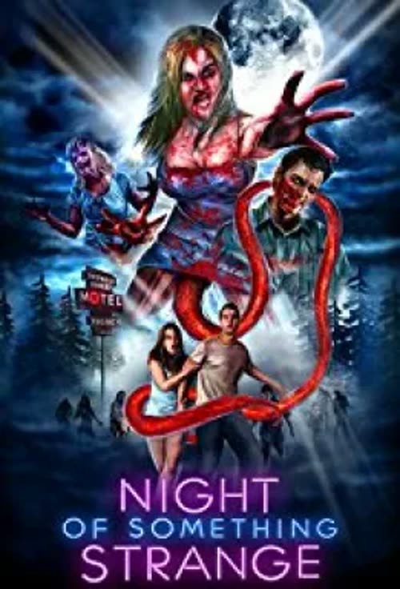
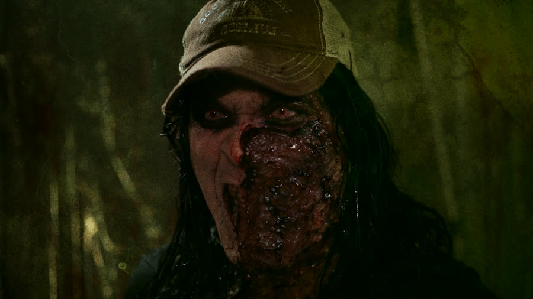
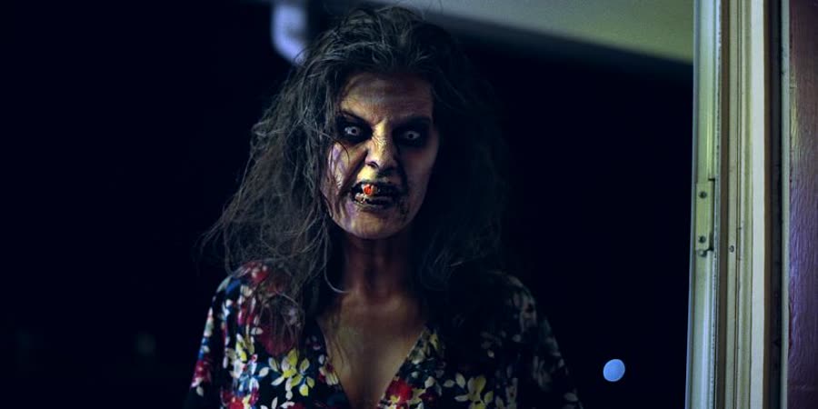
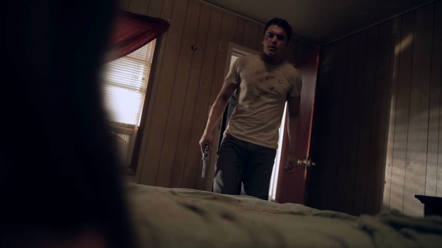

## *The Night of Something Strange (2016)*: Protection Wouldn't Have Helped

{: style="float: right; width: 30%; margin: 0 0 1em 1.5em;"}

Some movies ease you in. This one starts in a morgue, with a mop bucket, and immediately makes a decision so foul the rest of the film has nowhere to go but down. It belongs to a theme month called You Make Me Sick — disease, infection, bodily horror — and this movie heard that brief as a personal challenge.

### Patient Zero Has a Mop
{: style="clear: none;"}

A janitor mopping a morgue finds two bodies laid out side by side. He pulls back the woman's sheet. Her toe tag mentions a radiation leak and possibly an STD, and neither warning slows him down for a second: he assaults the corpse with the dead man lying right beside them.

The janitor is Cornelius, and the infection works fast. Cut to sausages cooking — subtlety is not on the menu at any point — while a woman who may be his girlfriend, wife, or mother, and is never explained, calls him to dinner. Cornelius is in bed writhing, doubled over, sick in a way that first reads as dying. Then he is standing on the bed urinating all over the pillow, red-eyed and snarling, fully turned.

She fights him off with an alarm clock and stabs him in the shoulder — then makes the classic mistake of walking over to check on him. He springs up, attacks her again, and kills her by pulling out an organ and eating it, a moment this post will describe exactly once. Then he removes the knife from his own shoulder and wanders into the night.

A truck hits him. The two men inside debate whether they hit a bear, a man, or a man-bear; the jokes throughout land like furniture dropped down a stairwell. Cornelius hauls himself into the truck bed, under a tarp that was underneath him a moment ago, roars back to life — and only then does the title finally appear.

### Names Stolen From Better Movies

Christine's journal narration introduces the real cast in a high school classroom, and the names give the game away immediately: Christine, her best friend Carrie, her boyfriend Freddie, and Jason, her half-cousin, who still tries to get with her. There is also Brooklyn, who is from New York, has the drugs, and is only coming because of his girlfriend Samara, who appears at a locker for five seconds, announces she is not going, and storms out of the movie entirely.

Christine does not seem to like most of these people, but it is beach week, and they are leaving directly from school with no bags and no plan — honestly the most believable teenager behavior in the film.

Freddie makes a protein joke that should have earned a trip to the office; the teacher barely reacts. The classroom sits in total, ambient-noise-free silence while Christine delivers an entire monologue before the bell. These are some of the worst school scenes ever filmed, in a competitive category: *Fever Lake*, a movie this show has mocked for months, is a masterpiece next to this. Fever Lake had craft. Fever Lake had music.

Outside, tough guy Dirk arrives in a muscle car while the soundtrack announces he is a mean one. He texts Pam, who asks to be excused and leaves school with him instead. Two storylines set out: Christine's car full of people she tolerates, and Dirk and Pam, in a parallel track of cheating, pit stops, and relentless urination.

### The Bathroom Is Ground Zero

{: style="float: left; width: 45%; margin: 0.4em 1em 0.6em 0;"}

Back at the trailer, the woman Cornelius killed is up and moving. A mailman knocks and gets punched through the chest — then she lets blood drip into his mouth, because this infection does not travel by anything as dignified as a bite. Bodily fluids are the entire transmission system, every fluid, every combination, and the movie will not let one go to waste.

Dirk and Pam stop at a gas station run by a chain-smoking clerk who looks halfway undead before anything has happened to her. The truck drivers pull in too; one calmly loads his jacket with stolen beer while the clerk smokes and reads. Pam goes in for the bathroom key, and the camera, from inside the toilet, watches her drop in a used tampon. Remember the tampon. The movie will.

Cornelius — stabbed, truck-hit, undead — arrives at the same gas station and politely uses that bathroom like a man with business to attend to. He vomits blood into the toilet, urinates blood, fishes the tampon out, smells it, chews it, and spits it out. This is precisely the scene that ended a previous attempt at this movie years before the podcast: everything before it was a struggle, and the tampon was the last straw.

Christine's group arrives. Carrie asks for the key, survives a long unhinged lecture about never flushing tampons, and finds the toilet still full of Cornelius's blood and vomit, with no toilet paper. She hovers. She slips. She sits in it. That is her infection scene — no bite, no attack, just a catastrophic slip in the worst bathroom in Virginia. Outside, Freddie drops his pants to fart in the sleeping Brooklyn's face and accidentally does considerably worse. Brown liquid is involved. Nobody's day is improving.

### Spring Break, Motel Hell

Carrie feels sick almost immediately and throws up on Brooklyn in the car; Brooklyn throws up in sympathy. Cornelius watches from the woods — having somehow beaten a car full of teenagers there again — touching himself, again. He has a tell, a head-tilting, eyes-rolling maneuver that announces it every time. Lucky us.

The group abandons the beach for a motel, under a buzzing sign the camera admires for five or six excruciating seconds: that sign is where this movie spent its entire ambient sound budget. The lobby, meanwhile, suggests an entirely different horror movie is hiding inside it. It is. Hold that thought.

Freddie and Jason ask for two rooms. The innkeeper establishes that they are not gay and sells them, in his words, two non-gay rooms. He also offers what sounds very much like "do you want to lick my balls?" and is apparently "do you want a wake-up call?" That is the joke. That is the whole joke.

On the way out, Jason glances into a room off the lobby and gets a peek at whatever lives back there: a kid in a clown mask, playing with an older woman who could be a sister, could be a mother, in a room that belongs in an entirely different horror movie. Nobody explains it. Nobody even comments on it. File it away — this motel is running two pictures at once, and the second one is waiting its turn.

Dirk and Pam are at the same motel, because this motel has gravity. Their enthusiastic encounter — he has just found another man's enormous photo evidence on her phone — ends with a bloody condom flicking blood into Dirk's eye. "We've done this before," she says. "Not with me," he answers, doing the math.

Jason is voted out of the room so Freddie can be alone with Carrie, and negotiates down to sleeping in the car. Carrie, smelling of vomit and corn dogs, rejects Freddie's blue-balls speech and throws him out. He goes to the dumpster, drops his pants, knocks himself unconscious on its edge mid-activity, and lies there for the rest of the night. The innkeeper's parting wisdom, delivered by headlight: if you shake it more than three times, you're playing with it.

### Everybody Ends Up at the Motel

{: style="float: left; width: 45%; margin: 0.4em 1em 0.6em 0;"}

One stop back at the convenience store explains the clerk. After everyone left, she put out her cigarette and lit another one — smoking in the store, indoors, in 2016, decades after that stopped being legal anywhere, and entirely unbothered. Putting away a can, she turned and found the mailman behind her: the same mailman from the trailer, chest-punched and blood-fed, now fully turned. The movie shows it twice at once, color footage and black-and-white security feed at the identical angle, an arty little flourish in a film that has earned no others. He knocked her down and came at her slow while she crawled away across the store floor — still smoking. She would not put out that cigarette to save her own life, literally. He fell on her and assaulted her, because that is how this infection books its travel, and that is how the clerk joined the cast of the turned.

So when the clerk — fully turned, still smoking — smashes through the car window at Jason, it is not a random arrival. who escapes into Carrie's room and chains the door. Carrie is in there looking rough, and she skips zombie small talk entirely: she demands he sleep with her, and the thrilled virgin complies. Mid-act she sits up with red eyes and bites his nipple off, then his chin.

Dirk storms out on Pam over the phone, delivering the funniest line in the movie — "I've had better sex in boot camp," a comeback whose implications he does not examine — while Cornelius slips in behind him, smashes Pam with a heavy tube television, and finishes her with a bite this post is declining to map. Outside, the innkeeper brooms the bloody condom off Dirk's back and flings it toward the dumpster, where it lands on the unconscious Freddie's face. Freddie wakes, never notices, and resumes exactly what he was doing.

Then comes the film's longest sustained mistake. Freddie enters what he believes is Carrie's room, finds a body in the dark, and climbs in. It is Jason. Carrie is simply gone — people, keys, and condoms teleport constantly in this movie, and nobody on set kept a list. In darkness, Freddie rationalizes his way through a different body shape, different hair, and anatomical discoveries that should have ended things in seconds, up to and including what he decides are two of something there is usually one of. The scene runs far too long, and the two of them end up physically stuck together for the rest of the film.

The zombie clerk breaks in — through the door two different people have locked and chained, a door that locks from whichever side the plot needs — chokes Freddie while smoking, and produces a cloud of green gas from below the waist like a smoke machine. Freddie stabs her with a bedside lamp and electrocutes her. A lamp, used as a sword.

### Shoot Them Where It Hurts

Christine's soda machine eats her money; Dirk hits it, a soda drops, and the two flirt for what feels like forty-five minutes while the movie burns down. Carrie interrupts — screaming, blood running down her leg, fully turned. Dirk punches her down; she pops back up and knocks the keys from his hand, and the keys end up under the car, despite him having been inside the car, which has a floor, when he dropped them. Continuity did not drop the ball in this film. Continuity was never issued a ball.

Dirk shoots Carrie. She stays down, briefly. Cornelius drags Dirk from the car and urinates on him at length — after which Dirk climbs back in completely dry, not a drop on him. Christine shoots Cornelius before things escalate, throws the gun away the way movie people insist on doing, and calls the police: her friend tried to kill her and may have eaten something, or be on her period. She is the only person in the film who ever calls these things zombies, once, near the end, to a cop who is not listening.

Because here is the discovery the third act hangs on: the groin is this infection's kryptonite. Dirk kicks Cornelius there repeatedly and it works. Christine kicks Carrie there and her shoe gets stuck inside her; Carrie pulls it out and throws it back. The police arrive; the cop draws on Christine instead of listening, and Cornelius appears behind him, finishing in a jet of fluid that turns out to be acidic and eats the cop alive. Freddie, still attached to the now-reanimated Jason, gets dragged through a doorway and broken in half at the frame — knees bend, bodies fold, it did not have to go that way, but this movie always chooses the way it goes. Cornelius's mother, unseen for most of the film, materializes on top of the car and kills Brooklyn with a part of her anatomy that also breathes green mist. The innkeeper saves Christine from the mailman with a shovel — then knocks her out with it.

### The Innkeeper's Family Dinner

{: style="float: left; width: 45%; margin: 0.4em 1em 0.6em 0;"}

Remember the other horror movie hiding in the lobby? Here it is. Christine wakes in a plastic-sheeted room, Dexter by way of a family reunion, duct-taped to a table across from Dirk. The innkeeper sits at a dinner table with his family — the clown-mask kid from the lobby, a young woman who may be a daughter or a wife and communicates in sounds nobody can parse — eating an ear cut from a rotting head while everyone laughs. Fresh meat has arrived. The film pivots, without warning or apology, into a backwoods cannibal picture, and the *Texas Chainsaw* energy is not subtle.

Cornelius, of all people, saves them: he bursts in, rips out the innkeeper's throat, and punches the clown kid. Dirk — freed somehow — tells Christine to shoot Cornelius in the brain. She does. Nothing. "The other brain," Dirk clarifies, wasting precious seconds on a punchline, and Christine shoots Cornelius in the testicles. One falls out. Cornelius goes down.

Jason and the clerk attack them in the car before they can leave. A metal pipe falls out of the sky between them — not off a truck, not from a balcony, out of the sky. Dirk beats Jason in the chest with it, over and over, knowing perfectly well where the killing spot is, before finally stabbing him there. Christine kills the clerk by reaching inside her and pulling out her ovaries, which are enormous, have mouths, and look like angry cherries. "Let's check the fuck out," Dirk declares, and they drive off over the fallen ovaries.

Morning. A sunrise field, two filthy survivors holding hands. They kiss — romantic, given both look like that gas station toilet — and Christine checks the mirror: her lips have erupted. Super herpes, transferred by the kiss. Dirk suggests he might be immune. A car hits her and throws buckets of blood over him. The truck drivers from the opening return — the one thread this movie ties off — finish the reanimated Christine with a shot to the groin, and offer Dirk a ride. He delivers a hero speech about Googling "hero" and finding his own name, and an ambulance plows into him mid-sentence. Credits roll over bloopers of a cast having an absolute blast — without competition, the best footage in the movie.

### The Verdict

Talon gives *The Night of Something Strange* **0 cents out of 10**. She asked whether negative numbers were available — negative ten was proposed, along with the suggestion that the filmmakers should be paying her. The formal score stands at zero, and the case is thorough: bad story, bad directing, continuity so broken that people, keys, doors, and roommates teleport between shots, no music, no ambience, and a strain of sexualized gross-out that is not gore in the gallons-of-blood sense but something grubbier, leaving you feeling dirty for having watched it. *Fever Lake* would beat this film for an Oscar. *June 9* would beat it. She did feel one pang in the credits, where the director's heartfelt thank-yous — some thirty people, starting with God — revealed a genuine labor of love. She felt bad for hating it. Briefly. She still hates it.

Dan gives *The Night of Something Strange* **0 cents out of 10**. A matching zero — the show's first dead tie at the bottom. He had tried this movie once before, years earlier, and bailed at the tampon; he picked it for the podcast anyway, pre-apologized repeatedly, and arrived at the recording out of apologies. He grants the filmmakers attempted something — gross-out comedy, horror, and slapstick in one — and failed at every layer simultaneously; he would rather watch gallons of honest blood than this parade of bodily functions. The bloopers nearly earned it something. Nearly. Even the best part of the movie could not drag it above zero.

Worth watching if you enjoy: absolutely nothing about this experience. Do not watch this movie — not with children in the house, not on a dare, and do not let its surprisingly decent Rotten Tomatoes score talk you into anything.

**Stuff we use / support the show:**
- Own it on physical media via [Gruv](https://www.tkqlhce.com/click-101633208-15032169)
- Watch with [Plex](https://www.kqzyfj.com/click-101633208-15734677)
- We record this show with [Riverside](https://riverside.sjv.io/4aR7A9)
