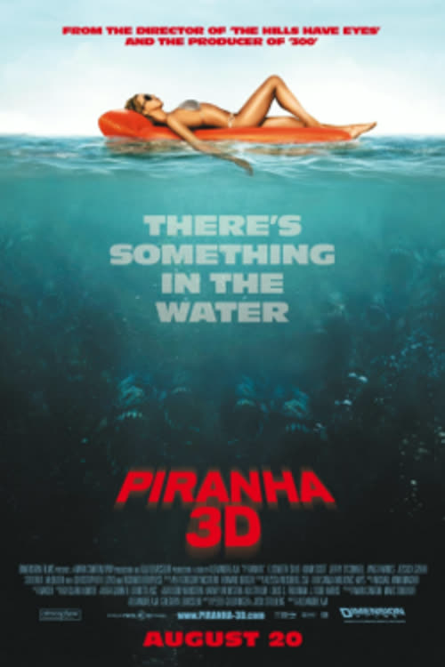
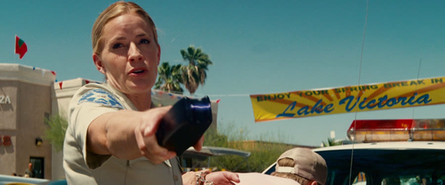
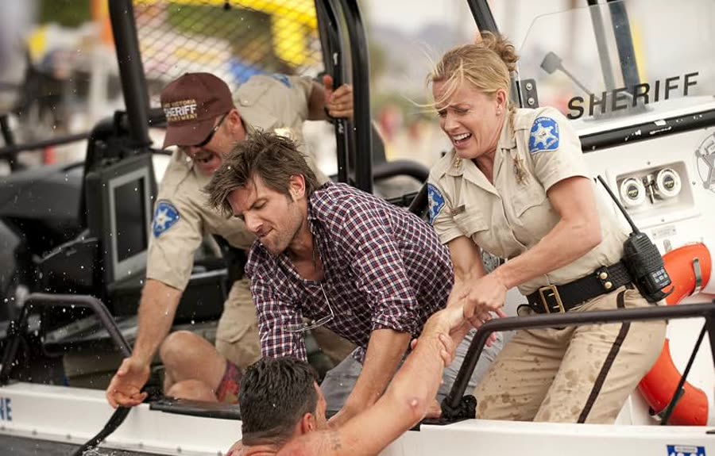
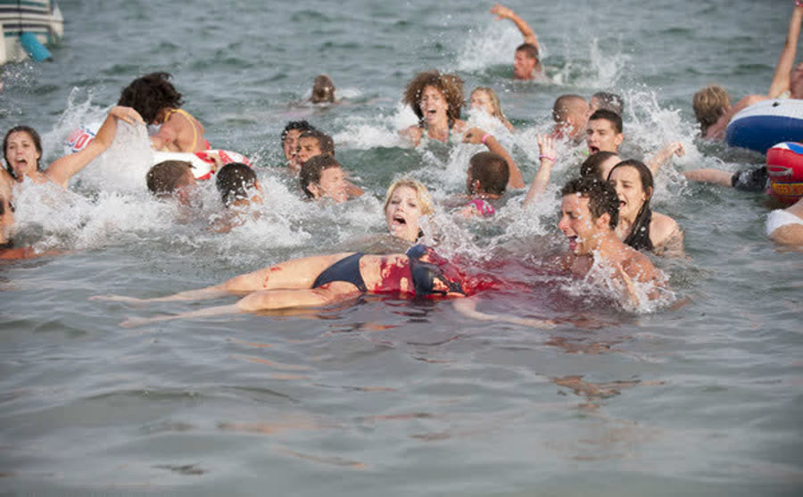
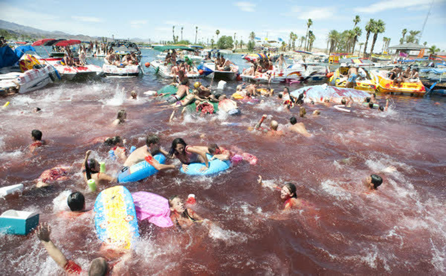
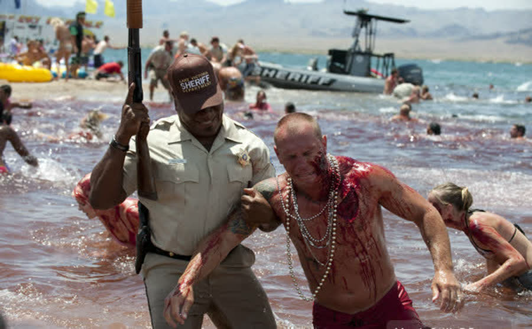
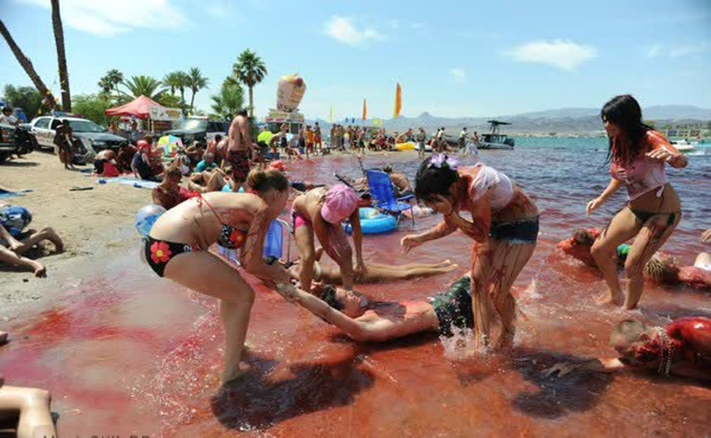

## *Piranha 3D (2010)*: More Floating Body Parts Than Anyone Asked For

{: style="float: right; width: 30%; margin: 0 0 1em 1.5em;"}

New co-host, same terrible lake decisions.

This is Christopher's first episode in the chair — a man who avoids the ocean on principle and is spiritually terrified of sharks. His welcome gift from the podcast gods: not one big predator, but thousands of tiny ones that travel in a pack. Congratulations on the upgrade.

*Piranha 3D* is what happens when *Jaws* goes to spring break. An earthquake cracks open a prehistoric lake sealed beneath Lake Victoria, Arizona, in the middle of the town's biggest party week of the year — and two million years of hungry fish meet several thousand drunk college students.

### Hooper Gets Eaten First
{: style="clear: none;"}

{: style="float: left; width: 45%; margin: 0.4em 1em 0.6em 0;"}

The movie opens with a joke, and the joke is *Jaws*. Richard Dreyfuss sits alone in a tiny boat in the middle of the lake, styled exactly like Matt Hooper — same clothes, same energy, even singing "Show Me the Way to Go Home." They never say it's Hooper. They don't have to.

Everything is calm and peaceful until a small seismic tremor cracks the lake floor open. The water starts swirling into a whirlpool, his boat gets caught in it, the engine won't restart, and he goes into the water — where a swarm of prehistoric piranha, released from underground about four seconds earlier, tears him apart. Calm nostalgia to instant chaos in one scene, and the movie has told you exactly what it is.

Worth knowing: Dreyfuss was paid $50,000 for that cameo and donated all of it to charity. The film's entire conscience, spent in the first three minutes.

### Babysitting Was the Whole Job

{: style="float: right; width: 45%; margin: 0.4em 1em 0.6em 0;"}

Spring break at Lake Victoria is the biggest money-making week of the year for this small Arizona town: college kids everywhere, drinking everywhere, music everywhere. We meet Jake Forrester riding through town, watching Sheriff Julie Forrester (Elisabeth Shue) arrest some drunk idiot. You don't even clock that she's his mom at first — she's just all business, and he's very clearly at the bottom of the local social food chain. His friend Kelly wants him out for spring break; he's stuck babysitting his younger brother and sister.

Then Derek Jones shows up. Derek (Jerry O'Connell) is the sleazy spring break video producer type, filming drunk college girls for money — *Girls Gone Wild* with the serial numbers filed off. The real guy behind that empire reportedly threatened legal action over unflattering depictions, which is rich, because Derek is nothing but an unflattering depiction. O'Connell also does not appear to be acting. He is this exact guy in every movie he's in; here the sleaze is just turned up louder. Jake's little sister is sitting with Danny, a gorgeous British girl, and Derek immediately clocks an opportunity.

That night, Julie and her deputy Fallon (Ving Rhames) head out onto the dark lake to look for a local fisherman named Matt who never came home — yes, the Dreyfuss character. They find his little boat drifting just out of reach. Julie leans out to grab it, loses her balance, and falls straight into the water. She comes up gasping — and Matt's mangled, half-eaten corpse floats to the surface directly behind her. A textbook jump scare, and the moment she understands something is seriously wrong in that lake.

Her ruling the next morning could not be clearer: the kids are not going near the water.

So of course.

### Sixty Dollars of Negligence

{: style="float: left; width: 45%; margin: 0.4em 1em 0.6em 0;"}

Jake parks his little brother and sister on the dock — open water, spring break boats rolling everywhere — and pays them $60 to keep their mouths shut while he goes off to party. Sixty dollars is apparently life-changing money when you're eight. The objection stands, loudly: those kids should never have been left there, and the movie spends the rest of its runtime proving it.

Out on Derek's boat, Jake gets called a "sand rat" for being a local, and the tour guide they hired to show them the lake's best spots takes them to a secluded location approximately fifty feet from his own house. Some guide. While the boat floats there, two of Derek's girls slip into the water for a full synchronized underwater dance routine, holding their breath for what appears to be twenty minutes without surfacing. In reality, trained synchronized swimmers performed that scene, which explains the impossible lung capacity.

Meanwhile, the abandoned siblings get bored. The little brother talks his sister into canoeing to a nearby island — she knows they're supposed to stay home, and goes anyway — where he fails to tie the canoe up properly and they watch it drift away. Stranded. The little girl wades into the shallows, waving and yelling for boats nobody can hear over the party, steps on a piece of broken glass, and starts bleeding into the water. Real piranha can detect a single drop of blood in fifty gallons of water. The movie cuts to the swarm's point of view, homing in on her — and she scrambles out just in time.

The piranha are spreading.

### Two Million Years of Eating Each Other

Julie goes back out on the lake with a team of seismologists investigating the crack in the lake floor. Their explanation: a whole subterranean lake has been sitting trapped underneath Lake Victoria, sealed off for millions of years, and the earthquake just opened it. Naturally, two divers decide this is a great moment to go down and explore the rift. They pop a flare inside — and light up hundreds, possibly thousands, of piranha. The swarm tears the first diver apart. The second makes the fatal mistake of trying to help him. Team leader Novak (Adam Scott) hauls her out anyway, but she's already mangled and gone. One piranha makes it onto the boat in the confusion, flopping and snapping like a demon with fins.

They take it to Carl Goodman, the local fish-store eccentric, played by Christopher Lloyd with precisely the slightly unhinged scientist energy the casting was designed for. Goodman matches the fish to a fossil: this species is about two million years old, supposedly extinct, and it survived all that time underground by eating each other. Now the rift is open, they have access to the whole lake, they are extremely aggressive, and the fresh meat on offer is an entire spring break crowd.

Good timing.

### The Money Shot

{: style="float: left; width: 45%; margin: 0.4em 1em 0.6em 0;"}

Back on Derek's boat, Jake — a kid who knows nothing about cameras — has been handed a professional rig and is suddenly a born cinematographer, filming a topless girl parasailing while Derek does coke on deck and demands the money shot. Then Jake looks over and sees his brother and sister waving for help from the island, and filming stops. Derek is furious about the ruined shot, right up until Jake drops the magic words: my mom's the sheriff. Suddenly the rescue is very much Derek's problem too.

The parasailing girl is not so lucky. Left dangling in the water as the boat slows, she starts screaming as the swarm hits her — and the guys on the boat assume she's playing it up for the camera, because a screaming bloody girl is, to them, super hot footage. By the time they haul her up, everything from the thighs down is gone.

That is the moment the movie stops pretending.

They grab the stranded kids and race back, late for Derek's main party event. The propeller tangles in lake weed, the boat goes nowhere, and Derek manages his frustration professionally: by choking Jake and screaming that all of this is his fault.

### Everybody in the Water

{: style="float: right; width: 45%; margin: 0.4em 1em 0.6em 0;"}

The main beach is peak spring break insanity — DJs, a wet t-shirt contest, and Eli Roth on a microphone hyping the crowd like a radio host. Police boats arrive telling everyone to get out of the water. Nobody listens. Under the surface, the swarm threads through hundreds of swimmers without touching a single one — holding out, apparently, for one girl sitting in a round raft with her butt in the water. They go for the butt. Then they go for everybody.

What follows is the movie's centerpiece: total, choreographed carnage. Boats plow through panicked swimmers and churn them into chum. The floating stage tips under the weight of everyone trying to climb it at once. Cops fire shotguns into the water, a strategy against thousands of fish roughly as sound as a teaspoon against a flood. One guy hijacks a jet ski, shotgun in hand, and goes full secret agent — one fish at a time, forever. Eli Roth's character makes it out of the water and up onto a dock without a single bite, which feels like survival — until a boat comes straight at his face and takes him out that way instead. Credit where it's due: not everybody gets eaten, and switching up the deaths keeps the massacre from going numb.

Then Fallon wades in with his shotgun, and when the shells run out, he rips the motor off a boat and goes to work with the spinning propeller — shredding piranha, screaming at everyone to get out of the water. It works for maybe thirty seconds. Then the swarm starts taking his legs out from under him, bite by bite, until there's nothing left for him to stand on.

While the lake turns red, Julie gets the call: it's Jake, finally admitting he screwed up. He's on Derek's boat, and it's sinking. She doesn't ask questions — she just parkours across a perfect line of jet skis, boats, and floats like she's running an obstacle-course final, and Novak pulls up beside her on a jet ski, already somehow knowing exactly where she was going.

### They Ate My Penis

{: style="float: left; width: 45%; margin: 0.4em 1em 0.6em 0;"}

Derek's boat has hit a rock and shattered the glass-bottom viewing panel it uses to film the girls, and the lower deck is flooding fast. Derek and one of the girls go over the side — she's eaten immediately — and Danny hauls Derek back aboard, minus everything from the waist down. Derek's assessment of the situation, delivered repeatedly and at volume: "They ate my penis." The movie then cuts underwater to confirm it, as the evidence drifts past and a piranha grabs it, chews thoughtfully, and spits it back out. Even the fish have standards. And yes, that was a practical effect — a floating prop, built to fly at the audience in 3D.

Kelly, knocked out in the crash, is trapped in the flooding cabin below deck. Julie and Novak throw a rope across from their boat and the evacuation begins: Danny first, then the two kids, then Julie, shimmying upside down over open water. Four people on one rope makes it dip — and Danny's long, long hair drags into the lake. The piranha latch onto her hair, then onto her, and pull her under. Gone, just like that. The others make it across.

Jake unties the rope, loops it around his own waist, and throws Derek's corpse off one side of the boat. The entire swarm converges on the free meal — which buys him the room to swim around the other side, dive up through the broken glass panel, and surface inside the flooded cabin. There he finds Kelly, a flare, and, because this movie loves him, two propane tanks sitting conveniently nearby.

### Those Were Just the Babies

Jake hands Kelly the flare, radios Novak with a ten-second countdown that stretches to about thirty — movie time — cracks open the propane tanks, and hauls her out to tread water in front of the boat. Naturally, the rescue boat's engine won't turn over. Naturally, the piranha finish with Derek's corpse and start drifting their way. The engine catches at the last possible second, the boat rips them out of the water, and Derek's boat goes up in a fireball behind them, raining dead piranha everywhere.

The protest is noted for the record: they did not need to blow up the boat. They just needed to leave. One small explosion kills the piranha in that one patch of water; it does not clear an entire lake. But try telling the movie that.

So everyone floats there, exhausted, in a lake paved with floating dead fish, congratulating themselves. Then Julie's phone rings. It's Goodman, and he has bad news: the specimen they brought him never developed mature reproductive organs. Julie looks out at the lake full of dead piranha and says she's feeling pretty good, actually. His answer: those were just the babies. Novak asks the only question left — "Then where are the parents?" — and right on cue, an adult piranha the size of a shark launches itself clean over the boat, takes him, and vanishes. Cut to black.

Sequel bait, obviously. The sequel is called *Piranha 3DD*, because of course it is.

### The Verdict

Christopher gives *Piranha 3D* **4 cents out of 10**.

For his first movie in the chair, he admitted he wanted to be nice — but the score is honest about what this is: an entertaining, light-hearted horror film that is not meant to be taken seriously, just chuckled at. He clocked the absurd number of big names rolling through it, noted that somebody out there actually petitioned to get this thing recognized for awards, and landed where he started: it was a time.

Talon gives *Piranha 3D* **four to four and a half cents out of 10**.

This is squarely her genre. She loves a cheesy animal movie, and she loves a disaster movie — *The Towering Inferno*, *The Poseidon Adventure*, *Titanic* — and this one plays like both at once: everything falling apart, everybody scrambling to get out. It is a no-brainer in the best way, the kind of movie she'd leave on if she caught it channel-flipping, half-watching while doing something else. She also gives it real credit where it counts: most of the gore is practical effects, not CGI, and that spring break massacre — weeks of filming, hundreds of extras, prosthetics, fake limbs, and water rigs — is carefully choreographed chaos from a director, Alexandre Aja, better known for much darker horror. It is a post-*Avatar* 3D gimmick movie, body parts flying at the screen and all, and it knows it.

So: a four and a four-ish, and the rare spring break where the fish had a better time than the tourists.

Worth watching if you enjoy: disaster movies where the disaster has teeth, practical gore over CGI, an inexplicably star-studded cast slumming it at spring break, and fish with absolutely no respect for the food chain.

**Stuff we use / support the show:**
- Own it on physical media via [Gruv](https://www.tkqlhce.com/click-101633208-15032169)
- Watch with [Plex](https://www.kqzyfj.com/click-101633208-15734677)
- We record this show with [Riverside](https://riverside.sjv.io/4aR7A9)
