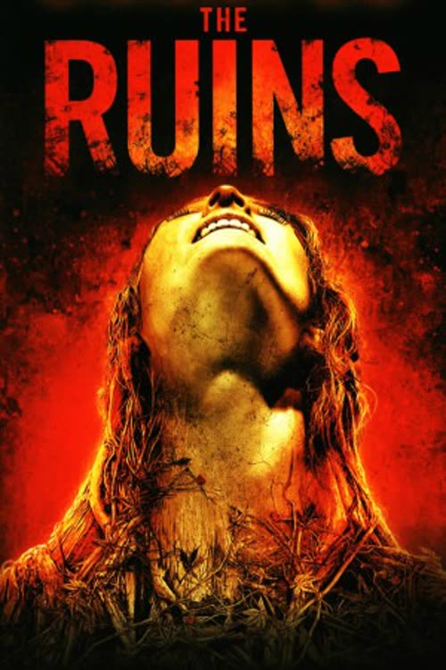
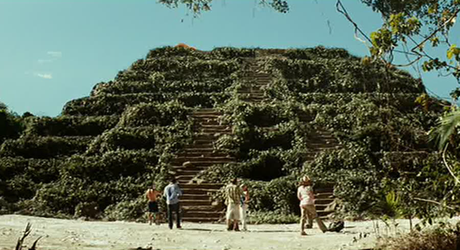
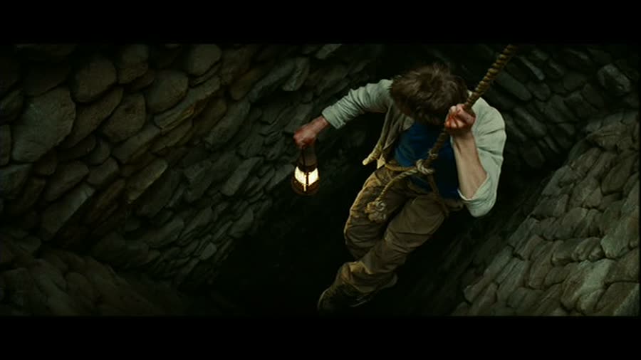
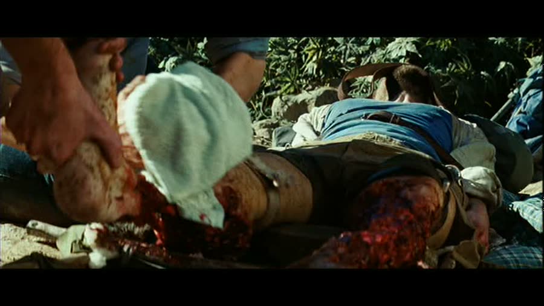
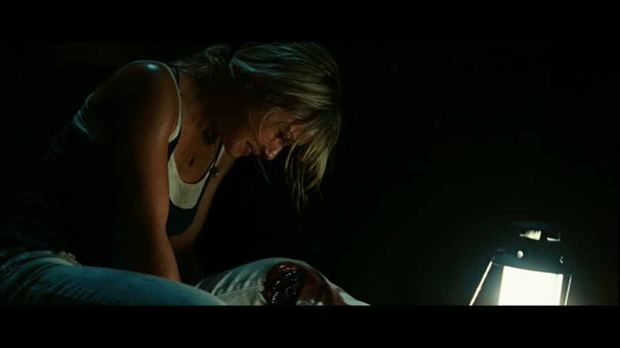
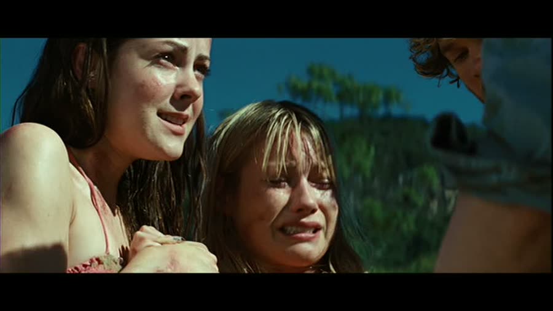
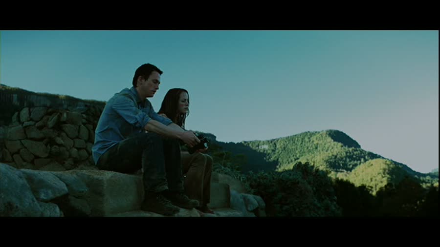

## *The Ruins (2008)*: The Most Tactical Houseplants in Cinema

{: style="float: right; width: 30%; margin: 0 0 1em 1.5em;"}

Some vacations end with a sunburn and a story.

This one ends with an armed perimeter, a field amputation, and a plant that plays chess.

*The Ruins* takes the single worst group decision in horror — follow a stranger into the jungle because he seems nice — and then, just to be thorough, makes the destination itself the monster. No masked killer. No haunted house. Just a very old pyramid, a very patient vine, and four Americans who were having a great time right up until they weren't.

### Stranger Danger Is Merely a Suggestion
{: style="clear: none;"}

It opens with a warning nobody gets to hear: a woman alone in the dark, screaming, before something drags her away. Then the movie whiplashes to Cancún, where Jeff, Amy, Eric, and Stacy are having the time of their lives by a resort pool — maybe the most violent tonal transition in horror history.

Jeff is the responsible pre-med one who believes he can handle anything. Amy is there to have a good time. Eric is kind of just there. And Stacy is about to have a very, very bad week.

Enter Matthias, a German tourist who found the earring Amy dropped at the bottom of the pool. Good eye. Suspicious eye, honestly. For about ten seconds it looks like he's working up to hitting on her; instead, he leaves with an invitation for drinks, and within roughly forty-five seconds of knowing this man, the group has agreed to hike with him and his friend Dimitri into the jungle to find an ancient ruin where Matthias's brother Heinrich was last seen.

Read that back. A stranger. An unmarked location. A missing person already attached to the itinerary. You would normally do something like this with a guide, with credentials, with somebody who is at least from the same hemisphere as the jungle. Matthias is not even local. He's just a guy. A guy who could, for all anyone at that pool knows, be planning to traffic them out of the country. The movie never starts if anyone says that out loud, so nobody does.

### Every Red Flag Was Waving

The next morning, the red flags line up politely and get ignored in order. Nobody shows up to give them a ride. Heinrich's truck is sitting abandoned on a dirt road. Matthias, the one person who supposedly knows where they're going, looks confused. Great signs, one through three. They keep walking.

The ruin itself almost justifies it — a huge ancient pyramid in a clearing, genuinely cool, and completely covered in dense green vines. Every inch of it. They're in awe for about thirty-five seconds.

Then the villagers arrive: armed with bows, knives, and guns, shouting in a language that is neither English nor Spanish, and deeply unhappy. The group tries to explain itself through panic gestures. Dimitri, in the single worst diplomatic move of the film, walks toward them holding out Amy's camera as a peace offering. What are a bunch of armed men in the jungle going to do with a camera? They don't want to be on Instagram. They shoot him with an arrow through the chest, and then their leader shoots him in the forehead.

So the group does the only thing available: they run up the pyramid. Slowly. Backs turned. Up a staircase, against bows and guns. It works anyway, because the villagers never follow — they fan out around the base and settle in. Which raises the obvious question of why they don't simply shoot everyone on the steps and be done by lunch. The answer is that they don't have to. Which is when the real situation becomes clear. This is not a chase. It's a quarantine.

{: style="float: right; width: 45%; margin: 0.4em 1em 0.6em 0;"}

### The Phone Is Not Ringing

At the top they find an abandoned campsite — tents, gear, supplies — belonging to people who are no longer anywhere. And from the shaft at the center of the pyramid, they can hear a cell phone ringing, despite having no signal worth mentioning at ground level. Matthias, running entirely on hope that Heinrich is alive down there, lowers himself on an old rope that nobody inspected. The rope snaps. He falls the full length of the shaft and breaks his back — paralyzed, at the bottom of a hole, in the exact place everyone was already afraid of.

They haul him out on a makeshift backboard, and Jeff, who is a medical student and gets reminded of it constantly, confirms it's as bad as it looks.

Then comes the moment that explains the villagers. Jeff and Amy go back down to reason with them — again, through a language barrier, with people who shot their friend an hour ago. It goes nowhere, Amy loses her temper, and she rips up a clump of the vine and throws it at them. It hits a little boy. The villagers shoot their own child without hesitating.

That's the whole movie in one act: they will kill one of their own kids before they let a single cutting of that plant leave the hill. Whatever is on this pyramid, they know exactly what it does.

Amy and Stacy descend the shaft after the phone and find where it leads: a chamber of vines and a young woman's body, vine-covered and badly decomposed — Heinrich's colleague, quite possibly the woman from the opening scream. She's holding the phone. The phone is not ringing. The flowers on the vines are making the sound, mimicking a ringtone, because the flowers mimic anything — sounds, voices, whole conversations — and a ringing phone is excellent bait. It's a Venus flytrap with better marketing. Touch one, and the vine lunges. They get out. Barely.

{: style="float: left; width: 45%; margin: 0.4em 1em 0.6em 0;"}

### Field Surgery, Hold the Anesthesia

Overnight, the vines get to work on the one person who can't move. By morning they've worked their way into Matthias's legs and eaten them down to the bone below the knee. Jeff's diagnosis is that the only way to stop it spreading is amputation, performed on the spot, with a hunting knife, a rock to break the bones, and a cast-iron pan to cauterize. Survival horror becomes a pioneer medical drama.

Jeff's reassurance is that Matthias can't feel anything below the waist anyway, on account of the broken back. He also hands him a belt to bite on, just in case — which tells you how confident that reassurance was. Matthias screams through the whole thing. Turns out the diagnosis of paralysis came from a student who, as everyone keeps pointing out, is not actually a doctor. He is doing the best he can in an impossible situation. It just happens to involve a man feeling his legs get cut off.

Afterward, the severed legs sit to one side, and the vines slither in and drag them away, like a delivery order finally arriving. The plants are patient. They know how this ends.

{: style="float: right; width: 45%; margin: 0.4em 1em 0.6em 0;"}

### The Plants Play Dirty

Then the vines stop waiting and start instigating. The flowers can replay sounds with edits — context removed, a little ooh-la-la added — and one night they treat Stacy to what sounds exactly like her boyfriend Eric having sex with Amy. What actually happened was a sad, fully clothed conversation. Stacy comes out swinging accusations anyway: in the middle of a siege by armed villagers, next to a friend with no legs, her brain lands on infidelity.

Honestly, the plants have a point about this group. The four of them erupt into a full screaming match — and while everyone's distracted, the vines quietly suffocate Matthias. The poor man had the worst of it from start to finish: paralyzed, amputated, and finally murdered by landscaping during an argument he couldn't even join. These are not dumb movie monsters. These are the most tactical houseplants in cinema history, and everyone else is playing checkers.

{: style="float: left; width: 45%; margin: 0.4em 1em 0.6em 0;"}

### Under Her Skin

By the next morning, Stacy has vines growing under her skin from a cut on her knee, slithering visibly up her leg. Jeff cuts a couple out of her leg and her back. She keeps saying she can feel them in her head, and then everyone watches a vine move slowly beneath the skin of her forehead — and every single one of them lies to her face about it. No. Didn't see anything. You look great.

It's the worst part of the movie, because there is genuinely nothing to be done about it. You cannot perform forehead surgery at a campsite. So Stacy does it herself: while the others sleep, she takes the knife and cuts herself open all over, hunting for vines that may or may not be in each spot, and the effects work is properly gnarly. Jeff finds her and tries to help; she slashes his hand wide open. Eric — who just watched that happen — decides he'll have better luck, walks in, and gets stabbed in the chest. He's dead before the vines drag him away, because the vines seem to prefer their meals already deceased.

Then Stacy, lucid enough to know what's left of her, begs Amy to kill her. Amy can't. So Jeff does it. Quick, quiet, and easy to miss if you blink — a mercy killing handled like the movie is embarrassed to look at it. Down at the perimeter, the screaming stops, and you have to figure the villagers are keeping a tally. That's two. Almost done here.

{: style="float: right; width: 45%; margin: 0.4em 1em 0.6em 0;"}

### An Escape Plan for One

Which leaves Jeff, whose sliced-open hand means the vines are already in him too. His plan is good, and it's only good for one person, and he knows it. He smears blood all over Amy so she looks like a corpse, carries her down, lays her at the base of the pyramid, and then walks the perimeter screaming at the villagers — drawing every eye to himself while the "body" lies forgotten. On his signal, Amy gets up and runs for Heinrich's Jeep, and hauls ass down a jungle track that somehow produces no bumps at all.

The villagers shoot Jeff. Their leader finishes it with a headshot that reads less like murder and more like mercy, and also like policy: nothing that touched that hill leaves it.

Except Amy does leave it — and here the version of the movie matters. In the theatrical cut, she just drives away, clean, which is almost unheard of in horror. In the DVD cut, the camera holds on her face as she drives, and you can see the vines moving under the skin around her eye. She escaped the ruins. The plants came with her. It's the better ending by a mile, and it sets up a sequel the world tragically never got: Amy, Manhattan, everyone's gardens ruined.

{: style="float: left; width: 45%; margin: 0.4em 1em 0.6em 0;"}

### The Verdict

Talon gives *The Ruins* **5 cents out of 10**.

It's a formulaic one, and the destination is visible from the pool — tourists, jungle, bad idea, worse outcome. But the effects are good, the acting is good, and it's genuinely entertaining while it follows the formula. The theatrical ending genuinely surprised her, purely because horror movies are not supposed to let the last girl just leave. Leave it on if it turns up while channel surfing. Just maybe don't take jungle-hiking advice from anyone you met forty-five seconds ago at a resort pool, no matter how sharp their eyesight is at the bottom of it.

Christopher gives *The Ruins* **6 cents out of 10**.

He's seen this one multiple times, and it's the concept that keeps him: not a jump-scare machine, but something slow getting under your skin — literally — and staying in your head. The visuals sell it, the vine effects hold up, and a monster that's smarter than the protagonists is a rarer thing than it should be. It's his pick of the two, and the houseplants did the heavy lifting.

Worth watching if you enjoy: killer-plant movies that take themselves seriously, survival horror where the smartest character on screen is a vine, vacation movies that function as a warning label, and endings that only exist on the DVD — which is, for the record, the ending you want.

Don't bring one home.

**Stuff we use / support the show:**
- Own it on physical media via [Gruv](https://www.tkqlhce.com/click-101633208-15032169)
- Watch with [Plex](https://www.kqzyfj.com/click-101633208-15734677)
- We record this show with [Riverside](https://riverside.sjv.io/4aR7A9)
