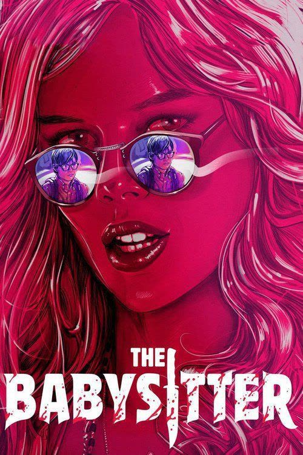
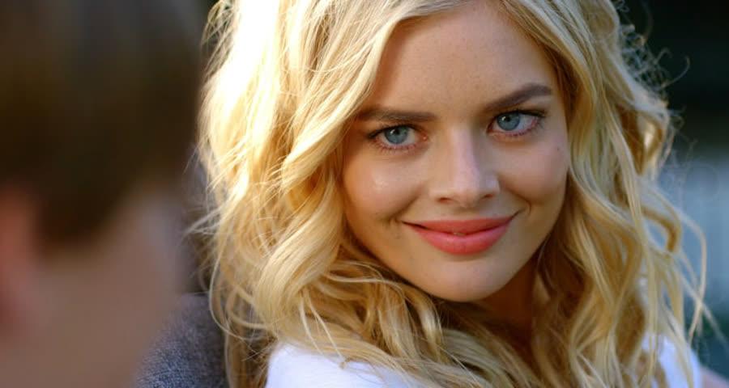
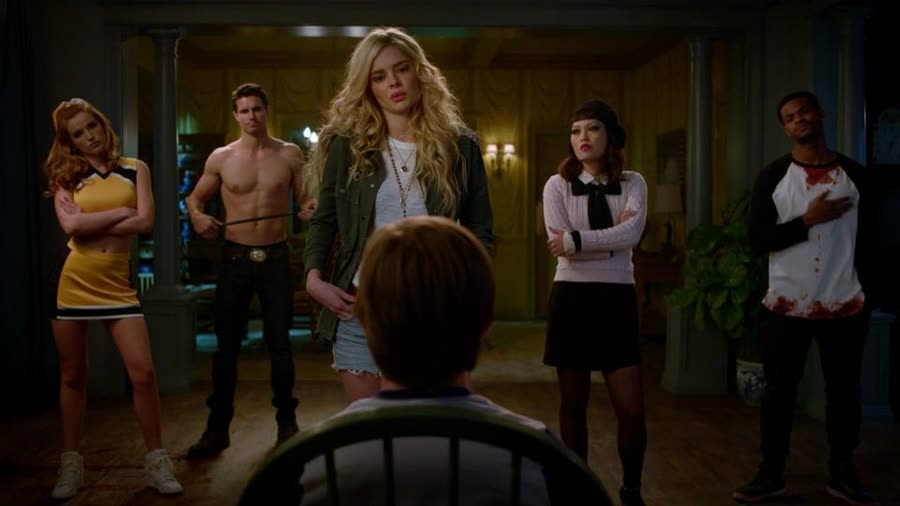
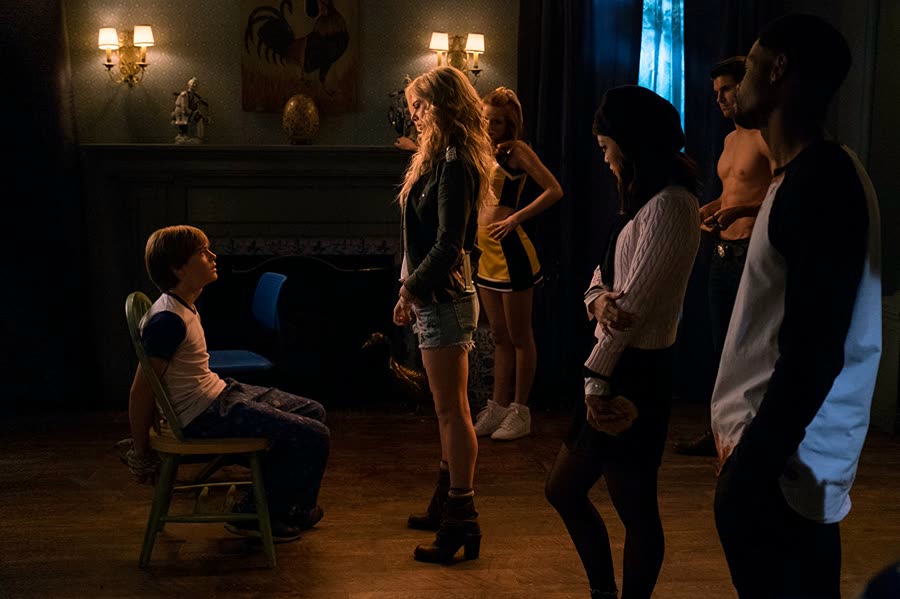
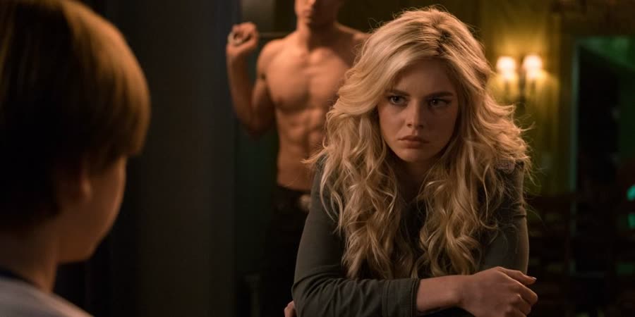
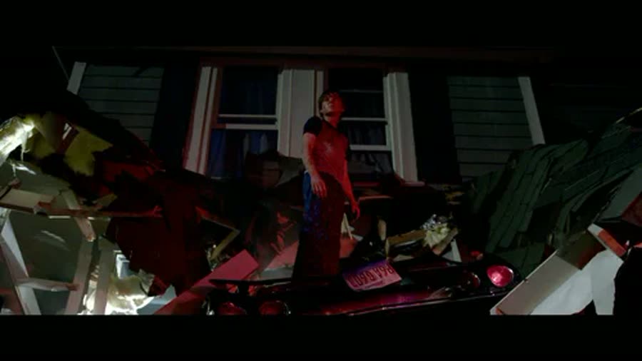

## *The Babysitter (2017)*: Home Alone, but with Blood and Guts

{: style="float: right; width: 30%; margin: 0 0 1em 1.5em;"}

Some kids get a babysitter because their parents want a night off.

Cole got one because his parents correctly judged that he could not be trusted alone with his own anxiety, and then the babysitter turned out to be running a satanic cult out of the living room, so honestly, everyone lost that bet.

*The Babysitter* is a 2017 Netflix film directed by McG, which is a name that tells you everything about the energy before you even press play. It kicks off Grave Humor month — horror comedies, the movies that make you laugh right up until you realize you really shouldn't be laughing — and it is exactly that: a sweet coming-of-age movie that gets stabbed in the head about twenty minutes in.

### The Best Babysitter Money Can't Buy
{: style="clear: none;"}

{: style="float: left; width: 45%; margin: 0.4em 1em 0.6em 0;"}

Cole is twelve. He is anxious, nerdy, bullied on the regular, and afraid of approximately everything, which the movie establishes early with a vaccination at the nurse's office that he treats like a firing squad. Hold onto that needle phobia. It matters later, because it always does.

He also still has a babysitter, which at twelve is a public announcement that you have zero street cred. But then there's Bee. Bee is cool, confident, funny, and patient. She stands up to his bully and stabs the kid's bicycle tire for good measure. She talks sci-fi with Cole, keeps top-five lists with him, and treats him like he actually matters — which puts her above literally everyone else in his life.

His parents leave for the night and it is just the two of them: dancing, junk food, genuine hanging out. She even pours him a shot of liquor, which he stares at like it might be evidence. It is a great night. She is a great babysitter.

Then Mom's rule kicks in — bed at 10:30 — and Cole's neighbor Melanie, his age-appropriate crush and best friend, has already planted the idea that babysitters always do adult stuff after the kids go to sleep. So Cole sneaks downstairs and hides on the steps to watch.

### Truth or Dare, Hold the Truth

{: style="float: right; width: 45%; margin: 0.4em 1em 0.6em 0;"}

Bee's friends arrive: Max the jock, Allison the cheerleader, Sonya with the artsy haircut and the "this is going to go bad" energy, John the comic sidekick, and Samuel — a nervous, nerdy guy Bee befriended coming out of a store earlier, who already looks like he's regretting every choice that led him here.

They play Truth or Dare. For a minute it's exactly what Cole expected: a little scandalous, a little exciting. Bee gets dared to kiss everyone in the room, and Samuel is last. He's visibly terrified, so she calms him down, talks him into it, and they kiss.

Then she calmly pulls out two knives and stabs him in the head.

He does not die. He stays alive and keeps talking, which is somehow worse. The group barely reacts. They haul out chalices and collect his blood while he bleeds, and the terms become clear: these idiots made a deal with the devil for success, popularity, whatever each of them wanted, and the price is blood on an ancient book. Samuel was the sacrifice. But the ritual also needs *innocent* blood.

Samuel's isn't innocent enough, apparently. They need Cole's.

### Advanced Science Requires Stabbing People in the Head

{: style="float: left; width: 45%; margin: 0.4em 1em 0.6em 0;"}

Cole does several smart things in a row: he calls 911, grabs a pocket knife — adorable — and then plays dead asleep in his bed while the cult comes upstairs and draws blood from his arm with a needle. The kid who nearly passed out over a flu shot holds perfectly still for a satanic blood draw, which tells you exactly how scared he is.

He tries to escape down a knotted-sheet rope out the window and passes out from the blood loss instead. Bee, who noticed the open window and found it suspicious, was standing in his room the whole time.

So Cole wakes up tied to a chair downstairs while the cult explains that this is all a science project. An advanced one. Stabbing people in the head is a requirement. Sure. And the worst part is, it probably never needed to go this way — if Bee had just *asked* Cole for a little blood, needle phobia and all, he likely would have given it to her. That's how much this kid adores her.

Then the cops answer his 911 call, which sounds like help. It is not. Max throws a fire poker through one officer's eye. The second officer panics, fires, and accidentally shoots Allison in the chest. Bee and Max finish him off, Max rips the poker back out of the first cop's eye for an encore, and now there are no adults left to fix any of this. The cult forces Cole to hand over the police codes to call off the backup — he knows them all, because at some point this child apparently wanted to be a cop, which is the most Cole fact in the entire movie.

### Every Movie, They Run the Wrong Way

Cole saws through his ropes with the pocket knife, gets caught at it via a mirror — one of the funnier beats in the movie — and then, with the front door *right there*, bolts upstairs. Upstairs. To be further trapped. This is at least the second movie in a row where the fleeing victim picks the one direction with no exit, and it remains infuriating every single time.

John chases him up, and Cole pushes him over the banister. John lands on a trophy, which goes straight through his neck. That is the moment it lands on Cole: *I'm killing people now.*

He escapes out the window anyway and hides in the crawl space under the house, among the spiders and the bugs, because this night had not yet been sufficiently awful. Sonya crawls in after him, and Cole improvises: bug spray plus a firework rocket, one homemade flamethrower explosion extravaganza. Sonya burns. The house, notably, does not — whatever fireproofing is under that house deserves its own five-star review.

### The Killer Is Also a Life Coach

{: style="float: left; width: 45%; margin: 0.4em 1em 0.6em 0;"}

Max is the last of the muscle, and Max is a problem, because while he's hunting Cole he keeps… coaching him. He eggs him on about standing up to his bully — the bully is literally egging the house at one point — basically delivering a pep talk to a kid he fully intends to murder for his blood. Why are we workshopping his confidence if he's going to be dead by midnight? It is funny, and it makes no sense, and those two things are this whole movie.

The chase ends up on the platform of Cole's tree house — just the floor, since it was being taken down — and Max falls, gets tangled in the rope swing, and hangs himself. Cole: two for two on cult members, zero weapons used as intended.

He runs to Melanie's house, and Melanie absorbs "my babysitter runs a satanic cult and everyone is dead" with the calm of a woman on her third satanic cult rodeo. Bee shows up, there's a chase in circles around the ground floor, Cole gets out, promises Melanie he'll handle everything — and she kisses him. Terrible timing. Take the win anyway.

### She Shot the Cheerleader, Not the Kid

Back home, Cole stops running. Inside is Allison, who has spent the back half of the movie wandering around with a bullet hole in her chest, distraught — not about dying, but about whether anyone will ever want to touch her breasts again now that there's a hole in one. Priorities fully intact. She comes at Cole with a kitchen knife.

Bee shows up and blows Allison's head off with a shotgun.

Which is the tell. Bee could have sacrificed Cole in the first place — he's innocent, he's right there — and she never wanted to. She needed a vial of his blood, not his life, because the friendship was never an act. She was a really good babysitter. Then she gave him some liquor and called up Satan.

So she explains it all: the deal she made when she was younger, the huge ornate book with the old papyrus pages, innocent blood spilled on it in exchange for everything she ever wanted. And what did she want, after all these years and all these bodies?

Confidence. That was the big purchase. Soul, murders, ancient evil tome — for the ability to feel comfortable in a room. The suggestion that she could simply *stop* now, since she's clearly got the hang of being confident, is not one the book seems interested in entertaining. Dense plotting is not what we're here for.

She offers Cole a place beside her — protection, forever, the two of them — and for half a second it is genuinely sad, because the affection runs both directions. Cole chooses himself. He says no, and he burns the book.

### A Twelve-Year-Old John McClane

{: style="float: left; width: 45%; margin: 0.4em 1em 0.6em 0;"}

For the finale, Cole steals the keys to Melanie's dad's car: a mid-forties, newly divorced man who was never cool and now compensates with a pristine muscle car that is his entire personality. Cole drives it straight through his own house and directly into Bee.

There's a car on top of her, a dresser involved somehow, maybe some clearance between bumper and babysitter if you squint — and then the two of them have a weirdly tender final moment in the wreckage, because even now, they like each other. Cole climbs out. Police and emergency crews flood in. The neighborhood bullies are standing there going on about how cool Cole is now, while their ringleader gapes at his own crew like, *what the fuck, guys.*

His parents come home to the smoking crater of their evening and Cole tells them he doesn't need a babysitter anymore. Established. Thoroughly.

And because no ending is allowed to stay clean: stay through the credits. Bee survived the car, the house, and everything else, and she attacks a firefighter inside the wreckage. It is entirely possible to watch this entire movie, enjoy it, and miss that scene completely — and then wonder what on earth a sequel could possibly be about. There's a sequel. *Killer Queen*. The whole dead cast appears to be back in it, which raises questions nobody is prepared to answer.

### The Verdict

Talon gives *The Babysitter* **6 cents out of 10**.

It was exactly what she expected it to be — with one surprise: the friendship was real. Bee wasn't a fake babysitter luring a kid; she genuinely liked Cole, protected him, and tried to keep him alive while still going through with the ritual, and liking the villain turns out to be half the fun. The acting is good, the relationship is believable, and the whole thing plays like *Home Alone* with blood and guts. Best of all, the movie quietly does the thing everyone in Cole's life kept asking for: it forces the kid who was afraid of everything to stand up for himself, and by the end he's a twelve-year-old John McClane telling his parents the babysitter era is over.

Christopher gives *The Babysitter* **1 cent out of 10** — his lowest rating so far, and he's saving the zero in case something worse comes along.

He found funny moments in it, but the style just isn't his: the dialogue jumps around, the story assumes a lot and skips over the rest, and the whole plot was predictable beat for beat — and for a man who cheerfully admits he doesn't follow movies, knowing exactly where this one was going the entire time said everything. The over-the-top gore reminded him of *Evil Dead*, which is a compliment he did not intend. He will not be watching the second one. He does not care what Cole does afterward.

So: a six and a one, and a friendship strong enough to survive a satanic blood ritual and a Buick through the living room wall. Barely.

Never trust a babysitter whose idea of arts and crafts involves a chalice.

**Worth watching if you enjoy:** *Home Alone* but the traps are fatal, *Evil Dead*-style gore played for laughs, villains you'd still split a pizza with, and sequels resurrected entirely by mid-credits scenes.

**Stuff we use / support the show:**
- Own it on physical media via [Gruv](https://www.tkqlhce.com/click-101633208-15032169)
- Watch with [Plex](https://www.kqzyfj.com/click-101633208-15734677)
- We record this show with [Riverside](https://riverside.sjv.io/4aR7A9)
