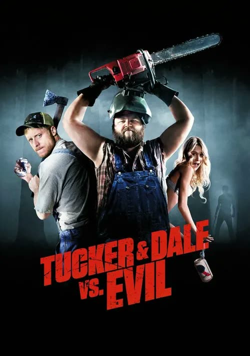
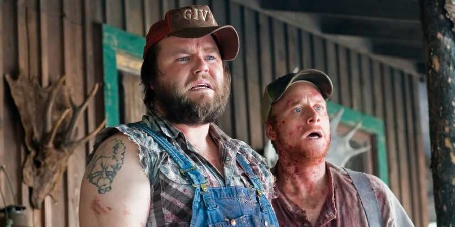
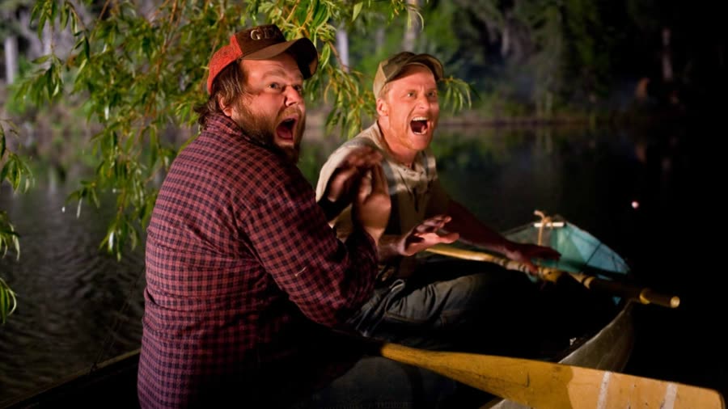
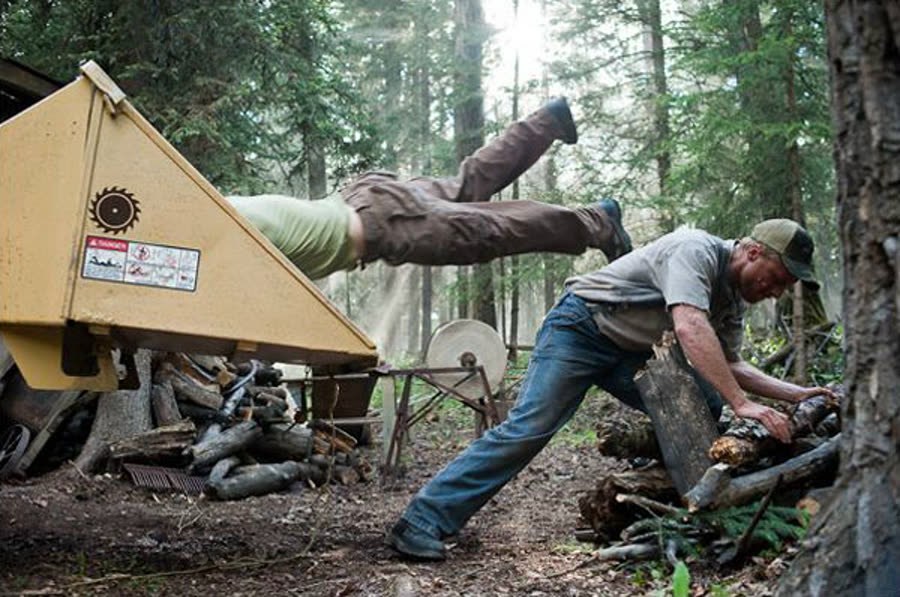
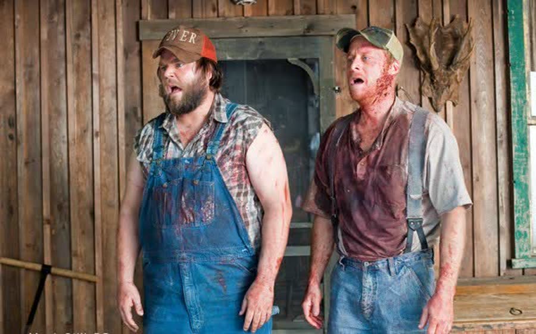
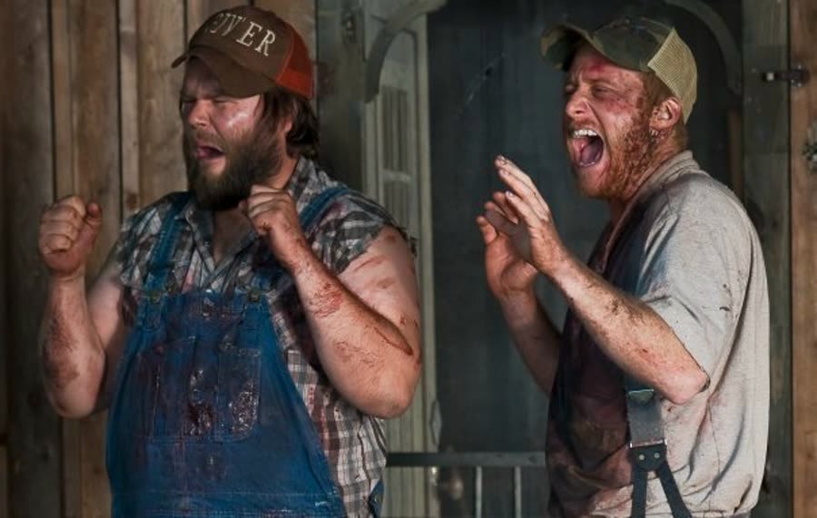

## *Tucker and Dale vs. Evil (2010)*: Less a Slasher, More an OSHA Violation

{: style="float: right; width: 30%; margin: 0 0 1em 1.5em;"}

Two sweet hillbillies buy a vacation cabin. Nine college kids go camping in the same woods. By the end of the weekend, almost all of the college kids are dead, and Tucker and Dale have killed exactly none of them.

This is the rare slasher movie where the apparent killers are the nicest people in it, the victims do all the work themselves, and the whole thing runs on one engine: nobody, at any point, stops to have a conversation. It's less a slasher film, more an OSHA violation — a workplace-safety incident with a body count, except the workplace is a fixer-upper cabin and every hazard gets triggered by a panicking undergrad.

It also opens at the end: a news crew pokes around a wrecked house, the reporter gets brained, and the cameraman gets chased into the dark. No explanation. Hold onto that; the movie put its "the killer survived!" stinger at the front, just to be different.
### A Scythe Is Not an Icebreaker
{: style="clear: none;"}

The college kids are five minutes into their Memorial Day weekend camping trip when they realize nobody packed beer — the one item that should have gone in the car before the luggage, the food, and possibly some of the passengers. So they stop at a gas station, because college kids in these movies always stop at a gas station, and the gas station is always full of creepy hillbilly energy. It's a law.

Waiting there are Tucker and Dale, on their way to the vacation home they just bought. Tucker is the practical one. Dale is the big sweet one with a massive inferiority complex and a heart the size of the truck. Tucker, coaching in real time, sends Dale over to talk to Allison — the one girl in the group who seems like an actual human being, which is by design; the other girls are mostly decorative. Dale shuffles up holding a full-size scythe, grinning way too hard, and nervous-laughs his way through it.

Amazingly, the girls decide he is terrifying and leave. Correct call, wrong conclusion, and that's the whole movie in miniature.

### Decorated by a News Buff

{: style="float: right; width: 45%; margin: 0.4em 1em 0.6em 0;"}

The cabin looks like a crime scene because it is one. Bones hang from the ceiling like wind chimes; the walls are papered with newspaper clippings about teenagers dying in these woods. Tucker, examining the bones, decides the previous owner "must have been an archaeologist." Dale, reading clipping after clipping about death, concludes the man was "a real news buff." Then they find the flyer that seals the deal — hot dogs, buy three get two free — and they are stoked. It's dusty, it's derelict, it's perfect, it's theirs.

Meanwhile, the kids set up camp nearby, and Chad — the popped-collar alpha douchebag of the group, the kind of guy who gets rejected by a girl and immediately becomes her problem — gathers everyone around the fire to tell the story of the Memorial Day Massacre. Twenty years ago, in these exact woods, a lone hillbilly slaughtered a group of campers. One survivor. Chad tells it with the energy of a man who has waited his whole life for this campfire. Remember the survivor. Remember who tells the story, and how much he loves telling it.

### We've Got Your Friend

{: style="float: left; width: 45%; margin: 0.4em 1em 0.6em 0;"}

The kids go skinny dipping, in the loose sense — boxers, bras, underwear, one guy suspiciously eager. Tucker and Dale happen to be night fishing on the same lake. Allison, fresh off fending off Chad's advances, climbs a big rock to get into the water away from the group. Dale spots her. Dale yells "Tucker!"

Pro tip, delivered too late: if you see a beautiful half-naked college girl, do not scream another man's name. Allison startles, falls, and cracks her head on the way in. Dale dives in and pulls her out, because Dale is a good person. Her friends, watching from shore, see two enormous hillbillies dragging their unconscious friend out of a dark lake, and conclude: kidnapping.

Tucker and Dale, left holding an unconscious woman in a boat, do the one thing guaranteed to make it worse. They shout after the fleeing kids: "We've got your friend!"

Not how they meant it. Exactly how it sounded.

Allison wakes the next morning in the cabin, understandably terrified — until Dale brings her breakfast in bed, pancakes and a little bunch of flowers, so nervous and kind-hearted and terrible at everything that she works it out fast: this man is not a threat. When she screams at the sight of him, he apologizes and assumes the obvious: she must hate pancakes. He'll get her something else. A dog also appears somewhere in here — Jangers, probably; the name gets said four different ways and nobody can settle it.

### Running From Bees, Into a Tree

Chad, meanwhile, has organized a rescue mission. Evidence: none. Thinking: none. He's decided, and no further information will be processed. The kids creep up on the cabin while Tucker is outside cutting wood — and Tucker's chainsaw goes through a beehive hidden in a hollow log.

Tucker runs. Full sprint, chainsaw revving, face getting demolished by bees. One of the college kids — the practical one, the work-shirt kid, the group's lone voice of "wait, that doesn't mean they're murderers" — sees a chainsaw maniac coming at him and runs too. For a few seconds they're running side by side, shooting each other looks, and you can see the thought forming: hold on. We're not running from each other. We're running from the same thing.

Then he runs directly onto a pointed tree branch and impales himself clean through. A bee lands on his nose as he dies, wearing the expression of a man who figured it out one second too late.

Chad finds the body, which in Chad's mind confirms everything. The kids suggest calling the police; Chad says phones don't work out here anyway, then smashes one — which, as was noted at the time, definitely makes it not work. They're not here to camp; they're here to battle hillbillies. Chuck sensibly takes his truck and goes for help, while the girl who wore heels to the woods complains that he gets to leave.

Back at the cabin, Allison is helping Dale dig the new outhouse, trading farm-kid credentials. The watching kids see a hillbilly making their friend dig in the dirt and reach the obvious conclusion: her own grave.

### He Fed Him Into the Wood Chipper

{: style="float: left; width: 45%; margin: 0.4em 1em 0.6em 0;"}

The rescue attempts begin, and the movie finds its rhythm: roughly half an hour of college kids trying to save their friend and accidentally killing themselves in the process.

Todd charges Dale with a homemade spear. Dale spins at Allison's warning and clocks her with the shovel — her second head injury of the weekend, she's going to have paperwork — and Todd trips and falls onto his own spear in the outhouse hole. Mike comes at Tucker by the wood chipper waving a little Swiss Army knife, and Tucker, dodging and trying to save him at once, just doesn't get there. Mike goes in headfirst. Tucker ends up standing at the chipper covered in Mike, holding what's left, staring like a man asking the universe what, exactly, the fuck.

From the kids' side of the treeline: the hillbilly fed their friend into a wood chipper. From Tucker and Dale's side: these kids are in some kind of suicide pact, and for some reason they're also trying to kill Allison. But why? Nobody knows — and as Tucker reasons, it's good that neither of them knows, because if they knew, they'd have to go too. The logic is airtight. It is also insane. Both things power the rest of the film.

The tragic part is that the movie tells you exactly what's wrong, out loud, in a quiet scene. Allison's studying psychology; she wants to be a therapist; she believes the biggest reason there are so many problems in the world is a lack of communication. The entire rest of this film is one giant lack of communication wearing a body count.

### The Sheriff Believes Them, Briefly

{: style="float: right; width: 45%; margin: 0.4em 1em 0.6em 0;"}

Chuck returns with the sheriff, the other surviving kids locked in the back of the cruiser. Tucker and Dale, who have just agreed that nobody will believe their day ("we had a doozy of a day" is the official summary), tell him the whole story anyway. He is reasonably skeptical. Then he leans on a cabin post — the same post Tucker leaned on earlier and dodged — and a board studded with nails drops off it and clobbers him in the face. The sheriff staggers out to radio for help and dies on the way.

The kids in the back seat watch a lawman walk into the cabin and get carried out dead, and take it as final proof. Chuck, the only one not locked in, grabs the sheriff's gun. He does not know how guns work. Tucker, from across the yard, finds himself coaching a man who is pointing a gun at him: you gotta take the safety off. Chuck takes the safety off and shoots himself in the face — in full view of his friends, who somehow file this, too, under things Tucker and Dale did.

### Those Were His Bowling Fingers

Chad now goes fully off the rails, which means leaving the rails he was already off. He catches Tucker, hangs him upside down from a tree, and takes two of his fingers off with an axe — a trick shot, mid-swing, on a moving target, with an accuracy that suggests prior experience. The fingers are Tucker's bowling fingers, which makes it personal. He wraps them in a piece of Tucker's shirt with a note — we have your friend, come and get him — and sends them to Dale like the world's worst ransom demand.

Allison wakes in time to fetch the fingers herself ("How long was I out?"), and Dale explains, as gently as a man can, that her friends have gone crazy — they're trying to kill Tucker, they may be trying to kill his dog. Then he asks her the question of the film: are your friends on medication? "Why?" Because he thinks they forgot to take it. Best line in the movie, and it's already been earmarked for use on coworkers.

Dale cuts Tucker down, and at the cabin Allison the trainee therapist finally gets both sides to sit down and talk over tea. It almost works. It does not work. Chad had doused the place in gasoline earlier; the two remaining kids burst in with a chainsaw right on his fifteen-minute schedule; a fight flips the table; a lantern sets one kid's leg on fire; and the girl in the heels grabs a jar to throw on it. The jar is moonshine — which, it must be confirmed from real-life experience, is basically drinkable gasoline. He goes up like a torch, the gas cans Tucker meant to move go next, and the cabin — the vacation home, the dream — explodes.

Tucker, Dale, and Allison crawl out. Chad drags himself out of the wreckage after them, half his face burned off, full Two-Face, vengeance still at the top of his list after being exploded. They pile into Tucker's truck — his last possession on Earth, be careful with it — and Dale immediately drives it into a tree. When Dale comes to, Allison is gone, Tucker is bleeding in the dirt, and the two of them have the talk: Tucker admits he let Dale win at frog-catching when they were kids, just to build him up. Now Dale has a girl to save and a one-eyed dog with her scent. Jangers will find her. Jangers finds her.

### Part Hillbilly

{: style="float: left; width: 45%; margin: 0.4em 1em 0.6em 0;"}

The sawmill. Allison is tied to a log on a moving track, inching toward a giant buzz saw, because Chad has completed his transition from douchebag to full movie villain, face-licking and all. Dale breaks in wearing a welding-mask getup meant to look intimidating, which mainly intimidates Allison. The final fight is chainsaw versus iron bar, and it ends the way this movie ends things: Dale's thrown hatchet curves through the air with Wanted physics and slices exactly the one rope that drops Allison off the track an inch from the blade.

They run — up the stairs, because of course they run up the stairs — and barricade themselves in the loft, where an old newspaper photograph tells the truth Chad got wrong his whole life: his mother was the massacre's lone survivor, locked away in an asylum from the trauma, and his grandmother raised him on her version. But his father wasn't a victim. His father was the hillbilly. The killer in the picture looks exactly like Chad because Chad is part hillbilly, and his entire personality is a lie his grandma told him.

Chad, chainsawing through the door, does not take the news well. Dale, who remembers everything anybody tells him, remembers the tea: Chad's allergic to chamomile. He throws the chamomile in Chad's face; Chad wheezes out that he'll be fine, and falls straight out the back of the loft.

The cops, when they finally come, buy the simplest version: the college kids were a suicide pact. It's not even wrong, really. The news crew from the opening is there — same crew — and the bookend clicks into place: the wrecked house, the brained reporter, the figure chasing the cameraman. Chad lived. Tucker, watching the report from a hospital bed, has had his fingers reattached — found, mostly; one of them is suspiciously nice, with a fingernail, and looks like it belonged to a woman, and nobody says anything about it. Dale shows up in his bowling shirt: did he ask her out? He fakes Tucker out — no, he couldn't do it. But he heard she's a really good bowler, so they're going bowling tonight.

She is a really good bowler. And when Dale starts his "in case I never see you again" speech at the bowling alley, Allison grabs him and kisses him and tells him she feels the same way. The hillbilly got the girl, the fingers, and the bowling date. Everybody else got a wood chipper, a spear, a tree branch, and a jar of moonshine.

### The Verdict

Talon gives *Tucker and Dale vs. Evil* two scores, because one wouldn't cover it: **7 cents out of 10** as a horror movie, and **9.5 cents out of 10** as a horror comedy.

Horror comedy is not her genre — she's seen maybe four or five in her life, and she only watched this one because she caught her oldest son and her mom laughing hysterically at it in the next room and had to know what was that funny. It was this. She's seen it four or five times since. Alan Tudyk is great, Tyler Labine is great, the hillbillies' innocence bouncing off the college kids' certainty never stops being funny, and the jokes stack — she's still laughing at the last one when the next one lands. She'd recommend it to anyone who wants a good horror comedy, full stop.

Christopher gives *Tucker and Dale vs. Evil* **5 cents out of 10**.

He doesn't love the genre either, and he wasn't super impressed — but this was way better than The Babysitter, there are some genuinely funny parts, and in fairness he laughed more recounting it than he did watching it. It could be on, it could be off; either way he's fine. It isn't a bad movie. It's just not one he'd turn on again. (He also does not like Wash, which is a separate, ongoing situation.)

So: a five, a seven, and a nine and a half walk into the woods, and only the hillbillies walk out.

Worth watching if you enjoy: cabin-in-the-woods movies run through a photocopier of misunderstandings, death by home improvement, Alan Tudyk, and the radical idea that most horror could be avoided if everyone just sat down and talked.

**Stuff we use / support the show:**
- Own it on physical media via [Gruv](https://www.tkqlhce.com/click-101633208-15032169)
- Watch with [Plex](https://www.kqzyfj.com/click-101633208-15734677)
- We record this show with [Riverside](https://riverside.sjv.io/4aR7A9)
