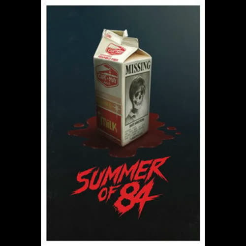
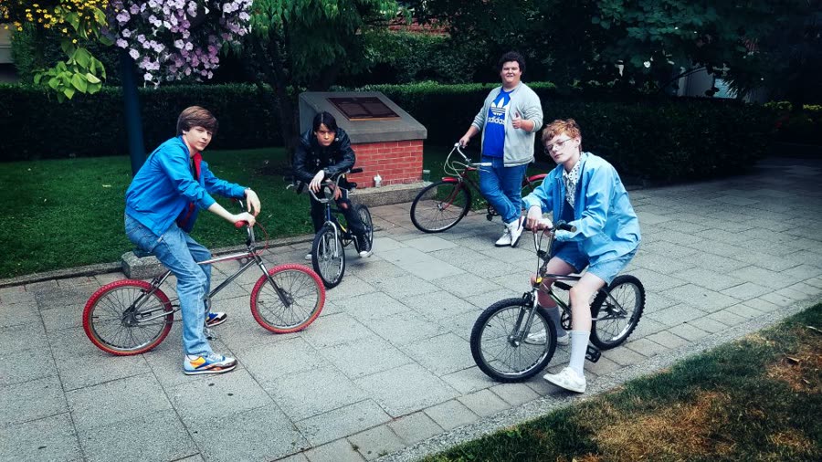
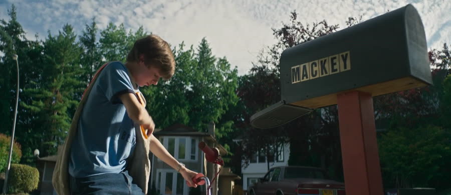
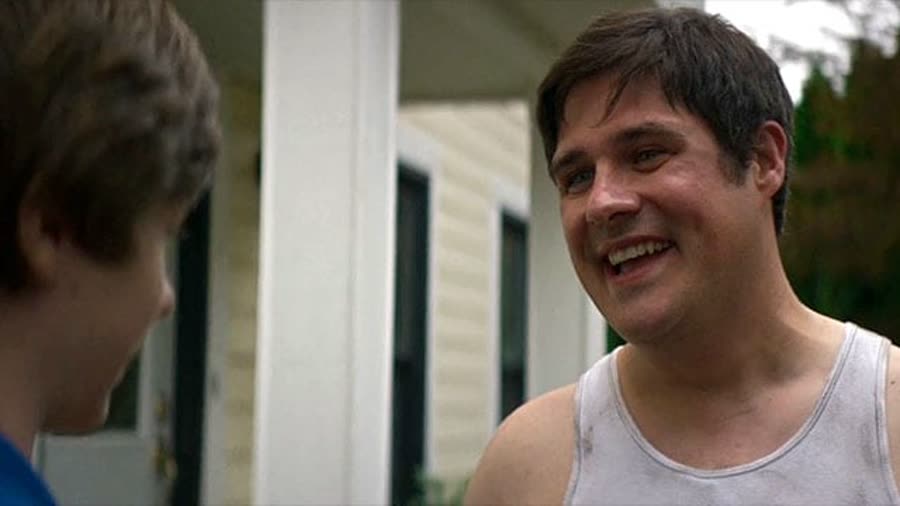
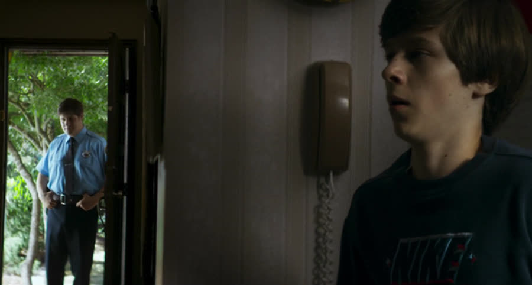
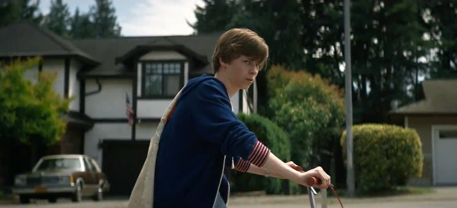

{: style="float: right; width: 30%; margin: 0 0 1em 1.5em;"}

Davey Armstrong is fifteen, and he has a theory about his neighbor.

The problem is that Davey has a theory about everything. The other problem is that this time he's right.

### The Kid Who Cried Serial Killer
{: style="clear: none;"}

{: style="float: left; width: 45%; margin: 0.4em 1em 0.6em 0;"}

The movie opens on Davey's morning paper route: one kid, one bike, one perfectly quiet suburb, and a voiceover laying out his whole worldview. The world is a lot darker than adults want to admit, serial killers are everywhere, and statistically speaking, one of them probably lives right next to you.

This isn't abstract for Davey. His dad is a cameraman for the local news station, and the story coming through their living room every night is the Cape May Slayer: thirteen teenage boys gone missing in Cape May County over the last decade. No arrests. No leads. Nothing. And across the street lives Wayne Mackey — a cop, friendly, helpful, waves hello every single morning — who Davey has decided is absolutely the guy. His reasoning: Mackey fits the profile. Single man, thirties or forties, lives alone. Which, to be fair, also describes every other 30-to-40-something white dude living alone, and his friends are happy to point that out.

The friends: Eats, short for Eaton, the bad boy, the chaos agent. Faraday, the smart one, the research guy, the one who thinks before doing. And Woody, the loyal one — wherever Davey goes, Woody goes. That is Woody's whole deal. Keep it in mind. It matters later, in the worst way.

Davey's bedroom, meanwhile, is wallpapered in news clippings about serial killers and missing children, which is the kind of interior decorating that would concern a parent. Davey's parents seem untroubled. Then there's Nikki, eighteen, Davey's former babysitter, leaving for Stanford at the end of the summer and mentally already gone. All four boys admire her. Davey admires her most.

### Milk Carton Evidence

{: style="float: right; width: 45%; margin: 0.4em 1em 0.6em 0;"}

One day Davey spots a teenage boy inside Mackey's house. It's quick — he looks away, looks back, and the boy and Mackey are both gone. A few days later, at breakfast, Davey turns the milk carton around and the same face is staring back at him under the word MISSING.

That's it. That's the whole inciting incident, and it's enough, because a face you recognized in a place it shouldn't be is not a thing you can unknow. He brings it to the group. They're skeptical — this is not Davey's first theory — but they agree to help, and so begins the most ambitious summer surveillance operation ever run by four fifteen-year-olds with too much time and not enough sense.

They set up a whiteboard in Eats' treehouse and start logging Mackey's life. When he leaves, when he comes home, what he's carrying. And the routine is interesting. He buys bags of soil and gardening tools constantly — ten bags of dirt a day, for a backyard sandwiched between two other houses. How much garden can one man have? He carries a duffel bag to work every day. He jogs at eleven, eleven-thirty at night, every night, same route, for an hour. Everything about Mackey is controlled and deliberate in a way that stops reading as "organized" and starts reading as "a man with something to organize around."

The boys also go through his trash at the end of his driveway — at night, in full view of the neighborhood, standing around discussing their findings afterward, which were nothing. The dug-up mess gets blamed on raccoons. The raccoons in this neighborhood are apparently running a construction company, and they will be blamed for a great deal more before the summer is out. And all through it, Davey watches from his window through binoculars with his bedroom light on, which rather defeats the purpose. They can see you. Turn the light off.

### Manhunt Is Not a Cover Story

{: style="float: left; width: 45%; margin: 0.4em 1em 0.6em 0;"}

The cover story is manhunt — the neighborhood-wide teenage hide-and-seek game — and under it, the operation escalates. One night Davey stands on Woody's shoulders, climbs the ivy-covered trellis outside Mackey's window, and plants an old GI Joe walkie-talkie, taped permanently on, in the ivy. What exactly a man who lives alone is expected to announce to his empty bedroom remains unclear, but points for commitment.

Davey has actually been inside before this — he helped Mackey carry furniture down into the basement, where he noticed a padlocked door and a darkroom full of perfectly normal photos, and filed both oddities away. Now, from the trellis, he watches Mackey move room to room until Mackey throws the window open and scares both of them half to death. Davey bolts. The next day, Mackey is utterly reasonable about it — kids playing manhunt, his yard has good hiding spots — which was just how it was back then. Kids ran entire neighborhoods and nobody called anybody.

Meanwhile Woody and Faraday tail the nightly jog to a storage unit, where Woody peeks through the gap and reports a car he's never seen — a mint VW Bug — and containers of something Faraday decodes as sodium hydroxide. Lye. Used to decompose organic material. Lye's other hobbies include pretzels, soap, and cleaning products, so the options are pretzels, soap, or murder.

That same night, Davey and Eats dig up Mackey's garden looking for bodies — blame the raccoons — find nothing, and move on to the shed. Eats picks the lock. Inside: lawnmowers, saws, normal shed stuff. And then Davey spots a shirt. A bloody shirt. The same distinctive shirt the missing boy was wearing in the photo on the milk carton. Yes, it's convenient. No, it doesn't stop being evidence.

### The Apology Tour

{: style="float: right; width: 45%; margin: 0.4em 1em 0.6em 0;"}

So the boys finally go to the adults, and the adults hear exactly one thing: our children have been trespassing, vandalizing, and breaking into a shed. Davey's parents are furious — at the boys. His dad, a man who literally points a camera at the Cape May Slayer story for a living, does not connect a single dot. The boys are marched across the street to apologize to the serial killer.

And Mackey is perfect. Calm, gracious, completely unbothered — which is, of course, exactly what a serial killer would be. The boy was his nephew, just visiting. No hard feelings. Kids will be kids. He shakes hands and smiles, and standing there it genuinely reads like a misunderstanding, which is the movie's favorite trick: making you wonder if Davey has just broken your brain.

Davey is grounded. Nikki — who has been getting closer all summer, talking to him for real, sneaking out his window when his parents come home — tells him to drop it before he ruins his life. Then a suspect is arrested for the Cape May Slayer murders, and the arresting officer is Mackey. Hero. Case closed.

Except Mackey comes to Davey's house to smooth things over and offers, right there, to call his nephew and prove it. Davey hauls the phone down the hallway on its long cord. It rings and rings. Nobody answers. "We're cool, right?" Mackey leaves — and Davey immediately calls the operator and asks for the last number dialed from his phone. It's Mackey's own number, right there on his mom's fridge list. Mackey called his own house.

Davey is not crazy. And now Mackey knows that Davey knows, and the movie quietly shifts into a different gear.

### Open the Second Door

{: style="float: left; width: 45%; margin: 0.4em 1em 0.6em 0;"}

The window is the Cape May festival: the whole town in one place, Mackey included. Faraday is stationed at the festival as lookout. Eats is backup, which means Eats is on a bus-stop bench with his headphones up so loud he couldn't hear an air raid — a lookout in name only. Davey and Woody break into Mackey's house with Davey's lock-picking skills (learned from Eats) and his dad's enormous video camera to document everything. Nikki climbs in through a window and scares the hell out of them: she knew they'd be up to something, so she might as well join.

In the basement, they pick the padlock. Behind it is a child's bedroom — preserved, staged, perfect, like Mackey's own childhood room pickled and kept. It's wrong in a way nobody can fully explain, and Woody and Nikki both think maybe it's not wrong enough. Then there's a second door, and both of them say don't open it.

We came this far. What did anyone think we were here for? Some of us have a thing about doors. You open the door.

It's a bathroom. The walls are covered in photographs. The shower curtain is closed. Davey pulls it back and finds the boy from the milk carton in the tub, dead — and another boy, recently taken off the street, still barely alive. Thirteen boys have gone missing in a decade with a killer loose, and the neighborhood still lets its kids run at night. Nobody learns anything in the suburbs.

Carrying the living boy upstairs, Davey finally sees the photos for what they are: family portraits. All thirteen missing boys, each with their family. Mackey stole them. And one of the portraits is Davey's own family. I'm next. The cop hunting the Cape May Slayer has been on the investigation into his own crimes for ten years, steering it nowhere. The guy he arrested must be thrilled.

They get out with the boy and the footage. The police take it seriously, an APB goes out, and the system works — eventually, in the most roundabout way imaginable. It feels like the end. It is not the end.

### A Real Game of Manhunt

That night Woody sleeps over at Davey's. And in the dark, the attic ladder comes down — silently, which is the movie's one true fantasy, because those rickety spring-loaded ladders could wake a hibernating bear. Mackey takes both boys. Not Santa Claus, for anyone wondering. He leaves the parents untouched; parents were never the point.

He drives them in his cruiser to a wooded island and tells them they're going to play manhunt. The real kind. They run, and they fall into his dumping ground: the remains of the missing boys, ten years of them, scattered in the woods off a perfectly ordinary road where people walk their dogs. No graves. No lye, apparently. Just sloppiness, protected by the fact that the man who'd investigate it kept assuring everyone he'd checked personally.

The plan — Scooby-Doo rules exist for a reason, and rule one is never split up — is to split up. Davey makes noise and draws Mackey off; Woody makes for the car to get help. Mackey slices Davey's Achilles tendon on the way past. Woody makes it to the car.

And Mackey is already there. He pulls Woody's head back and cuts his throat, fast, no hesitation, no dramatic pan away. Killing a kid on screen is gnarly, and neither shock in the room that night was faked: the loyal friend, the one who goes wherever Davey goes, dead because he followed Davey one more time.

Then Mackey has Davey — hobbling, helpless — and does nothing. Killing Davey ends it, and Mackey doesn't want it to end. He wants Davey alive, home, and looking over his shoulder for the rest of his life, knowing Mackey knows where he lives and can come back whenever he chooses. The waiting is the punishment. Davey crawls to the main road and gets picked up by a driver who cruises past Mackey's burning cruiser without stopping. Another bonfire. Nothing to see here.

### Everything Looks the Same

{: style="float: left; width: 45%; margin: 0.4em 1em 0.6em 0;"}

The last sequence is the first one, ruined. Same paper route, same bike, same suburb — except Woody's house is in foreclosure. Nikki waves goodbye from a car on her way to Stanford. Eats and Faraday are tearing down the treehouse and can't even look at him. Mackey's house is still wrapped in police tape, long after a sliced Achilles has healed enough to ride a bike on, because nobody ever bothers to take the tape down.

Davey unfolds a newspaper. Headline: the Cape May Slayer is still at large.

Everything looks the same. None of it is.

### The Verdict

Christopher gives *Summer of '84* **one and a quarter cents out of 10**.

The movie was slow, it dragged, and it committed his cardinal sin: it's a movie about kids. Kid-led movies get on his nerves, these four got on his nerves, and Faraday — the smart one, the one with the glasses — got on them most of all. It's a bog-standard setup, suspicious kid versus weird adult, stretched over an hour and a half. What saved it from a flat repeat of *The Babysitter*'s single cent was the ending, which he did not see coming at all: Woody's death, and Mackey sparing Davey on purpose. A hair above one cent, and the hair is entirely the last ten minutes.

Talon gives *Summer of '84* **six and a half cents out of 10**.

It's a slow burn, and she'll admit she has limited patience for slow burns — but this one earns it. The nostalgia is real for anyone who grew up in the '80s, the friendship between the boys gets the room it needs, and the tension builds in small, effective sprints: she caught herself yelling "go, go, go" at the screen through the walkie-talkie plant, the trash dig, and the shed break-in, and if you're yelling at the TV, the tension is working. It's more suspense thriller than horror, the acting is good, the Nikki thread lands — and the ending is super dark in a way she was not expecting at all. The longer she sat with it, the more she liked it.

So: a one and a quarter, and a six and a half. Starts like *The Goonies*, ends like a reason to never feel safe watching *The Goonies* again.

Worth watching if you enjoy: '80s nostalgia with teeth, slow-burn suburban dread, neighborhood-watch kids in over their heads, and endings that refuse to comfort you.

**Stuff we use / support the show:**
- Own it on physical media via [Gruv](https://www.tkqlhce.com/click-101633208-15032169)
- Watch with [Plex](https://www.kqzyfj.com/click-101633208-15734677)
- We record this show with [Riverside](https://riverside.sjv.io/4aR7A9)
