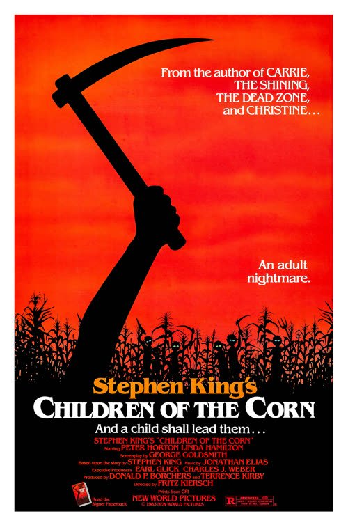
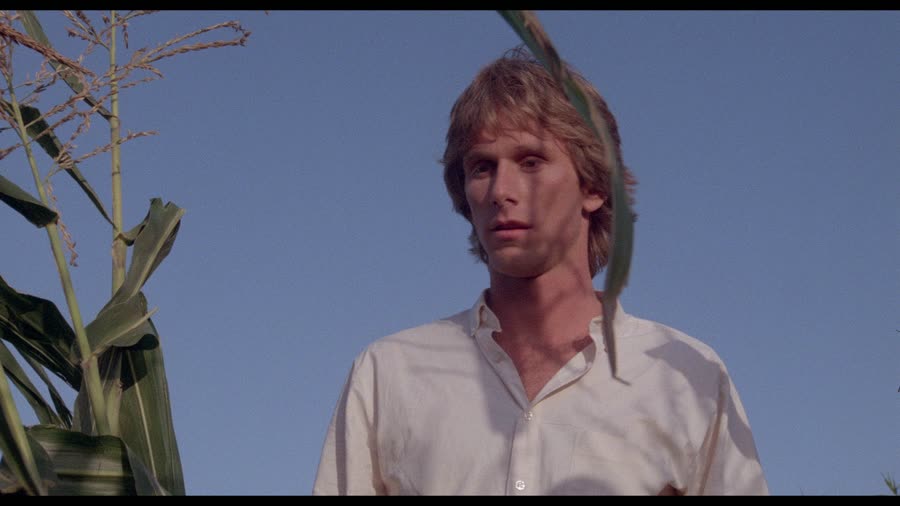
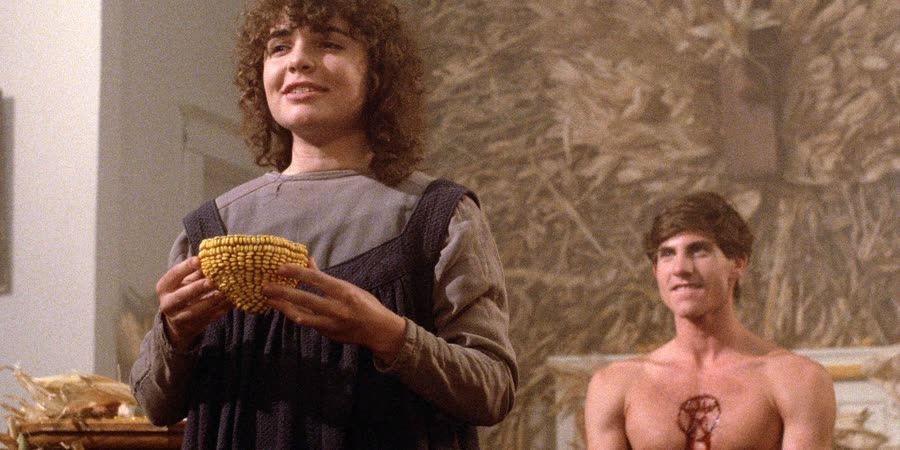
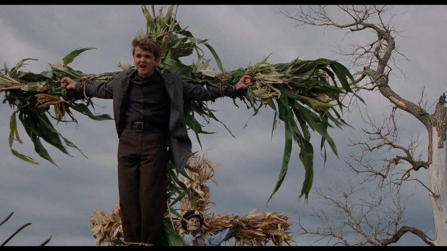

## *Children of the Corn (1984)*: All Hail the Maiziah

{: style="float: right; width: 30%; margin: 0 0 1em 1.5em;"}

Some towns you drive through and forget.

Gatlin, Nebraska, you drive through and the children murder every adult in it, so forgetting it is really more of a them problem.

Stephen King wrote the short story for *Penthouse*, of all places, and then hated the movie for straying too far from it. What the movie keeps is the important part: a crop failure, a charismatic child preacher, and absolutely zero adult supervision. Population: children. Occupation: murder. Religion: complicated.

### Breakfast of Champions
{: style="clear: none;"}

The whole thing is narrated, after the fact, by a kid named Job — spelled like the Bible, pronounced like employment, and a trap for anyone reading from notes. Job's dad had old-school parental intuition: he did not like Isaac, so on the Sunday in question he took Job to church instead of letting him run out to the cornfields with the other kids. It is the single best parenting decision in the entire film, and it buys the man about twenty minutes.

After church: the diner. Job's dad feeds coins into a pay phone to check on his sick daughter at home — a timeline detail so eighties it should be in a museum — and Job orders a milkshake thick enough to qualify as a solid. Outside the glass, Isaac appears. He does not speak. He just gives the eyes and the little head nods, signals to the children working inside, and the hat is doing a lot of the menace all by itself. A shame about the hat, really: he wears it for exactly one scene, and yet decades later it is the entire memory of the character.

The coffee has been poisoned. The adults start dying where they sit, and the kids come at the rest with knives, farm tools, anything with an edge — they have locked the doors first, because this cult does logistics. Then, when it is over, they simply leave. No words. No cleanup. Job, whose father has just died in front of him, does nothing. Not a tear, not a scream. Nothing is what Job was doing, and at nine or ten years old, shell shock is a fair defense — but the stillness is the creepiest thing in a scene full of corpses.

Three years pass. Nobody comes to check on Gatlin. Hold onto that.

### Happy Birthday, Here's a Body

Three years later, meet Burt and Vicky: he has just graduated medical school, she is Linda Hamilton about fifteen minutes before *The Terminator* made her Sarah Connor, and they are driving cross-country to a new job in Seattle. Their catastrophic mistake is driving through Nebraska, which, to be fair, a lot of routes force on a person.

The movie's first real jump scare is a birthday horn. Vicky sneaks up on a sleeping Burt, lets it rip, and it lands harder than anything the corn ever manages. File that away; the bar has been set by party supplies.

Out on the highway, a boy runs out of the corn and in front of their car. What Burt and Vicky do not know is that the kid was escaping Gatlin — and that Malachai, Isaac's redheaded enforcer, caught up with him in the field and slashed him open seconds before he reached the road. Burt hits what is left of him at speed. It is, honestly, the best effect in the movie: he absolutely nailed him.

Then the concern starts. Burt, a doctor, can tell the boy was cut up by something other than a car, which is why Vicky gets sent back to lock the doors — there is somebody out there. Vicky's reaction to having just killed a child is to ask "Is he dead?", receive confirmation, and then go take a nap in the car. A full nap. No adrenaline whatsoever. Meanwhile Malachai circles the car with his knife, doing nothing, and when the dead boy springs up at her a moment later it turns out to be a dream — which raises the question of how she can dream a person she has never seen. She cannot. The movie simply does not care.

Burt's solution to all of this is to put the body in the trunk, so it can serve as evidence. Evidence he is now covered in, in the trunk of his own car. On paper, flawless.

### Probably Just My Golf Bags

{: style="float: left; width: 45%; margin: 0.4em 1em 0.6em 0;"}

They need a phone. There are no phones. There is only corn, for miles, in every direction, forever.

What they find instead is a mechanic whose dog fetches his tools for him — a system that sounds efficient until the dog brings back a wrench eight times the size requested and gets told "perfect, thanks." The mechanic is worse than useless: Gatlin's children have blackmailed him into steering travelers anywhere but toward help, so he warns them off Gatlin while giving directions that lead, with geometric certainty, to Gatlin. Every road sign agrees. Gatlin, four miles, to the right. Go left: Gatlin, two miles, to the right. The signs are not broken. The signs are the trap.

Bouncing down dirt roads between the cornfields, the car slams its brakes for a turn and something thuds in the trunk. Vicky asks what that was. Burt, without missing a beat: "Probably just my golf bags."

It is the funniest scene in the movie, and it is not close.

The children, tipped off that strangers are coming — Sarah, Job's little sister, has a gift; she draws things before they happen — decide the mechanic has outlived his usefulness and kill him. They kill the dog too, which is the one death in this movie that feels genuinely personal. He was the only competent employee in the county.

### Population: Corn

So Gatlin it is, and Gatlin is empty. No people, no moving cars, no sound. Just corn — and not out in the fields where corn belongs, but *in* the town: stalks stuffed into cars, wedged in doorways, draped over office furniture. The whole place has been redecorated by agriculture. It has the energy of a town where something went wrong three years ago and not one person in the outside world has bothered to drive in and ask a single question.

By pure luck they park at the very diner from the opening and go in hunting for a phone. While they are inside, children start messing with their car, and Burt — who has a dead child in his trunk, a fact that has somehow slid down his priority list — chases them off like a man whose biggest problem is vandalism. The hypocrisy is breathtaking. You have one in the trunk, homie.

Looking for help, they find a house, and because everyone in this movie has lost their minds, they do not just knock: they go in, look around, try the kitchen phone (cord cut, naturally), and proceed *upstairs*, into a stranger's bedrooms, in a ghost town, uninvited. Rude as hell is the only verdict available. Upstairs is Sarah, six or seven years old, alone with her crayons, drawing pictures of things that have not happened yet. Her latest work will be along shortly, and it is not good news for Vicky.

### All Hail the Maiziah

{: style="float: left; width: 45%; margin: 0.4em 1em 0.6em 0;"}

Burt leaves Vicky with Sarah and goes back out to accomplish nothing. In his absence, Malachai and his goons come for Vicky — while, downstairs, Sarah is calmly drawing a picture of Vicky being captured. Sweetheart, draw faster. That is the whole value of prophecy: lead time.

Vicky ends up tied to a cross made of corn in a clearing, an offering for the god of this place: He Who Walks Behind the Rows. Rows. As a child, at least one viewer spent years picturing a demon hiding behind a single rose, which does sound like a nicer class of demon — probably smells lovely. The adult word is *rows*, endless rows of corn, and the god moves through the ground beneath them in rolling waves of dirt that are, for most of the film, all you ever see of it. The restraint works. For most of the film.

Meanwhile, the cult is having office politics. Malachai does everything around here: he keeps the children in line, he handles the adults who pass through, he killed the mechanic. Isaac mostly hangs out in the corn communing with his god and taking the credit. Three years of doing another man's dirty work has produced exactly the feelings you would expect, and Malachai begins staging a coup — because workplace resentment is universal, even in corn.

Burt, hunting for Vicky, stumbles into the church mid-service: a congregation of children, a bowl of blood about to be passed around, and a boy on the altar about to turn nineteen. That is the deal here — on the night before your nineteenth birthday, you are sacrificed to the god, willingly, joyfully. Why nineteen and not eighteen is never explained; the cult's paperwork is not its strong suit. Burt interrupts with the reasonable suggestion that everyone calm down, and gets stabbed in the chest for his trouble. He runs it off. This is the eighties: a strip of blood, a bonk on the head that bothers him more than the knife wound, and he is back in business. Job hides him in a storm cellar, where Sarah — professional, age seven — bandages a chest wound like she is clocking into a shift.

### The Fastest Deprogramming in History

{: style="float: right; width: 45%; margin: 0.4em 1em 0.6em 0;"}

From the top of a barn, Job shows Burt the clearing: the cross, the children, Vicky. Except the coup has moved faster than the rescue. When Burt arrives, it is not Vicky on the cross. It is Isaac. Malachai has given the god his prophet, and Isaac — serene, certain, warning them that the god talks to *him*, not to Malachai — is about to find out he was right. Something yellow and amoeba-like rolls up out of the earth and takes him, and Isaac launches out of the clearing like a corn-fueled rocket. The effects, which have held together on atmosphere all film, choose this moment to fall completely apart.

Burt bonks Malachai across the face, frees Vicky, and then performs the quickest plot resolution ever committed to film: he lectures the children. These kids have run a murder cult for three years. They have killed dozens of people, including their own parents. Burt suggests, in essence, that Isaac may have been manipulating them — and it *works*. It takes maybe three minutes. People spend years in therapy after leaving high-control groups; these children needed one sentence and a stranger with a head injury. Only Malachai holds out, so Burt beats him, thoroughly, like a grown man who has had a long day.

Then Isaac comes back. Possessed now — hair wild, eyes wrong, the god wearing him — and his first order of business is the employee who put him on the cross. He kills Malachai with one hand. A tiny kid, one hand, no contest: the demon provides the strength, and Malachai provides a lesson about middle management reaching beyond its station.

### Burn Down the Whole State

Everyone retreats to the barn. The storm is rising, the ground is moving, and Job produces the solution: a Bible verse. Burt reads it aloud, waiting for the magic, and the magic turns out to be literacy — the verse mentions fire, Vicky clocks "lake of fire," and the plan becomes arson. This from the woman who napped through a vehicular homicide and mistook a corpse for golf equipment. Character growth.

The plan has one logistical problem: the corn is *everywhere*. It is the town, the roads, the county — arguably the state. They are going to burn one field and call it a demon. But it is the only plan on the table, so Burt fills the irrigation system with gasoline, runs out a hose, and gets attacked by the corn itself, stalks wrapping around him like the vegetation in this part of Nebraska has unionized. Job frees him with a pocket knife, gets scolded for leaving the barn, and then watches Burt throw the Molotov and miss — all that corn, and the bottle lands in a dirt lane. So the child retrieves the still-burning bottle, carries it back, and hands it over with the energy of a tiny supervisor: throw it again, correctly. It is the most competent anyone is in the entire third act.

Second throw: everything goes up. A red beam shoots into the sky, the clouds twist into a giant face — a frown, a big unhappy frown — and the ambiguity the movie spent an hour protecting dies right there in basic CGI. The god is gone, apparently because the demon needed *this* corn specifically, despite the audience having watched the cast drive through roughly nine thousand acres of the stuff.

Burt and Vicky walk away with Job and Sarah in tow, having known them for one day and already floating "a week? a month? forever?" like a couple adopting children at gunpoint. Back at the car — covered in corn, because of course it is — Burt digs for a map and finds one last true believer hiding in the back seat. She lunges at him with the biggest miss of all time, gets bonked square on the forehead for it, and the four of them walk off toward the next town, leaving a dead boy in a trunk and a concussed child in a corn-car behind them.

Not their problem anymore.

### The Verdict

Talon gives *Children of the Corn* **3 cents out of 10** — and the gap between that and nine-year-old her is the whole story. At nine, watching it on HBO a couple of years after release, she would have said nine without blinking; at 51, the effects that once amazed her look like what they are. The three cents are explicitly for the kids, who carry this movie: John Franklin was 23 when he played Isaac, a growth hormone deficiency giving him the stature and the voice, and the result is genuinely unnerving in a way acting alone does not explain — your brain keeps insisting something about him is older than it should be. Malachai matches him beat for beat. Against that, Peter Horton is fine, Linda Hamilton is — generously — pre-*Terminator*, and the famous restraint of He Who Walks Behind the Rows is spent at the end on a lighting effect and a frowny cloud. She read King all through childhood, which may be why the film gets scored against the story it could have been.

Christopher gives *Children of the Corn* **4 cents out of 10**. This was his first viewing, and he arrived with two strikes against it: he does not like movies dominated by kids, and he is not a huge fan of older horror. What saved it is that it is far more fun to talk about than to watch — the notes wrote themselves, and the golf bags line alone earned goodwill no cornfield could burn off. Watching it alone and going to bed, he would pass; as an episode, it over-delivered. Even he concedes the children out-acted the adults, though the highest praise in his corner remains reserved for the fact that none of this was his problem.

Worth watching if you enjoy: killer-kid movies where the kids are scarier than the monster, eighties practical-effect confidence right up until it runs out, cults with serious middle-management problems, and deadpan trunk-based comedy. Skip it if you need your demons kept off-screen to stay scary — because eventually, this one puts its god in the clouds, and gives him a frown.

**Stuff we use / support the show:**
- Own it on physical media via [Gruv](https://www.tkqlhce.com/click-101633208-15032169)
- Watch with [Plex](https://www.kqzyfj.com/click-101633208-15734677)
- We record this show with [Riverside](https://riverside.sjv.io/4aR7A9)
