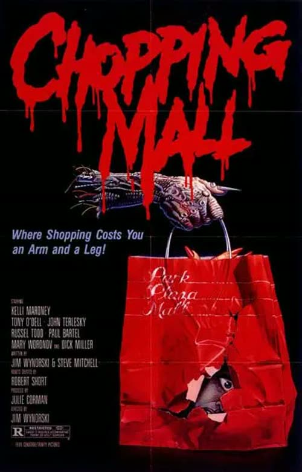
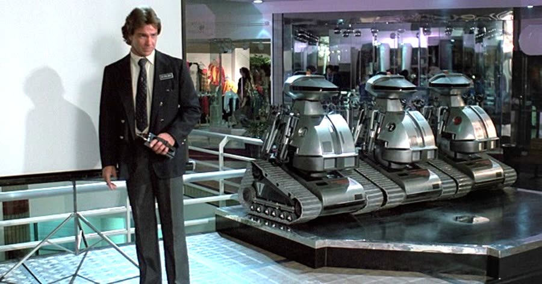
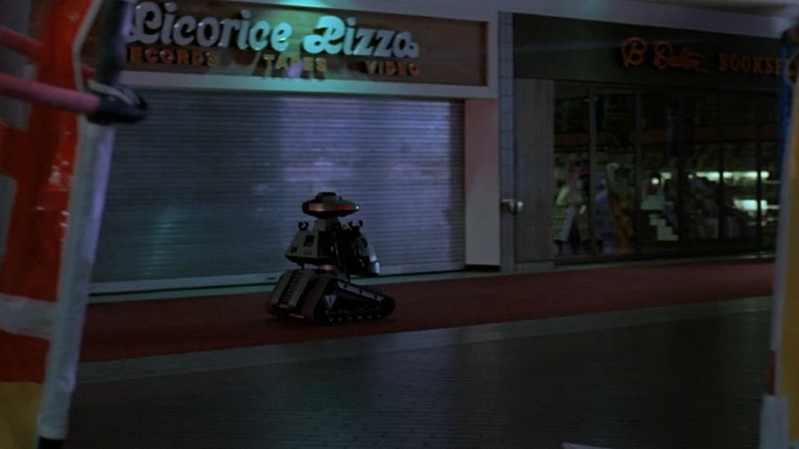
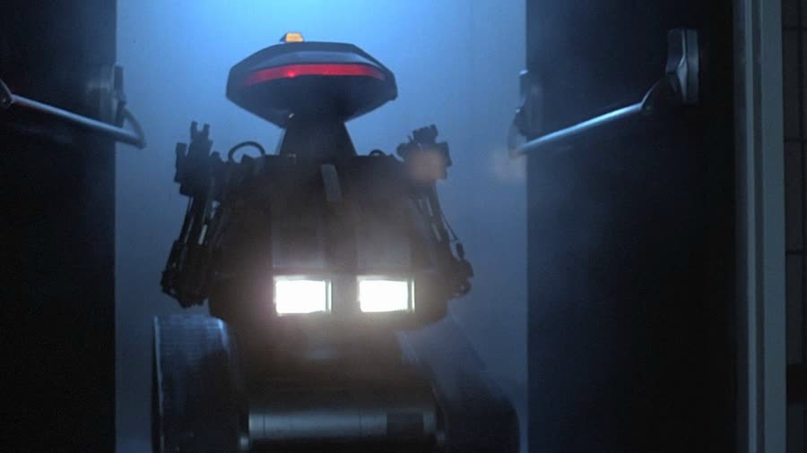
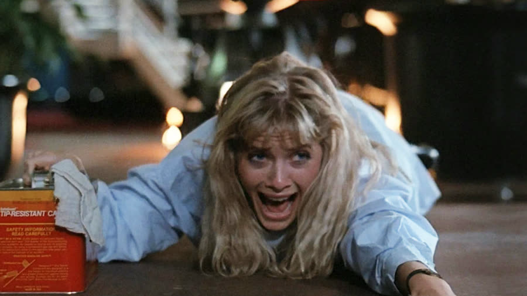

## *Chopping Mall (1986)*: The Lasers Work on Vibes

{: style="float: right; width: 30%; margin: 0 0 1em 1.5em;"}

Some malls hire a security guard.

Park Plaza Mall installs three military-grade robots with lasers, tasers, tranquilizer darts, and little claw hands, because apparently shoplifting sweaters from Chess King had reached DEFCON levels.

*Chopping Mall* is what happens when a corporation builds the Terminator, assigns it to loss prevention, and then acts surprised. Eight mall employees, one after-hours party, one lightning storm — and the penalty for trespassing becomes death by laser beam, administered by a robot that cannot climb stairs.

### Mall Security, but Make It Military
{: style="clear: none;"}

{: style="float: left; width: 45%; margin: 0.4em 1em 0.6em 0;"}

The movie opens with the big unveiling: three security robots called Protectors, patrolling the top floors of the mall after closing. They look like R2-D2 got rejected from the police academy and developed anger issues instead — although, for the record, R2-D2 did not have tank tracks, and the Star Wars nerd in the room would like that noted.

Immediately, there are questions. How many people are breaking into malls after closing? The most dangerous part of a mall is when everybody is in it. This does not feel like theft prevention; it feels like a bunker preparing for the fall of civilization, with a food court.

And the system apparently cannot run itself. It requires dedicated technicians sitting in a control room all night, monitoring three robots like NASA mission control. Why can't the mall manager just flip a switch at closing time? Why is this poor guy in a room, all day, waiting for nighttime robot patrol? The movie has no answer. The movie has many things, but answers are not among them.

### Studio 54, but It's a Furniture Store

Meanwhile, the mall montage introduces a four- or five-year-old wandering the mall completely alone, ice cream cone in hand, riding the elevator by himself. Nobody watched their kids in the eighties, so this is not a plot point. It is just the eighties. He ends up covered in ice cream he may not have actually eaten — and, weirdly, those same chocolate streaks keep turning up on the camera in later shots. Remember the ice cream. It comes back.

The actual victims assemble: four couples. Rick and Linda. Greg and Susie, who works at the pizza place with Allison. Mike and Leslie. And Ferdy — Ferdie, per the subtitles, and no, it does not sound like a real name either — and Allison, the only semi-functional human beings in the film.

{: style="float: right; width: 45%; margin: 0.4em 1em 0.6em 0;"}

The plan: an after-hours party in the furniture store where some of them work, which, honestly, is a great use of a furniture store. Everyone drinks, hooks up, and treats the showroom like Studio 54 — a reference that has to be explained to the younger half of this podcast, who hears "still life" and thinks of paintings. The seventies were a long time ago. It is fine.

Outside, a lightning storm hits the mall. And hits it. And hits it — four or five strikes on the same little control box, which really puts a dent in the whole "lightning never strikes twice" thing. The storm fries the robot control system and then, its work apparently done, stops.

### Porn Kills

The first technician notices something is wrong — how could he not, the zap made the biggest noise imaginable — and opens the manual, because there was no YouTube in 1986. Inside the manual: half a poster of a half-naked woman. He is instantly, fatally distracted. He never hears the robots roll up behind him. One of them opens a little Lego claw hand and slits his throat.

Porn kills, everyone. Just so you know.

A second technician arrives to find his predecessor vanished entirely — the robots handle their own HR, apparently — sits down, and gets killed too. What actually matters about this man is that he chews gum from the second he walks on screen until the second he dies. Five minutes of screen time. All chewing. It nearly ended the viewing entirely; a fiancée had to be informed that the movie was about to be turned off.

The robots also electrocute a janitor — a face from a ton of eighties movies, in a role far too small for him — with the full zap-zap, see-the-skull treatment. Then they go on patrol, exactly as programmed. Only now the mission includes murder.

### Headshot Mode

Back at the party, Leslie has a problem that outranks mortal danger: she needs a cigarette. Mike is dispatched to the cigarette machine — they had those back in the day, and they were awesome — where a robot demands his badge, fails to recognize it, sleep-darts him, and then slits his throat anyway. The dart and the throat-slitting is a belt-and-suspenders approach to mall security.

Leslie goes looking for him, finds the body, and runs. What follows is the movie's central mystery, and it is not the robots. It is the lasers. They hit the walls, the windows, the signs. They hit Leslie in the back, the legs, and repeatedly in the butt, and they do absolutely nothing — roughly equivalent to getting zapped by a bug zapper. Then, the second she reaches the furniture store, in full view of everyone, one shot hits her head and her entire head explodes.

Why didn't her ass explode? Because there is a headshot mode, evidently. Or because the beams only activate when the effects budget kicks in. Both theories hold up equally well, which is to say the lasers run on vibes and everyone in this movie is at their mercy.

The survivors barricade themselves in the stock room. Note that while fleeing for their lives, several of them naked or close to it, every single one of them managed to retrieve all of their clothes from all over the furniture store. Survival instincts: strong. Laundry retrieval instincts: stronger.

### Guns, Ducts, and One Flare

The guys' plan is guns, so they break into the sporting goods store — malls sold major firearms back then, right there between the food court and the almonds. The girls' plan is the air ducts: crawl to the parking garage. The robots, demonstrating the only competence they will show all night, crank the heat in the ducts until the metal burns the girls' hands through their shirtsleeves. The ducts, meanwhile, are brand spanking new. Not a speck of dust. This mall has many problems, but ventilation hygiene is not one of them.

Susie panics about Greg and bolts, so the others follow her into an auto parts store, where they assemble gasoline cocktails and Allison grabs exactly one road flare, for no reason whatsoever. Take all the firepower you can carry? No. One flare. Remember the flare, too.

The guys confront a robot head-on, automatic weapons blazing, and Ferdy rolls a propane tank up against it. They shoot the tank. The robot tips over. That is all. No explosion, no fire — MythBusters busted this one years ago; the Jaws ending lied to everyone. And after a decent interval, the robot tips itself back up, because of course it does.

### Stop, Drop, and Roll

The girls' turn goes worse. The lasers, having been decorative all night, suddenly work: Susie takes one in the leg, and it gushes blood. Then the robot shoots the gas can in her hands and she is entirely, completely on fire.

Susie was raised in the eighties. Stop, drop, and roll was the elementary school curriculum. She was already on the ground. She stands up and burns anyway.

The survivors regroup in the pizza restaurant and immediately begin calculating how much money they owe for the damage to the mall — eighty-five years to pay it back, by one estimate. To be clear: the teenagers being hunted by murder robots are not the liable party here. The killer robot company is somewhat more liable.

Also unexplained: the police. The original sales pitch said the robots detain criminals until the mall computer contacts the police. There have been explosions, murders, laser shootouts, and electrical fires, and nobody has come. There were fire alarms in 1986. Meanwhile the master plan is to destroy a control center that may or may not already be destroyed — the movie cannot keep its own wiring straight — and nobody, at any point, simply uses the stairs. The robots run on tracks. Tracks cannot do stairs. They can only ride the escalators, which are somehow still on, because if they weren't, there would be no movie.

Greg, unhinged after Susie's death, charges the robots to avenge her. They throw him over the railing. Blink and you will miss the entire death: fine, fine, fine — dead, three floors down. If only he had landed on whatever Allison lands on later.

### A Golf Cart, a Mannequin, and a Lot of Paint

The last four — Allison, Ferdy, Rick, and Linda — pass a store called House of Almonds on their way to hide in a department store. An almond-only business model inside a mall seems unsustainable, but this is the Sherman Oaks Galleria, a real mall that appeared in roughly every eighties movie ever made, the Leonardo DiCaprio of shopping centers. There may well have been an almond store.

The mannequin decoy plan works beautifully: a robot shoots its own reflection, the laser wraps around it like Christmas lights, and it blinds and fries itself, which feels about right for these things. In the chaos, Linda takes a laser to the chest and dies instantly — so torso shots are lethal, when the lasers feel like it.

{: style="float: right; width: 45%; margin: 0.4em 1em 0.6em 0;"}

Rick, having lost Linda, gets on the dumbest half-assed golf cart ever committed to film and drives it directly into the electrified robot. Say that again out loud. He runs into the electrified robot. Cart, man, and robot all electrocuted. What was the expected outcome of this plan? Grief is not a strategy.

And then there were two, and the two immediately split up, Scooby-Doo style, to search for a control room neither of them can locate despite both working in the mall. Ferdy click-clacks down an endless back corridor — thirty minutes down, two seconds back when Allison screams — and throws a fire extinguisher at a robot, which catches it and throws it back. He goes down in a puddle of blood. Dead, surely.

Allison, alone, hides in a pet store behind a small bag of dog food — hiding behind a microphone would be as effective — while the robot knocks over the tarantulas and snakes, all of which beeline directly for her, because they know. She dangles off a railing — there is a ledge for her feet, right there, which she declines to use — falls three stories, lands on a display suitcase, and walks away with a limp. One suitcase saved her life. Greg is furious somewhere.

Her last stand is the paint store, where she pours can after can of paint across the floor — paint that is somehow already colored, in every eighties shade, in cans that are somehow half full, when paint is famously sold white and tinted at the counter. She adds the thinner, lures the robot in, and its tracks spin uselessly in the slick. Then out comes the one flare from the auto parts store, the most patient Chekhov's gun in cinema. The paint goes up in an explosion bigger than the propane tank ever managed, the robot's head pops clean off, and the mall, somehow, does not burn down.

{: style="float: left; width: 45%; margin: 0.4em 1em 0.6em 0;"}

Daylight. Allison walks out — and Ferdy appears, head wrapped in a roll of blood-soaked toilet paper. Head wounds bleed like crazy; the man had a boo-boo. The two semi-functional humans are the only survivors, which is the most logical thing in the entire film. The credits then introduce the whole cast by name, like this was an event picture. One of us turned it off at the first name.

### The Verdict

Christopher gives *Chopping Mall* **half a cent out of 10**.

His first answer was zero — then he pulled it back, because he is saving zero. Half a cent is half of his previous lowest score, and it is earned: nothing in this movie makes any sense, the robots are pieces of junk that could be defeated by a staircase, everyone dies one by one in ways too fast to follow, and the gum-chewing alone nearly got the movie turned off. He could not imagine ever wanting to watch it again.

Talon gives *Chopping Mall* **2 cents out of 10**.

Two cents just for existing, and for being an eighties movie. Growing up on this exact species of film builds an immunity to its annoyances — it is so stupid it loops back around to fun, the perfect thing to have on while doing something else, even if looking away for one second means somebody died and you will never know how. The discontinuities genuinely drove her up the wall, though. This is a Roger Corman production written at top speed — it was originally called *Killbots*, until Corman decided audiences wouldn't know what a killbot was and renamed it after a chopping that never happens. Nobody gets chopped. There are no hatchets. Talon was promised hatchets.

So: corporations should never build killer robots, and laser technology in the 1980s worked entirely on vibes.

Worth watching if you enjoy: killer robots with the speed and menace of angry Roombas with asthma, laser physics governed by mood, the Sherman Oaks Galleria in its prime, and a head explosion that single-handedly justifies the effects budget.

**Stuff we use / support the show:**
- Own it on physical media via [Gruv](https://www.tkqlhce.com/click-101633208-15032169)
- Watch with [Plex](https://www.kqzyfj.com/click-101633208-15734677)
- We record this show with [Riverside](https://riverside.sjv.io/4aR7A9)
