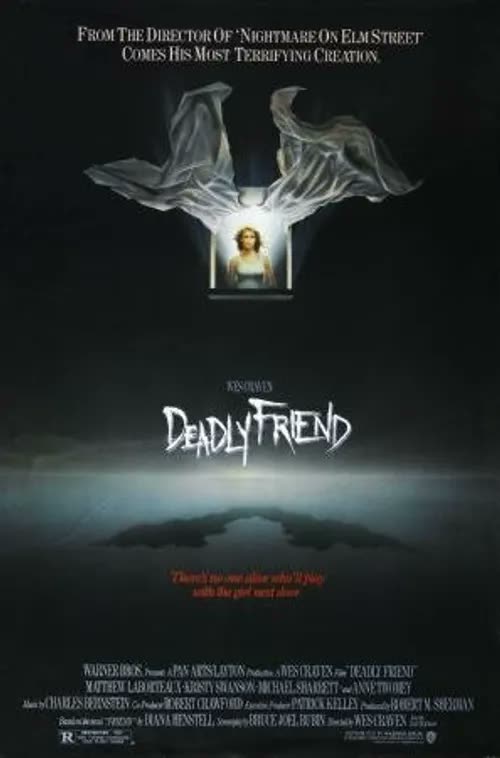
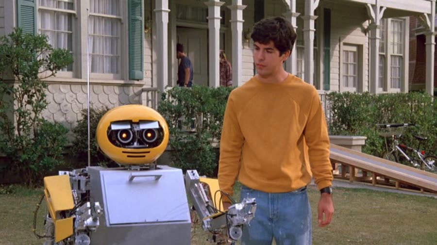
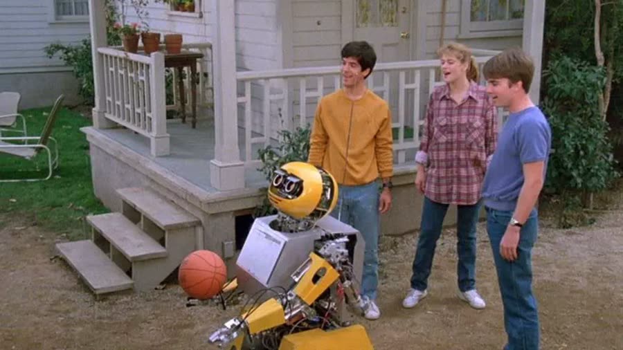
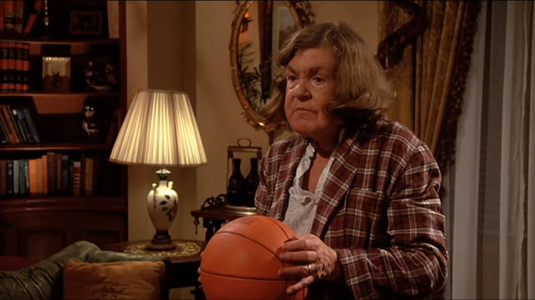

## *Deadly Friend (1986)*: Grief Counseling Was Unavailable

{: style="float: right; width: 30%; margin: 0 0 1em 1.5em;"}

Some teenagers build a robot best friend.

Paul Conway built one, lost it, and then installed its brain in his dead girlfriend, because apparently grief counseling was unavailable.

*Deadly Friend* is Wes Craven's 1986 pivot from teen drama to teenage Frankenstein: about forty-five minutes of sweet neighborhood setup, followed by one of the worst "I can fix this" decisions ever committed to film. It starts with a cute little robot and ends with emotional trauma and a basketball with a body count.

### A Robot Named BB
{: style="clear: none;"}

{: style="float: left; width: 45%; margin: 0.4em 1em 0.6em 0;"}

The movie opens outside a restaurant called Burger Heaven, which, yes, would get all the business. A thief is breaking into a Volkswagen van — back then you could apparently pop a car window open with your bare hand and a positive attitude — and going through a purse inside. His mistake is commenting that the little robot in the back is cute. BB clamps a pincer around his neck before the owners even get back. Best security system of 1986: everybody needs one. He's also one software update away from Chopping Mall, and that thought never entirely leaves.

BB belongs to Paul, a fifteen-year-old who built and programmed him himself. Paul is not just smart; he's scholarship-to-a-university, neuroscience-and-AI, has-his-own-lab smart. He can't drive or rent a car, but sure, give the child a laboratory. Mistake number one, possibly.

Paul and his mom Jeannie have just moved to Welling, Pennsylvania. BB immediately shows signs of being a little more autonomous than advertised: needing to charge, he flings a piano across the room to reach the outlet and wrecks the floor doing it. Imagine a Roomba that rearranges your furniture and plugs itself in. The initiative is impressive. The property damage is a preview.

### Welcome to the Single Block

The neighborhood assembles fast. Next door is Sam — Samantha, played by Kristy Swanson, the original Buffy — who seems sweet and is visibly jumpy, because her father Harry is a drunk who announces himself by screaming about where she put his bottle. Paul, arriving mid-yell, just turns around and walks away. Correct instinct, terrible foreshadowing. Nobody says where Sam's mom is. On this street, nobody asks. It's a single-parent block: Paul's dad is gone too.

{: style="float: right; width: 45%; margin: 0.4em 1em 0.6em 0;"}

Tom, the paperboy, completes the friend group by falling off his bike at the sight of BB in the most diabolical flop ever filmed — every limb in a different direction, Peter Griffin energy. He'll do it again. It's his gift.

Down the street lives Mrs. Parker, a mean, reclusive shotgun owner who threatens the kids on sight and whom Tom treats as harmless because she never actually fires. Famous last assumption. And rolling through periodically is a dirt-bike gang of peak-'80s douchebags — dangly earrings, vests, one clown with a truly unforgivable haircut — who make the mistake of messing with the robot. BB gets a pincer full of the leader's nuts and holds on until the gang is gone. His friends left before he let go. BB isn't just a robot; he's a friend, he protects Paul, and he keeps receipts.

### The Whitest Basketball Game Ever Played

The gang plays basketball, in the loosest possible sense — possibly the whitest basketball ever committed to film, all jumping in place while the ball goes wherever it wants. BB gets a turn. The expectation is robot precision. Instead, BB turns around and chucks the ball backwards, a hundred feet over the street, straight onto Mrs. Parker's porch.

Mrs. Parker keeps it. It landed on her porch; it's her ball now. This was simply the law in the '80s — mean neighbors accumulated a house full of confiscated sports equipment, and children accepted it. What she doesn't notice is BB staring her down, little metal eyelids squinting. He's not letting it go. BB is making a list.

### Halloween Ruins Everything

The movie hopscotches holidays. Halloween: Sam comes to Paul's door with a bloody nose, asking for ice, saying nothing. Everybody in the room knows. Nobody says it.

Tom, one of the bigger ding-dongs ever to hold a paper route, picks this night to prank Mrs. Parker — the last person on Earth to prank, an armed woman with a padlocked gate. BB does his robot math and picks the lock. Sam goes up to ring the bell, the security system goes berserk, and Sam simply freezes. No ditch. She screams, drops, and has to be physically dragged away around the side of the house.

BB isn't there to help. Paul had switched him off for being annoying, so he's parked where he sat when Mrs. Parker comes out with the shotgun. She doesn't hesitate. She triple-taps him — arm, dome, chest — then reloads and shoots him again. Smoke, parts, gone.

Paul is devastated, and notably, he never tries to rebuild BB. Too sad, maybe. The robot was his best friend; you don't just build another one. Hold that thought, because it's about to become extremely untrue about a person.

### Studying on Thanksgiving

Thanksgiving. Sam has dinner with Paul and Jeannie — pleasant, warm, the works — and Paul walks her out and kisses her. Slick work, nerd. Then Sam goes home to Harry, who is up, drunk, and waiting. Her cover story is "we were studying," delivered while holding hidden books, on Thanksgiving night, after dinner. She is a terrible liar. She also does not deserve what happens next: Harry beats her and throws her down the stairs. She lands headfirst, convulsing, while he tells her to get up.

The ambulance takes her. Harry invents a story for the neighbors. At the hospital — which appears to be fused with the university, because the professor who recruited Paul is also the doctor, sure, combine them, save money — the verdict is brain death. Twenty-four hours on life support, then they pull the plug. Harry, told there might be a wait, is essentially tapping his foot. It can't happen soon enough for him. They move it up to nine o'clock.

Paul, having already lost his best friend, is now losing the girl, and Paul's response to grief is engineering. He remembers BB's microchip — the little BB brain he built, somehow intact despite BB's head being blown off. Backup chip? Prepared for everything? Either way, the plan forms: take Sam, implant the chip, bring her back. On paper, tell me how it makes sense. It doesn't. He is thinking with his heart and not his brain, and that is the lesson of the entire movie.

### Don't Think With Your Heart

Step one is drugging his own mother. Paul dumps powder into Jeannie's coffee — twice, because she keeps turning around — in what becomes the most tense scene in the film: the stuff is visibly floating on top while she sips it, declares she makes good coffee, and Tom spits his drink across his own face. Where does a fifteen-year-old get knockout drugs? The hospital, probably. He has access to everything else.

Tom is essential because Tom's dad is a hospital security guard with keys. In the chaos of a power cut — Tom cuts it too early, trapping Paul in an elevator, in a plan that involved cutting power to a building where Sam was on life support — Paul wheels her body out in a laundry cart, drives the VW bus he can barely operate to the lab, and puts the chip in her grey-blue brain. That brain is no good anymore, homie. Put nothing in it. Her leg twitches. Tom, professional faller, falls.

Paul stores her in the shed and switches her on with the remote. Her eyes open. She breathes. She also looks dead — pale, blue around the eyes — and she can't talk, and her hands curl into BB's little pincer claws, fingers crossed over like she's repping a gang. This is not Sam. This is Sam's body, BB's brain, and Paul's grief in a blender: BB-Sam. She spots Harry through the window and does BB's stare, and Paul deactivates her — trusting the off switch that never once worked on BB, who routinely turned himself back on. The super genius forgot he never fixed that. It balances out, apparently: the smarter you are, the less common sense you get.

### BB Had a List

Paul leaves her in the shed. She goes home — five steps, next door, the first place anyone would look, while Paul searches all over town. There, she lays a trail Harry cannot resist: a little bourbon pint, left out like bait for a rabbit. He bends down licking his lips, and she grabs him, throws him across the basement, holds him against the furnace, and breaks his neck while he burns. Forty-five minutes into the movie, the deadly friend has arrived.

Paul finds Harry's charred head in the furnace and makes his worst decision yet, which is saying something in a film where he stole a corpse: he hides the body. Into the coal bin — giant Pennsylvania coal chunks, a hand sticking out, pushed back in with another chunk — because maybe this can still be fixed. It cannot be fixed. We were past fixing at corpse theft. He moves Sam from the shed to a bedroom. The shed didn't work; why would a bedroom? Then the attic. He keeps moving her higher, like altitude is a security strategy.

That night she busts out for Mrs. Parker — who still has the basketball. She hears a noise, grabs the shotgun, and Sam picks up the ball and throws it so hard it explodes her entire head, in one shot, and the body walks around spurting blood like an Evil Dead audition. Death by basketball. The most famous scene in the movie, and it earns it: apparently a human skull is softer than a basketball. Don't get a basketball thrown at you.

{: style="float: left; width: 45%; margin: 0.4em 1em 0.6em 0;"}

### Come With Me, Paul

Mrs. Parker, to her credit, had called the police before dying — she'd seen "dead Sam" staring out of Paul's window. The cop took his time, then found two bodies with impressive speed, including Harry in the coal bin, which raises questions about what made anyone look in the coal bin. Very good police. Tom rolls up, takes in the scene, and passes out on cue. His casting call was three falls and a "say no more."

Everything collapses at once. Paul punches Tom in the nose — the second bloody nose of the movie, a theme — Tom declares he's calling the cops, and BB-Sam leaps out of the top window onto him and starts wailing. Then the biker picks exactly the wrong moment to beat Paul up ("no BB to save you now" — how did he know BB blew up? Was there a newspaper article?), and Sam arrives, grabs him by the chest, and throws him into a cop car, which kills him, somehow, without even going through the window. A lucky throw.

It ends in the shed, ringed by cops with drawn guns — a lot of firepower for one teenage girl, though in fairness she does have three bodies on her. She sees Paul restrained and struggling, reads it as a threat, and charges the cop with the gun. She's shot. She dies in Paul's arms. Again. He's lost his robot and his girl twice each.

And still he triples down. The morgue: Paul rolls her out of the drawer — "let's get you out of here" — out of rooms to put her in, out of plan entirely. Then she grabs his throat, and her face peels back, and BB's robot head comes out of her skin, teeth and all, and says it: "Come with me, Paul." Off-screen, a choking sound, then a snap. Roll credits.

Is it a dream? There were dreams in this movie — Sam stabbing Harry while he cackled, a basketball under a bedsheet swelling into Harry's head — and treating the morgue as one is the only way it makes sense, because a chip in a brain does not turn a body into a metal robot. But the flickers were real: Sam's vision pixelating like BB's, then clearing; her claw hands occasionally going normal; Sam surfacing enough to say Paul's name. She was coming back, in pieces, and he saw it, and that's the tragedy under the nonsense. The robot bursting out of her face is still a dumb ending. Both things are true.

### The Verdict

Christopher gives *Deadly Friend* **5 cents out of 10**.

Almost a stretch, and he knows it, but it earns the five on pedigree: it's Wes Craven, it's a classic '80s horror movie, and there are scenes that are genuinely good and genuinely funny. The basketball kill is the classic for a reason. His Craven loyalty runs deep — he watched the original *Last House on the Left* at a thirteenth birthday sleepover, the only kid still awake, and has never recovered — and for all its ridiculous premise, this movie doesn't put its ridiculous concept together in the stupidest way possible. You go in knowing a boy puts a robot chip in his dead girlfriend. It delivers exactly that, competently.

Talon gives *Deadly Friend* **5 cents out of 10** as well.

She probably wouldn't watch it again, but she enjoyed her time — the synth score alone, funky and perfectly mood-matched, carried a lot. It felt like two movies in one: a teen drama with real setup and character development, then a ridiculous splatter movie at the end, and the forty-five minutes of groundwork gave the crazy something to stand on — more substance and connection, honestly, than some slasher fare manages in its whole runtime. '80s movies aren't her super thing, but this one she could happily leave on in the background, doing something else, glancing up for the good parts.

So: a five and a five, and a neighborhood that should have invested in therapy instead of robots.

Worth watching if you enjoy: killer robots with claw hands, teen Frankenstein, death by sporting goods, and proof that no amount of genius substitutes for one (1) healthy coping mechanism.

**Stuff we use / support the show:**
- Own it on physical media via [Gruv](https://www.tkqlhce.com/click-101633208-15032169)
- Watch with [Plex](https://www.kqzyfj.com/click-101633208-15734677)
- We record this show with [Riverside](https://riverside.sjv.io/4aR7A9)
