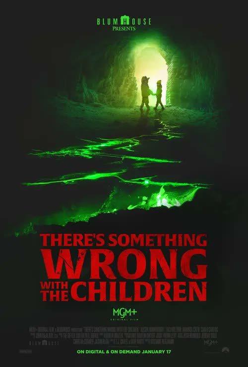
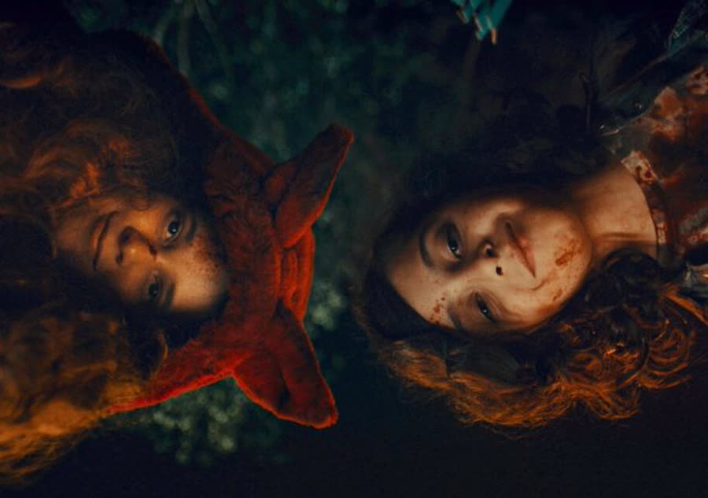
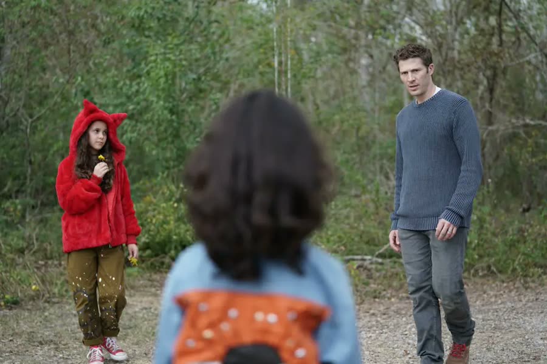

## *There's Something Wrong with the Children (2023)*: The Pit Is a Bug Zapper

{: style="float: right; width: 30%; margin: 0 0 1em 1.5em;"}

Two couples go to the woods for a relaxing weekend. One couple brings their kids.

By the end of the weekend, the kids are the only ones having a good time — largely because they are no longer, strictly speaking, kids.

*There's Something Wrong with the Children* is a Blumhouse movie with a title that does all its own marketing. It is not called *The Kids Are Acting a Little Weird*. It is not called *Maybe They're Just Tired*. The title is a warning label, and the movie spends ninety minutes punishing every adult who refuses to read it.

### Whose Kids Are These?
{: style="clear: none;"}

Margaret and Ben are spending the weekend at a pair of very nice cabins in the woods with their longtime friends Ellie and Thomas, and Ellie and Thomas's two children, Lucy and Spencer. It is exactly the kind of trip that looks great in the planning stage: woods, cabins, old friends, and a truly heroic amount of alcohol. These people drink the entire movie — a bottle of wine, then beer, then back again — and remain suspiciously coherent throughout. Horror is coming; liver failure is pacing itself.

The couples are not in the same place, though. Margaret and Ben are child-free and easy with each other. Ellie and Thomas are sniping from the first few minutes — short, sharp little comments, beers tapped pointedly on furniture, the whole marriage conducted at the volume of a stage whisper. It's subtle at first, the way a crack in a windshield is subtle.

### A Doorway to Nowhere

{: style="float: right; width: 45%; margin: 0.4em 1em 0.6em 0;"}

The next morning's hike turns up an abandoned building, and inside it, a cave — and inside the cave, a doorway somebody blasted through solid rock, opening onto a pit. Or a well. Or a stairway to nothing. Throw a rock in and it doesn't echo. It doesn't land. It just goes.

Lucy and Spencer take one look down and lock in like it's television. They're the only ones who can see the green light shining up out of it. The adults see a hole; the kids see a beacon, and they stand on the edge staring while one of them idly kicks a dead bird, because the movie would like you to start being uncomfortable early and stay that way.

For the record, this is a fork in the road for the hosts of this show. One of them would have seen that building, taken one look at the cave, and noped directly out of the entire hike. The other would already be inside, flashlight out, saying *sweet, what's down there?* Curiosity gets you killed sometimes. She's looking anyway.

### Insert Upside-Down Pineapple Here

Back at camp, Margaret finally gets the truth about the sniping out of Ellie, and it is not what anyone expects from a family camping trip. The two of them got together with another couple for a foursome that was essentially a twosome with an audience: Ellie and the other guy actually got going, Thomas and the other woman didn't, and so the evening's entertainment became watching Ellie enjoy herself a little too much. The marriage has been curdling ever since.

(One co-host of this podcast knew instantly what an upside-down pineapple signifies. The other had to have it explained, at length, on air. Insert upside-down pineapple here.)

So Margaret, being a good friend, offers to watch the kids for the night so Ellie and Thomas can have an actual date and maybe remember liking each other. For two people who've been at each other's throats all day, they accept *fast*. And this, in a horror movie, is how you accidentally become responsible for somebody else's demon children: the kids spend the whole evening begging to go back to the cave, back to the pit, in the dark, through the woods. Margaret and Ben say no — the correct answer — and put them to bed.

### They Jumped. They're Fine. Pick One.

In the morning, the kids are gone. Ben knows exactly where they went before Margaret's finished searching the cabin, and he runs — eventually; he does finish making breakfast first, which is either calm under pressure or a man extremely committed to pancakes. At the cave, he finds Lucy and Spencer standing at the edge of the pit, a quarter of a football field away, too far to grab. He calls them back. They turn around, give him a long, weird look — and tilt in. Both of them. Straight down into the endless dark.

Ben sprints back to camp in total panic, rehearsing the worst conversation a babysitter has ever had — and walks out of the woods to find the kids running around the campsite. Fine. Unhurt. Not a scrape on them, playing by their parents' cabin like nothing happened.

From here, Ben is trapped in the worst seat in horror: he knows, the audience knows, and not one other person in the movie is ever going to believe him. Worse, the kids know he knows, and they set about tormenting him with real craftsmanship. Spencer offers him a bag of chips full of bugs. Lucy pops a bottle top off with her father's trick and pours him a drink like a tiny bartender from hell. Spencer shakes Ben's pill bottle at him — his lithium, his mood stabilizers, the medication from the mental-health episode in Ben's past that the movie has been politely not mentioning. The bottle's full when he grabs it back. The kids are delighted. They're not just evil; they're strategic. All they have to do is push until Ben looks crazy, and the adults will finish the job for them.

### Everybody Fights, Somebody Dies

{: style="float: right; width: 45%; margin: 0.4em 1em 0.6em 0;"}

It works beautifully. The kids' morning disappearance comes out, Ellie and Thomas round on the babysitters who lost their children, and Ben — drowning and mean about it — throws the foursome in Thomas's face, with the footnote that only half of Thomas participated. Thomas is furious at Ellie for telling. Ellie fires back the lowest blow available: that Margaret won't have a baby with Ben because of Ben's issues. Margaret ends the debate by slapping the shit out of her, winning the argument on points and losing it on everything else. It is, not coincidentally, the most true-to-life scene in the movie. Put four adults, those secrets, and that much alcohol in one conversation and this exact fight happens one hundred percent of the time.

While the adults are still radiating, the kids come to Ben's cabin to keep poking him. There's a struggle over a fireplace shovel, Spencer catches it in the chest, chokes, and dies on the floor — lips blue, gone, just like that. Lucy watches the whole thing standing perfectly still, which is its own review of Lucy. Ellie does CPR screaming; Lucy points at Ben; Thomas calls 911 and reports that this man murdered his son. Help, in this rural area, is hours away. A murdered child gets you one police officer on a refrigerator-delivery schedule, apparently. File that away.

### The Shadows Have Wings

Ben finally tells Margaret everything: the kids jumped, the kids are dead, whatever came back is not them. She hears a breakdown, not a warning — the lithium does his credibility no favors — and she agrees to walk back to the pit purely so reality can prove him wrong. It does, in the worst way: the pit is bottomless, there are no bodies to see, and the "kids" are standing right back at camp. There's nothing to show her. She leaves him sitting in the cave with her pity all over him.

Then Lucy finds *her* — talks sweet, says Spencer is just playing, asks to show her something in the woods — and Margaret starts learning. Ellie and Spencer's body are gone from the cabin. Ellie is under the far side of a bed, a bloody ruin, and dies in Margaret's lap pointing down the hallway, where Spencer is standing. Margaret door-slams him, wedges the door with a dustbin (a big metal one; as wedges go, it holds, which nobody was more surprised about than this podcast), and gets her first real look at the truth: through the porch blinds, a shadow crosses — huge, winged, praying-mantis wrong — and then Lucy steps into the doorway shaped like a little girl. The kids are bugs wearing children. Their shadows can't be bothered to lie about it.

Hide-and-seek buys Margaret the car keys and a hiding spot in a closet she doesn't bother closing the doors of. Top-notch skills. It works anyway.

### Officer Dumbass

The police arrive. Officer, singular. Hours late, no ambulance, no backup. Margaret comes out covered in blood explaining that the dead boy is up and killed his mother, and the officer's procedure is as follows: leave the blood-covered woman standing alone by the car with a stern "don't go anywhere," wander inside solo, come back out, and announce there's a lot of blood but no bodies. Detective work. When she finally develops some suspicion — in the wrong direction, at Margaret — something off-screen puts a limb through her and the kids haul her away down the hall. The movie never shows how the bugs do their killing, incidentally. It shows aftermaths and shadows and lets you bill yourself for the rest. Blumhouse has money; they just declined to spend it on that.

Margaret's escape is a relay of bad decisions: hiding under the car with the keys in her hand, saved only by calling Thomas's phone so it rings out in the woods and pulls the kids off her. She makes the car — and then Ben wanders out of the trees, and she goes to him, because of course she does. She's sorry, she believes him now, they have to run.

Ben agrees with exactly none of that. Somewhere in the cave, alone, the pit's glow got its hooks into him too, and the man apologizing in front of her wants to *stay*. Start a family. Make beautiful bug babies. When he grabs her and starts dragging her by the legs, she gets a hand into his duffel and buries his own machete in his arm — and Bug Ben just sits down on the couch with it still in there, deflated, like a man whose evening has been mildly ruined.

### Run Their Asses Over

Spencer trips her on the porch steps and she goes headfirst into the railing, out cold. The kids drag her to the cave in that stop-start way small children drag anything, past the bodies — Ellie's, and the officer's — and feed the pit its offerings. It lights up when the cop goes in, pleased with itself, a firefly's butt of a god. Margaret comes to, and in the longest decision-making process ever filmed, the kids take forever to dump their own mother's body while Margaret dithers — do I run, do I fight — before finally shoving both kids into the pit. Which is where they came from. It buys her a head start and nothing else, and on some level she knows it.

At the cars, Ben reappears, and pulls the machete out of his arm the long way, for dramatic effect, which does not bear thinking about. And then Thomas — alive, inexplicably; Lucy killed absolutely everybody else, but sure, daddy's girl — charges out of the woods, tackles Ben, and buys Margaret the road. She drives. She pulls over on the main road, finally somewhere safe, and comes completely apart at the wheel, screaming, crying, beating the steering wheel.

Then she looks up. Lucy and Spencer are standing in the middle of the road, holding hands, waiting. She looks across the dash — half-expecting, half-hoping for a squished bug on the windshield, honestly the ending this movie deserved — and instead finds the little bouquet of flowers Lucy had been handing out all weekend. She puts the car in gear and floors it straight at them.

Cut to black.

### The Verdict

Christopher gives *There's Something Wrong with the Children* **7 cents out of 10**.

Nobody is more surprised than him. He hates kid movies and hated these kids personally — the hissing alone nearly got one of them knocked out in the first act — but this one got him: it builds, it gets genuinely exciting, the score lands like an *oh, shit* every time it kicks in, and the whole thing moves at a clip that made ninety minutes feel fast. It's the highest score he has given a movie on this show, for a movie about children. Growth.

Talon gives *There's Something Wrong with the Children* **5 cents out of 10** — five, maybe five and a half, and the "maybe" is carrying a lot.

Middle of the road, honestly. As a switch-your-brain-off watch it's fun, the fight scene is dead-on true, and the acting's genuinely good — Zach Gilford, as Ben, does a lot with a man nobody believes. But the movie never explains its pit: not a whisper of folklore, not enough clues to assemble your own answer, just a glowing hole that turns people into bugs for reasons unknown. Her best theory is that it's the human version of a bug zapper — light on, everybody drawn in, *zap* — and a movie that makes the host reverse-engineer its own premise has left money on the table. Add the draggy stretches, the pointless upside-down shot, and Thomas being spared for no reason the film can articulate, and it lands exactly in the middle: entertaining, infuriating, and held together by that nobody-believes-you tension she has a love-hate relationship with, because it works on her every single time.

So: a seven and a five, and a pit that remains, legally, a bug zapper until proven otherwise.

Worth watching if you enjoy: creepy-kid movies where the kids win most of the rounds, vacation friendships dying in real time, weaponized babysitting, and yelling "just run out the front door" at your television like it can hear you.

**Stuff we use / support the show:**
- Own it on physical media via [Gruv](https://www.tkqlhce.com/click-101633208-15032169)
- Watch with [Plex](https://www.kqzyfj.com/click-101633208-15734677)
- We record this show with [Riverside](https://riverside.sjv.io/4aR7A9)
