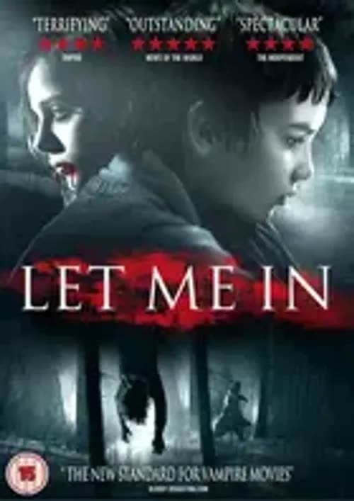
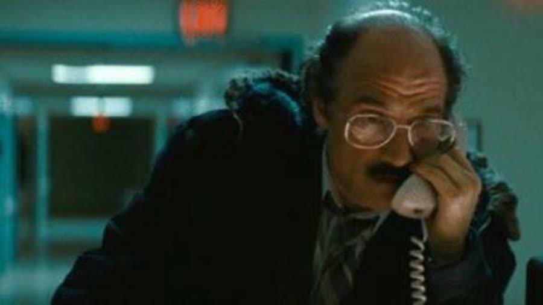
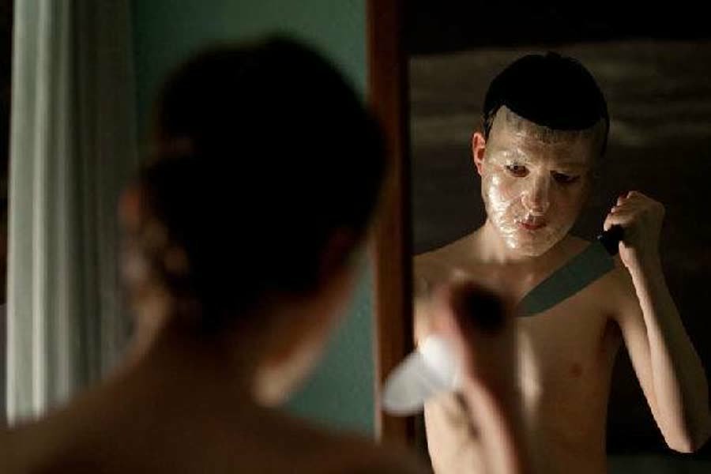
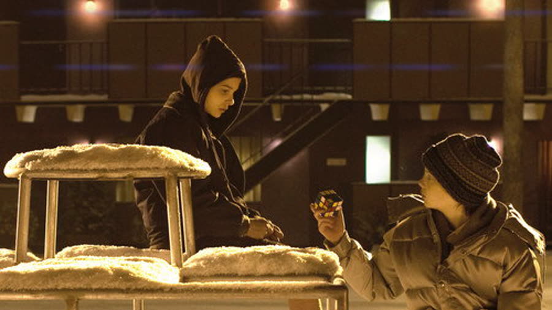
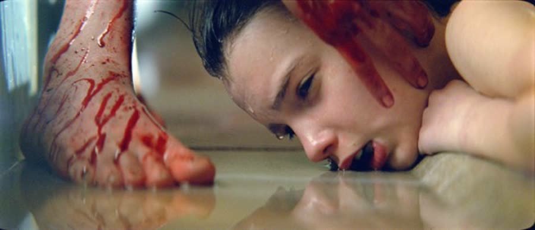
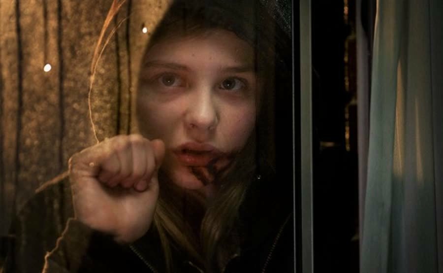
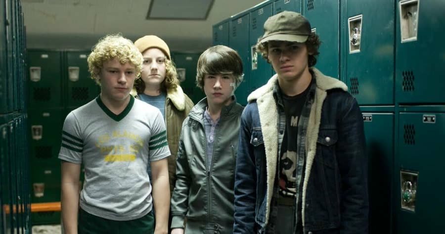
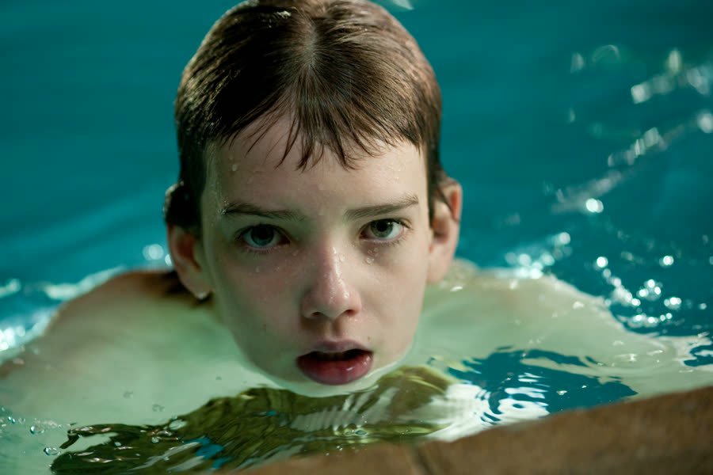

## *Let Me In (2010)*: An Unpaid Internship with an Extremely Demanding Benefits Package

{: style="float: right; margin: 0 0 1em 1.5em; width: 30%; max-width: 300px; border-radius: 10px;"}

Some kids meet their first girlfriend at school.

Owen meets his in a snow-covered courtyard, barefoot, at night, while he is practicing stabbing a tree.

*Let Me In* is a romantic coming-of-age horror story about a lonely, bullied boy who finally finds someone who understands him. Unfortunately, she is also an ageless vampire with a full-time employee whose job is murdering people and bringing her refreshments. So really, it is less first girlfriend and more unpaid internship with an extremely demanding benefits package.

### Poured Like Lasagna on the Snow
{: style="clear: none;"}

{: style="float: right; margin: 0.4em 0 0 0.6em 1em; width: 45%; max-width: 420px; border-radius: 10px;"}

March 1983, Los Alamos, New Mexico, and it is snowing hard. A man is rushed to the hospital covered in acid burns while a police detective questions him about a string of recent murders. The conversation is brief and very personal — the detective clearly thinks this burned man is connected to something.

Then the detective steps out to take a phone call, a nurse screams, and he runs back in to find the bed empty. The man has gone out the hospital window. The detective looks down at what is left of him in the snow, and the accurate description is that it looks like someone poured a lasagna down there. He is just gone.

All he leaves behind is a note: "I'm sorry, Abby."

Cool mystery. Now rewind two weeks.

### Hide the Candy, Grab a Knife

{: style="float: left; margin: 0.4em 0 1em 0.6em 0; width: 45%; max-width: 420px; border-radius: 10px;"}

Owen is twelve, lonely, and introduced singing with a mouthful of Now and Laters, which is a rough way to meet anybody. He loves those candies so much that when his mother calls him in for dinner, he dumps them in the snow and buries them rather than bring them inside — instead of, say, the pockets of the giant jacket he is wearing. Maybe he likes them frozen. Those things are hard enough to break your teeth at room temperature.

Inside is not better. His parents are mid-divorce, the phone call with his dad is one-sided and furious, and his mother is religious, wine-drinking, and emotionally somewhere else entirely. She cooks dinner and checks out. The movie never once shows her face — chin-down, background, or turned away, every single time — which is the point: she is not there for him, and the camera knows it.

Owen is also being bullied, badly, by a kid named Kenny and his two friends. And Owen is handling it by standing in front of his mirror in a weird clear plastic mask, holding a kitchen knife, rehearsing being called "little girl." It reads, at first, like a middle-school Michael Myers origin story. It takes a while to click that he is reenacting what Kenny does to him — play-acting the confrontation he is too scared to have. The mask never appears again. It does not need to. That kid takes the bullying home with him and sleeps next to it.

When he is not doing that, he is spying on the neighbors through a telescope. The loneliness in this movie is not subtle. It is a kid alone in an apartment with his mother right there.

### She Doesn't Get Cold

{: style="float: right; margin: 0.4em 0 0 0.6em 1em; width: 45%; max-width: 420px; border-radius: 10px;"}

A girl about Owen's age moves into the apartment next door with an older man, Thomas. Owen meets her in the courtyard, where he is stabbing a tree and pretending it is Kenny, and she is standing there barefoot in the snow. She tells him two things: she doesn't get cold, and they can't be friends.

Honestly, fair. The boy is rehearsing tree murder. Have a good time, bud.

Meanwhile, Thomas goes out with ropes, knives and plastic jugs, abducts a teenager, hangs him upside down in the woods and drains his blood into a jug with the practiced ease of a man who has done this many, many times. He gets the jug full — and immediately trips and spills all of it. Back home, Owen hears what sounds like a grown man screaming at Abby through the wall, and reasonably concludes she is being abused: barefoot in the snow, starving, someone's yelling at her. It is only later that it becomes clear the deep, animal voice doing the yelling was hers.

### Not My Problem, Said the Jogger

{: style="float: left; margin: 0.4em 0 1em 0.6em 0; width: 45%; max-width: 420px; border-radius: 10px;"}

Abby's stomach will not stop growling, so Abby handles dinner herself. The neighbor Owen has been spying on — the workout guy with the home gym — is out for his evening jog when he finds a small girl curled up in a dark graffiti tunnel, claiming she hurt herself and needs to be carried.

Every instinct should say no. You can come out of the tunnel. Nobody is going into the tunnel. He goes into the tunnel.

The second he picks her up, she spider-monkeys onto his head, and the movie stops hinting: she is a vampire, full animal, growling with that same deep voice from behind the apartment wall. She drains him and leaves him, and Thomas arrives to do cleanup, which consists of sinking the body in the frozen river and poking it down with a stick. It sounds stupid until spring is taken into account. It will thaw eventually. So will the evidence.

In the courtyard, though, things are almost sweet. Owen teaches Abby Morse code so they can tap through their shared wall. He tells her about Kenny. Her advice is simple: fight back. Owen's response — "what if they hit me back?" — is a problem, because they are already hitting him. There are three of them and he is tiny, but Abby is unimpressed, and she makes a vague promise: if he ever needs her to protect him, she will. She is stronger than he thinks. This is the understatement of the movie.

### In Case of an Acid Emergency

{: style="float: right; margin: 0.4em 0 0 0.6em 1em; width: 45%; max-width: 420px; border-radius: 10px;"}

Thomas goes out again, hiding in the back seat of a car — a plan that goes sideways when the driver picks up a friend, the car stops for gas, and the whole thing degenerates into a rocking station wagon at a gas pump that absolutely nobody notices. Thomas knocks the passenger out, steals the car, backs out blind through a soda-smeared windshield, and rolls it down an embankment in a genuinely gnarly wreck.

Trapped, he reaches for his contingency plan: a bottle of acid, poured over his own face, so no one can identify him or connect him to Abby. That is commitment. Not a gun, not a knife — a bottle of acid he has apparently been carrying around for exactly this emergency.

Which brings the movie back to the hospital, and the note, and the lasagna. Abby climbs the outside of the hospital to his window — she still has to be invited in — and the two of them press their hands to the glass. Whatever he manages to say through the burns, he leans toward that window and offers himself to her. Or he wanted fresh air. The charitable reading is sacrifice: this is a man who has spent his whole life feeding her, who already admitted he was getting tired, and who knew exactly what the acid was for.

Now Abby has no one. So that night she comes to Owen's window, mouth still dirty, and makes him say the words: she has to be invited in, and he must not look at her. Owen asks her to go steady. Abby tells him she is not really a girl. She is nothing. Owen, who feels like nothing too, accepts this completely, and she agrees to be his girlfriend. One demonstration does come up along the way: a vampire who enters uninvited starts shaking and bleeding from her own pores. The rules in this movie are the old rules, and they are enforced.

### You Only Get Caught When You Swing Back

{: style="float: left; margin: 0.4em 0 1em 0.6em 0; width: 45%; max-width: 420px; border-radius: 10px;"}

School takes the class ice skating on a frozen river — an outing with actual holes in the ice that everyone is trusted not to fall into. Kenny corners Owen and threatens him, and Owen, holding a big metal pole, finally does what Abby told him to do. He swings it like a baseball bat and splits Kenny's ear wide open.

And here is the universal law of bullying: nobody in authority saw any of what Kenny did. The retaliation, everybody sees. The PE teacher watches it happen — and then a group of students starts screaming, because the jogger's body has just been found in the ice, exactly where Thomas poked it down. Owen gets hauled to the principal's office, doesn't get suspended, and goes straight to Abby to report, glowing: he did it, he stood up, he split the kid's ear.

He takes her to an abandoned basement apartment to celebrate, and his idea of a romantic move is a blood pact. Surprise, Owen. He slices his own finger deep — properly deep, weeks-to-heal deep — and tells her it won't hurt when he cuts her. It is the worst possible timing, because Abby loses control on the spot: down on the floor, licking his blood up, until she raises her head and her face is wrong, all shadow and hunger. To her credit, she runs. She climbs a tree like a squirrel and goes for the neighbor instead — the one with the annoying little dog, who may or may not have been an appetizer — and then the boyfriend, who chases her off without even checking on his girlfriend first.

Afterward, Owen does the smartest thing anyone does in a horror movie: he asks her directly if she is a vampire. No walking around it, no calling her a "walker." She says yes. She needs blood. And in an old photograph, there she is, exactly as she is now — next to a young Thomas. Which raises the question hanging over this entire romance: Thomas was somebody's Owen once. Owen is not just her boyfriend. He is the replacement, in training.

The neighbor, meanwhile, is in a hospital bed gnawing on her own arm when a nurse opens the blinds — and she bursts into flames on contact with the sunlight, taking the nurse with her. The detective, who by now has connected a girl to all of this, lets himself into Abby's apartment alone with a handgun, finds Owen hiding there and Abby asleep in a taped-up bathtub she uses as a coffin, and starts peeling the tape. A crack of light burns her leg open. Owen yells for him to stop. Abby wakes up and kills the detective in front of him, and comes out covered in blood.

She has to leave town. She does — taxi, no goodbye Owen can stand — and he is heartbroken over a girl whose diet is people. Which, to be fair, is an upgrade from everyone else in his life.

### Three Minutes Underwater

{: style="float: right; margin: 0.4em 0 0 0.6em 1em; width: 45%; max-width: 420px; border-radius: 10px;"}

It ends, as it had to, with the bullies. Kenny's cruelty turns out to be inherited: his older brother does to Kenny exactly what Kenny does to Owen, and the brother is worse. The bullies set a dumpster fire to draw the teacher out, clear the pool, lock the door, and hold Owen underwater — three minutes under, or his ear gets cut. Owen cannot hold his breath that long. Nobody can. Even Kenny starts telling his brother to stop, and his brother does not care.

Then the brother's head drops into the pool in front of Owen.

Abby comes through the glass doors and dismantles every bully in the room — shark chum, all of them — and pulls Owen out of the water. She said she would protect him if he needed it. She keeps her word the way a vampire keeps words.

Last scene: Owen on a train out of town, a big trunk in front of him. A tap from inside the trunk. He taps back in Morse code. Owen is the Thomas now. That's it. That's the romance.

### The Verdict

Talon gives *Let Me In* **6 cents out of 10**.

The sadness is what sells it — the whole movie is heavy and lonely, Owen might as well have been alone for all the parenting he gets, and both kid actors carry it completely. She also lands on the darker reading and cannot unsee it: Abby knew Thomas was old and tired and failing, she knew Owen was alone and starving for anyone, and she played it exactly right. A vampire who has been twelve for a very long time knows how to recruit a caretaker. The classic rules help, too — invitations, sunlight, regular food coming straight back up — no reinventing the vampire, no explaining what a vampire is. It is a slow burn, but people keep dying during the burn, which helps.

Christopher gives *Let Me In* **half a cent out of 10**.

He liked the music, he liked how it was shot — at first it looked like a much older movie than 2010 — and the kills are exactly what a vampire should be: fast, strong, done. The traditional lore is dope and needs no explaining. But the kid dialogue does nothing for him, the characters are a rundown of a bully who sucked, a vampire who sucked, and a sad boy being sad, and two hours of that is two hours. He picked this movie. He is glad he picked it. Sarcastically.

So: six cents from one host, half a cent from the other, and a touching reminder that your child's first relationship may not be perfect — but as long as the new girlfriend is supportive, communicates well, and only occasionally dismembers his classmates, you really have to let them make their own choices.

Worth watching if you enjoy: classic vampire rules enforced without mercy, slow-burn sadness with a real body count, first love where the red flags are measured in pints, and an ending that is somehow both sweet and a life sentence.

Every school bullying policy in America could be replaced with one extremely committed vampire.

**Stuff we use / support the show:**
- Own it on physical media via [Gruv](https://www.tkqlhce.com/click-101633208-15032169)
- Watch with [Plex](https://www.kqzyfj.com/click-101633208-15734677)
- We record this show with [Riverside](https://riverside.sjv.io/4aR7A9)