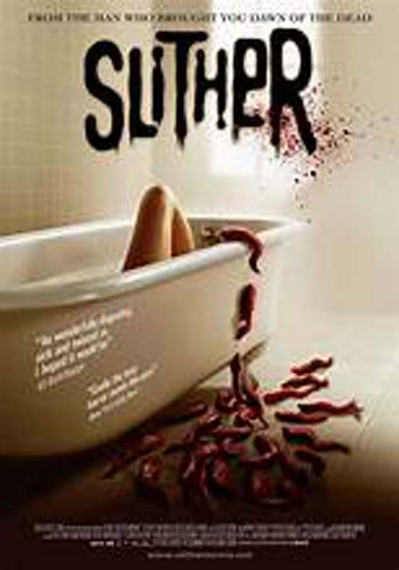
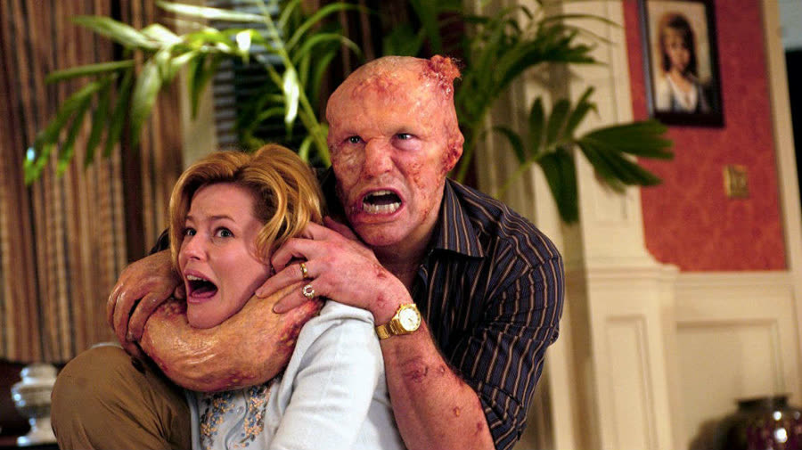
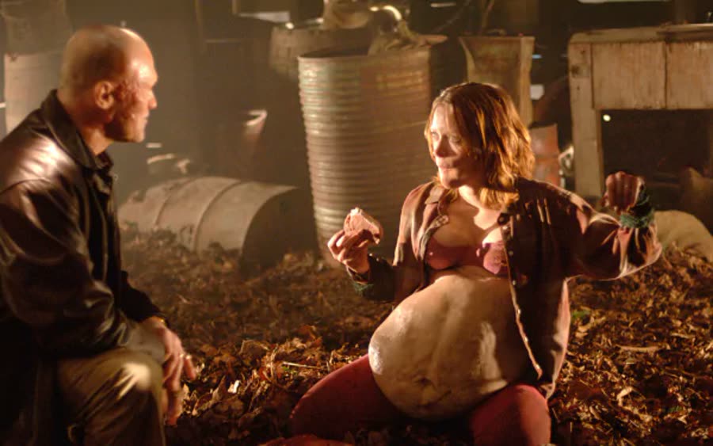
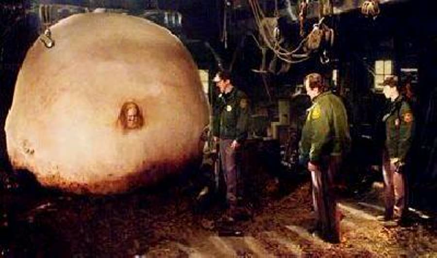
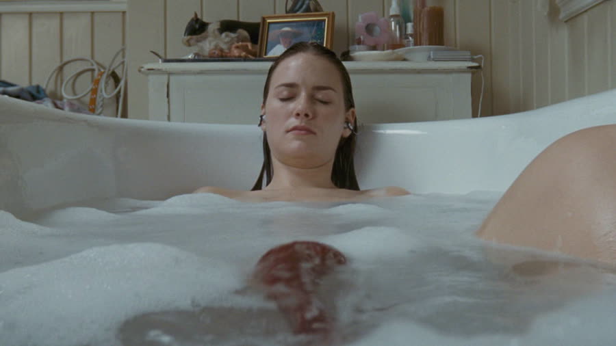
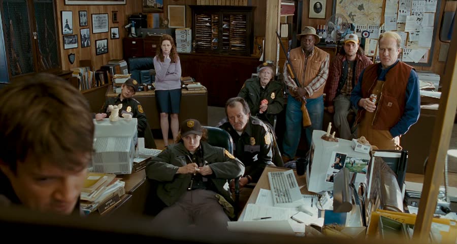
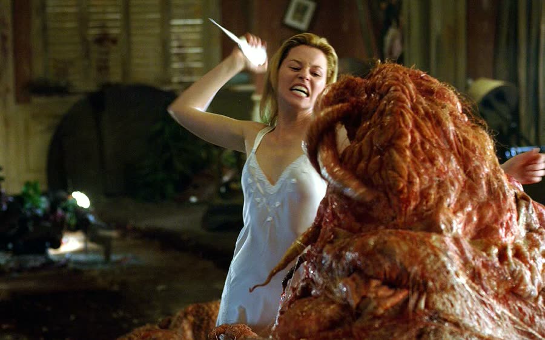

## *Slither (2006)*: Ten Out of Ten Cents on the Mr. Pibb

{: style="float: right; margin: 0 0 1em 1.5em; width: 30%; max-width: 300px; border-radius: 10px;"}

Some marriages end in divorce.

Grant and Starla's ends with a locked basement, a missing-person case, and a town where everybody suddenly has the same husband.

*Slither* is James Gunn's first movie as writer and director — a stacked cast, a flop at the box office, a cult classic ever since, and probably why there is no *Slither 2*. It is a horror comedy about an alien parasite that has spent eons eating its way from planet to planet, and its fatal mistake is landing in Wheelsy, South Carolina.

### It Was Just a Bee Sting
{: style="clear: none;"}

Wheelsy is a small town with three cops, one sheriff — Bill Pardy, played by Nathan Fillion, and yes, he is basically Mal from *Firefly* with a badge — and one very rich man: Grant Grant. Yes, that is actually his name. Grant (Michael Rooker, a man with the gift of being the most unlikable character in anything he appears in) is married to Starla, a young teacher he has known since childhood. She married him looking for a way out of a bad start in life. He is noticeably older — old enough that on first viewing he reads less like her husband and more like her dad — and the marriage is struggling.

Rejected in bed one night, Grant storms off to a genuinely great dive bar, awful karaoke notwithstanding, where Brenda, a girl from his past, leads him into the woods to show him their initials, carved in a tree years ago. Or possibly carved the other day. Skepticism is warranted.

Something has already fallen out of the sky out there. It landed softly, with no crater at all, and what Grant finds is a gooey, stinking rock with a slime trail leading away from it to a small worm-like creature that opens up and hisses at him. The richest man in town responds the only way he knows how: he pokes it with a stick.

The creature shoots a stinger into the middle of his chest. There is an X-ray flash of something wriggling inside him, and then Grant gets up, dusts himself off, and tells Brenda it was nothing. A bee sting. A fly bite. No big deal. For the record, a bee-sting lie lands differently in a household where Christopher recently defended the home by killing a wasp "with a big old butt" — his words.

### Fourteen Ribeyes and a Locked Basement

{: style="float: left; margin: 0.4em 0 1em 0.6em 0; width: 45%; max-width: 420px; border-radius: 10px;"}

Something is very wrong with Grant. He is clammy, sweating, changing — and hungry. Not snack hungry. He buys meat from every store in town, orders fourteen ribeyes from the butcher ("Having a party?" "Something like that"), and still needs more. He also puts a brand-new lock on the basement door, which is never where the Christmas presents are.

On the night of the Deer Cheer — the dance that opens deer hunting season — Starla reminds him they are leaving in twenty minutes. Or forty. Both numbers are fiction, because she then gets in the shower and washes her hair for ten minutes. Nobody is leaving that house on time. Meanwhile, in the bathroom, tentacles with stingers sprout out of Grant's chest — and he nearly uses them on his own wife before thinking better of it and bolting.

He goes to Brenda's instead. She greets him with a baby on her hip and Ritz crackers with an American cheese slice on top — classy — and what happens on her couch is a nightmare parody of a sex scene: two tentacles, one pumping something into her, one pulling something back out of her. Brenda disappears that night. A neighbor saw Grant go in. Bill leaves his card with Starla, who is adding things up: the missed Deer Cheer, the vanished woman, and a husband who now comes home with a swollen, discolored face, a misshapen mouth, and a bee-sting story his doctor supposedly confirmed. Starla calls the doctor — voiced, gloriously, by Rob Zombie — who has not seen Grant in a year.

From there it is missing pet posters all over town, then missing livestock. Starla takes a baseball bat to the basement lock, missing repeatedly, when the screwdriver in the junk drawer was right there and the house did not deserve that. Behind plastic sheeting she finds the meat stash: dead dogs, dead cats, other animals piled and hanging everywhere. No sheeting on Earth keeps that smell on one side of a door. She calls Bill; Grant appears at the window, gets in, and nearly strangles her with an arm that wraps like a tentacle before Bill and the deputies burst in and he slithers out, knocking over everything on his way through the door. Down at the station, the official theory is that he has become a squid. Or an octopus. The hosts are both confidently incorrect about which one the movie says, so it could be either.

### One Enormous Blueberry

{: style="float: right; margin: 0.4em 0 0 0.6em 1em; width: 45%; max-width: 420px; border-radius: 10px;"}

Grant has been feeding Brenda raw meat and roadkill in an abandoned barn, because the couch incident was an impregnation: she is carrying hundreds of alien offspring and growing like a human incubator. She is enormous, perfectly round, face right in the middle — the Willy Wonka blueberry girl, but horror. She seems only dimly aware of it. What she mostly is, is hungry: "Can you hand me that possum over there?"

Bill stakes out the next farm on Grant's route with his deputies, a few volunteers, the mayor, and Starla, who insists she can talk her husband back. Around a bait cow they wait, until Grant arrives — legless now, a giant red slug that looks like Jabba the Hutt and sounds worse, all slurps and wet dragging, under a score so dramatic it tips into comedy, which fits. He whips a tentacle and kills the cow, and splits one of the posse clean in half. Starla's talk does not take. He flees, fast for something with no legs, and the trail leads to the barn.

Who goes in first is decided by rock, paper, scissors, and Bill changes his throw at the last second and gets away with it. You dick.

### Cover Your Mouth

{: style="float: left; margin: 0.4em 0 1em 0.6em 0; width: 45%; max-width: 420px; border-radius: 10px;"}

Inside, Brenda is still growing, her sides ripping — and then she explodes.

Hundreds of little slugs go flying everywhere, and they are all aiming for the same place: the mouth. Two deputies get them. Everyone else gets a hand clamped over their face. Mayor Jack MacReady had stepped outside to throw up, took one in the mouth on his way back in, and got it out again, asking the only reasonable question of the night: "What kind of fucking creature wants you to eat it?"

Fair. It is another reason to relate to the mayor.

The surviving slugs pour out of the barn and race toward town. For slugs, they are incredibly, offensively fast.

### Fresh Air Is for Dead People

{: style="float: right; margin: 0.4em 0 0 0.6em 1em; width: 45%; max-width: 420px; border-radius: 10px;"}

At the farmhouse on that same property, the oldest daughter, Kylie, draws a bath. Windows open — no screens — headphones on, eyes closed. A slug comes through the window, crosses the floor, climbs into the tub, and swims all the way up to her face before she notices. She screams, it pops into her mouth, and she has to tear the thing out by hand and throw it across the room. When it comes at her again, bent but determined, she kills it with a curling iron that was sitting there on and hot, far from the tub, for no reason. This was flagged, correctly, as a safety hazard all by itself.

Down the hall, her mother finds the younger girls' bedroom door locked — they are seven to nine years old, why is it locked; possibly the slugs did it, without appendages — and instead of knocking off the doorknob, she beats a hole through the door with a horse statue. She is too late. The girls are taken. Mom escapes to the porch roof, jumps for it in a way that should have broken both ankles, and locks herself in the family truck while slugs coat the outside. Then her family walks out, calm as Sunday, calling her to join them: "Come on, we're family. It's family fun day." Dad picks up a rock and breaks the windshield.

Bill arrives in time. The same thing is happening everywhere: the infected reanimate and they are all Grant — his voice, his memories, finishing each other's sentences, all of them telling Starla they love her and she needs to come home. Starla shoots one and kills another in the street with a metal rod like she has done it before; the female deputy is killed; Bill flattens a zombie deputy with his car because the mayor was bent over fussing with his boot.

Kylie knows why, because the slug that got into her mouth showed her everything: this thing has moved from planet to planet for years beyond counting, consuming every living thing it finds. It infected Grant first and absorbed him — his memories, his thoughts, and his love for Starla. That is why every one of them is Grant.

And in the car, in the middle of all of this, Mayor Jack opens the cooler and reaches his breaking point: the dispatcher did not pack him a Mr. Pibb, the only Coke he likes. People are being eaten. The town is a hive mind. The real crisis is the missing Mr. Pibb. Christopher relates to this man more than any other character in the movie, defended the tirade as a breaking point any of us could reach, and states for the record that Mr. Pibb is the best soda, hands down. It does still exist, whatever he says.

### The Deer Came Down the Chimney

{: style="float: left; margin: 0.4em 0 1em 0.6em 0; width: 45%; max-width: 420px; border-radius: 10px;"}

Back at the station, dispatcher Shelby — Jenna Fischer, Pam from *The Office*, and the entire emergency plan — looks up as blood drips through the AC vent, and the slugs rain down on her. Next time Bill radios in, Shelby answers, "Hey, killer," in Grant's voice. So that's fucked, on top of everything already being fucked.

In town, the car gets hit twice and spun around, and the hive pours in: they take Starla, they take Jack. Only Bill and Kylie get out. The plan, such as it is, comes from Kylie's visions: Grant is the center of the hive. Kill Grant, and maybe they all die. What the station has is a grenade — planted in the plot much earlier by a throwaway line about some boys caught trying to blow up a pond, and yes, it was always coming back.

The station is dark, even though the computers are on. Turn the lights on, man. In the dark, something moves: a deer. An infected deer, inside the police station, absolutely furious, and winning, until Kylie steps in and bonks it unconscious with a fire extinguisher. Everything can be infected — not just people. And how did a deer get in there? Small town. Little door. Maybe it was a reindeer and it came in through the chimney.

They follow the hive to Grant's house, where the infected are dragging food — and themselves — to merge. Grant fills the living room now, his back end sticking out the door, flesh growing across the ceiling, bodies sinking into him naked with heads and torsos sticking out, all of them calling Starla home. If you watch one scene from this movie, watch that one: a graphic, R-rated Jabba the Hutt. Mayor Jack, freshly infected, finds a dead arm, goes "ew" the whole way through his first bite, and gets over the ew. He still ate it.

### Shoot Him, Shoot Him

{: style="float: right; margin: 0.4em 0 0 0.6em 1em; width: 45%; max-width: 420px; border-radius: 10px;"}

Upstairs, Starla wakes in a bedroom boarded inside and out, cleaned up and laid out in the white satin nightgown from their one nice night, their song playing downstairs. She does the smartest thing anyone does in this movie: she pulls the bristles off an old-fashioned hairbrush and hides its long, pointy handle in her underwear — somehow completely invisible under a flimsy nightgown — then goes downstairs and plays the loving wife, right up to the almost-kiss.

She stabs him. Not in the head. In the temple, this all ends on the spot; every head attached to him starts screaming about it instead. He throws her clear across the room into a piece of furniture that pulls down on top of her, a hit that should have broken half of her, and while Bill and Kylie fight their way in, the grenade gets slapped away, buried behind a couch in a drift of feathers, dug out, knocked out the window, and dropped into the pool, where it goes off with a sad little bloop. It is a very round grenade with the longest fuse in cinema — Weston, watching along, asked how long those usually last, and the answer (ten, twenty seconds, max) does not describe this grenade, which had the runtime of a rap intro.

Outside, Grant's tentacles find Bill: one goes in, one gets grabbed. Beside Bill sits a propane tank, venting away — impossibly long, like the grenade — and Bill hooks the free tentacle to it. Propane pumps back through Grant like a balloon until the tentacles reel Bill inside, where Starla picks up a Beretta (everyone else had revolvers; the details matter) and, after one last look between husband and wife, does it. Grant explodes. Every zombie walking to the house collapses where it stands. Kill Grant, kill them all: they were right.

Bill is fine, by the way — Kylie explains it only takes if both tentacles get in, and he pulled one out. The three survivors walk out past the wreckage, Starla in a pristine white coat that somehow has not a mark on it. It is her house and her closet, granted, but nobody stays that clean in that house. Stay through the credits: at the Grants' house, a cat comes sniffing around what is left of Grant, starts licking it, and a little stinger pops out. *Slither 2*, hinted at and never delivered — unless, like Mr. Pibb, it comes back.

### The Verdict

Christopher gives *Slither* **6 cents out of 10**.

He liked this one more than most of what the show has covered. Part of it is the soft spot for Nathan Fillion — Mal being funny and witty is an easy sell — but the comedy worked throughout, the cast was stacked with everyone fitting their role, and the movie was gross rather than scary: terrible to look at, and entertaining all the way through. Best of all, a parasite that has conquered planet after planet gets ended by some hillbillies in South Carolina.

Talon gives *Slither* **6 cents out of 10** as well.

It was not at all what she expected — she had no idea it was a comedy going in, and horror comedy is not typically her genre, though she keeps ending up liking them. This one earned it: the mayor alone (screaming at a double-parked truck in the middle of town, then turning sweet as pie for a mother and daughter walking past), an over-the-top score that pushes the movie exactly where it needs to go, and Fillion doing the wise-ass thing he does best. Not a masterpiece, but near the top of its genre.

And for the record: Mr. Pibb, **10 out of 10 cents**. The movie was alright.

Worth watching if you enjoy: gross-out horror comedy, creature features with practical-effects energy, hive minds with relationship problems, a mayor whose priorities are the real monster, and keeping your mouth closed at all times.

**Stuff we use / support the show:**
- Own it on physical media via [Gruv](https://www.tkqlhce.com/click-101633208-15032169)
- Watch with [Plex](https://www.kqzyfj.com/click-101633208-15734677)
- We record this show with [Riverside](https://riverside.sjv.io/4aR7A9)