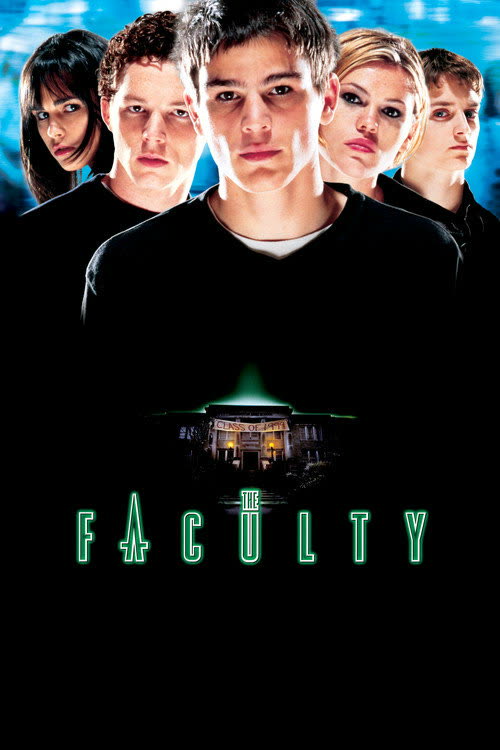
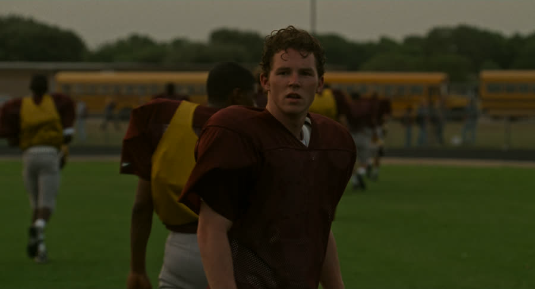
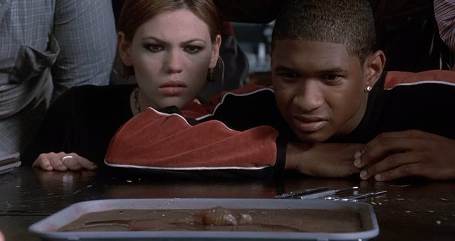
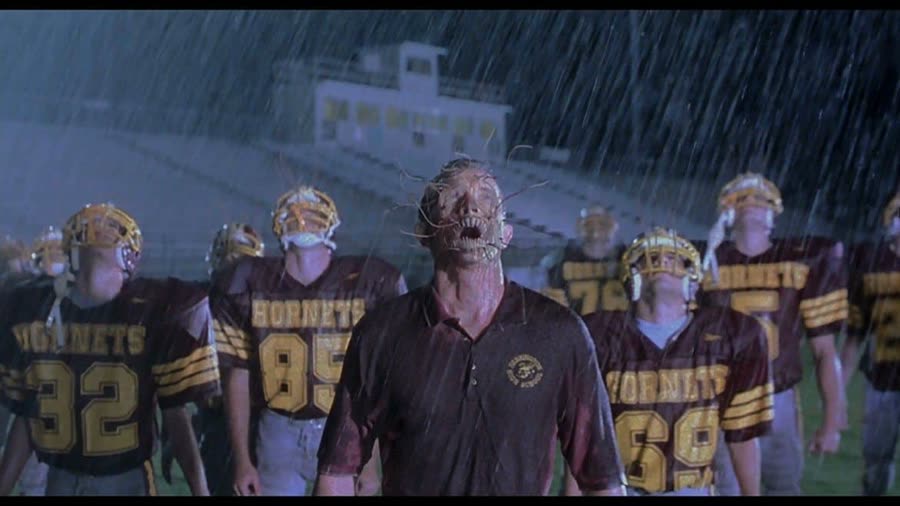
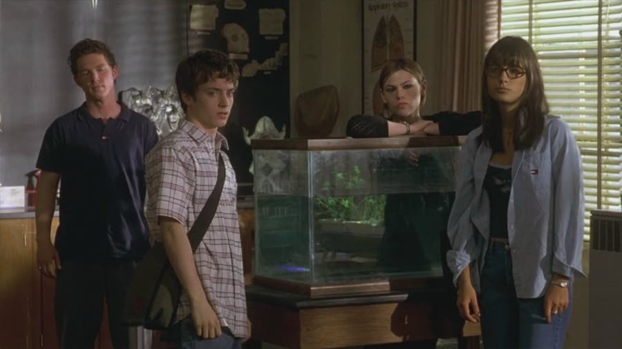
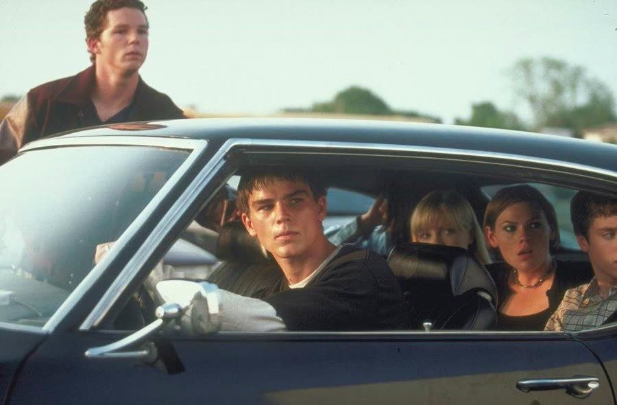
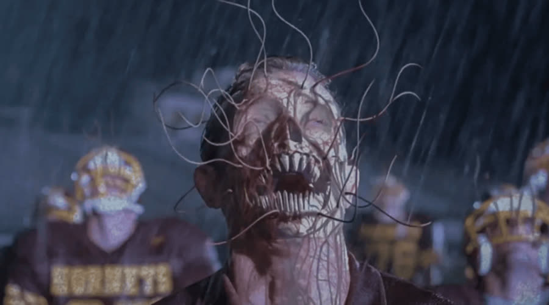

## *The Faculty (1998)*: The Ear, Not the Rear

{: style="float: right; margin: 0 0 1em 1.5em; width: 30%; max-width: 300px; border-radius: 10px;"}

Most high schools ask students to report suspicious behavior.

Herrington High skips that step, because the suspicious behavior is already tenured.

*The Faculty* is what happens when *The Breakfast Club* gets into a fistfight with *Invasion of the Body Snatchers*: Robert Rodriguez directs, Kevin Williamson writes, and a school full of alien parasites gets opposed by a newspaper photographer, a goth poet, and a drug dealer who has been a senior since the first Bush administration.

Christopher picked this one, partly for its wall-to-wall '90s grunge-rock soundtrack. The recognition was happy for the first few minutes, then it became clear the movie being remembered was some other school-invasion movie entirely. This one had never actually been seen.

That worked out fine for everybody.

### A Coach, a Sprinkler, and a Pencil
{: style="clear: none;"}

{: style="float: left; margin: 0.4em 0 1em 0.6em 0; width: 45%; max-width: 420px; border-radius: 10px;"}

The movie opens at football practice, where Coach Willis (Robert Patrick) is screaming at his players like they owe him money. Some of us played high school football under coaches who went in for character building. Coach Willis calls his players names, and when practice ends, he gets into a fight with the sprinkler — kicking it, then standing there arguing with it while it sprays him.

Walk out of the way.

Then a shadow falls over him, and the movie cuts away.

The faculty budget meeting tells us how Herrington High allocates money: no new computers, no field trip to New York, no money for the drama department's musical. There is, however, plenty for football. This prompted Christopher to reveal that his own school's football team doubled as the musical's stage crew — free labor and some wood — building elaborate two-story sets with no supervision and no qualifications beyond nails and screws.

That show was so sketchy.

Principal Drake returns to her office alone that night, where Coach Willis sneaks up on her, compliments her, and keeps asking for a pencil. She finally hands him one, and he stabs it through her hand. She fights him off, escapes through the chained doors, and makes it outside — where Mrs. Olson, the drama teacher, stands calmly on the other side of the glass.

Then Mrs. Olson stabs her in the chest with a pair of scissors.

They all secretly hate each other.

### Meet the Food Chain

{: style="float: right; margin: 0.4em 0 0 0.6em 1em; width: 45%; max-width: 420px; border-radius: 10px;"}

The next morning we meet the students, and Herrington's social order is less a hierarchy than an ongoing assault. The teachers have given up, the paint is peeling, and nobody in authority appears to care.

Casey Connor (Elijah Wood) is the school newspaper photographer, and the student body has chosen violence. Within minutes he takes an elbow to the face and gets slammed crotch-first into a flagpole. The question is unavoidable: how did that kid walk for the rest of the movie?

Delilah Profitt is the newspaper's editor-in-chief, head cheerleader, and Casey's crush. She is not easy to like for most of this movie, and the movie keeps giving reasons. She is dating Stan Rosado, the star quarterback, because that is how the status quo assigns partners.

Stan wants to quit football, raise his grades, and get into college on something other than an athletic scholarship. His evidence the system is rigged: a paper he worked hard on earned a D, bumped to an A because of his arm. This lands personally. First Stan is a quitter at sports; now, in a professional assessment, he is also a dummy. He got the A. This was not the tragedy Stan thinks it was.

Stokely Mitchell is the angry goth sci-fi reader who has convinced the school she is a lesbian so people will leave her alone. It does not work, but the strategy is understandable on a spiritual level.

Then we get Mary Beth Louise Hutchinson, the new transfer student from Atlanta, who introduces herself with her entire name every time she meets someone. She is cheerful, polite, and dressed like she wandered in from a much friendlier movie. The description of her involves Colonel Sanders, a plantation, and all the molasses in Georgia. Friendship is declined.

Finally, there is Zeke (Josh Hartnett): the parking-lot entrepreneur selling fake IDs, porn, and "scat" — powdered caffeine in hollowed-out pens — out of a 1970 Pontiac GTO. Zeke is clearly smarter than most of his teachers and is repeating his senior year anyway. The theory: Zeke is not failing school — he is afraid to leave it, because school is his entire business model.

### Get a Yeti, Dude

{: style="float: left; margin: 0.4em 0 1em 0.6em 0; width: 45%; max-width: 420px; border-radius: 10px;"}

Back in the faculty lounge, whatever got Coach Willis has settled in. He is throwing back the little two-ounce cone cups from the water cooler one after another, hydrating like a camel preparing for a long trip.

The concern is not the alien takeover. It is the container.

Get a Yeti, dude. Find something else to put that in.

English class brings Miss Burke (Famke Janssen), a nervous teacher whose authority functions more like a friendly suggestion. Zeke answers her Robinson Crusoe question correctly, then turns it into a joke at her expense — while flirting with her in a way that keeps one eye on the eventual police report.

Christopher admitted he had never heard of Robinson Crusoe. Talon's question stands: did they make him read at his Christian school?

We had audiobooks.

### Don't Touch That

{: style="float: right; margin: 0.4em 0 0 0.6em 1em; width: 45%; max-width: 420px; border-radius: 10px;"}

At lunch, Casey finds a strange dried-up thing on the football field. What it looks like is debatable — possibly a helicopter seed pod, possibly a small turd — but the bullied nerd picking it up bare-handed is extremely on brand.

He takes it to biology teacher Mr. Furlong (Jon Stewart) — a movie that gives Jon Stewart nothing funny to do being a waste of a perfectly good Jon Stewart. Zeke identifies the thing: a parasite normally found inside a squid or an octopus.

Casey points out that this is strange, because they are in Ohio.

This started a war. Christopher mounted a full defense of imported seafood: calamari exists in Ohio, seafood gets transported, somebody could have been eating lunch on the field. Talon's position was simpler: there is no live ocean in Ohio, and a parasite from a live squid does not commute.

Neither host surrendered.

Then water gets knocked onto the creature and it starts moving. Furlong puts it in a tank, where it grows tentacles and teeth — and Furlong, scientist, professional, adult, reaches in and touches it. It bites the tip of his finger off. The correct instructions had been given several times by then: don't touch that, it's alive, leave it alone. Furlong's actual response to discovering a possible new species is to start thinking about grant money.

### May Cause Half Your Head to Fall Off

Stan formally quits football, and the coach is calm and supportive about it — which is somehow worse.

In the showers, Mrs. Brummel wanders in half naked, gasping and clutching at Stan. He grabs the back of her head to steady her, and her hair comes off in his hand. Casey walks in during this, because Casey's timing is a curse.

Miss Olson later explains that Mrs. Brummel has cancer and is reacting badly to a medication. A medication that is not FDA approved — judging by the side effects, which apparently include half your head falling off and molesting students in the shower.

Outside, Miss Burke confronts Zeke about selling drugs on school grounds and tries to be more authoritative. Zeke responds by offering her chocolate laxatives and cherry-flavored condoms, like a trench-coat salesman who has never once feared consequences. She flees, mortified. Meanwhile, there is a separate battle with the word "authoritative," which takes four attempts. Zeke's inventory was not the only thing in that parking lot that refused to cooperate.

### The Ear, Not the Rear

Delilah needs a front-page story, so she and Casey sneak into the teachers' lounge — the one room in a school where students fight in the halls and sell drugs in the parking lot that is apparently still sacred. Casey had been elbowed in the face and flagpoled that morning. The lounge is where he worries about consequences.

Hiding in the closet, they find Mrs. Brummel's dried-out body — a dead ringer for the chocolate lady from SpongeBob — and overhear the truth: the entire faculty has been changed. Then Nurse Harper (Salma Hayek) — sick the entire movie, which is hilarious — walks in for cold medicine. Willis and Olson hold her down and force a little parasite into her ear.

Which raised the episode's central scientific question.

Why the ear?

Christopher, being practical, proposed an alternate route and argued it would be the easiest way in. Talon's summary of the official position: the ear, not the rear — if Christopher had his way, it would be up the butt. Her rebuttal involved miles of intestines. Christopher remained unmoved. The debate ended, as all great scientific debates should, with them polling the audience.

The kids get discovered and tell the police — who return to find the closet now contains a CPR dummy, because the aliens had all afternoon to tidy up. Casey looks insane. His parents decide he is on drugs and confiscate everything in escalating order: phone (Casey does not call anybody, so this one is symbolic), internet, music, and then, from his mother, the porn.

By the next day, Delilah is hiding behind glasses, a ponytail, and no makeup, convinced nobody will recognize her. Glasses, no glasses.

You're not Superman, honey.

### Thank God for the Drug Dealer

{: style="float: left; margin: 0.4em 0 1em 0.6em 0; width: 45%; max-width: 420px; border-radius: 10px;"}

The takeover accelerates. Teachers line students up for "ear exams." The changed Miss Burke is glamorous, mean, and says things to Zeke about his mother that made him actually flinch. And Zeke's own friends try to buy every pen of scat he has — which is easy to figure out in real time. The infected are not partying. They are clearing the supply of the one thing that can hurt them.

In the library, Casey lays out the theory: aliens would not arrive in giant ships. They would start quietly, somewhere nobody would notice — like an Ohio public school. Stokely names the precedents: *Invasion of the Body Snatchers*, *The Puppet Masters*.

The group checks on the creature in Furlong's classroom, and it is gone — these aliens, unlike the students, are good at hiding evidence. Furlong walks in and attacks. Zeke snaps the blade off a paper cutter — a weapon pretending to be office equipment — takes Furlong's fingers off with it, and when the fingers turn into parasites, stabs him in the eye with a pen of scat. Furlong fizzles and dies.

The drug works.

So they go to Zeke's house — a terrible hiding place, since the faculty know where he lives, but an excellent laboratory, built from stolen school science equipment. Testing on Oscar the lab rat confirms the rules: the parasites are part of one larger organism, need a moist host, and consume the water inside the body. That is why Mrs. Brummel dried out. And scat kills them because caffeine is a diuretic — it dehydrates them on contact.

The drug Zeke has been selling to avoid graduating is now the only defense against an entire alien invasion.

The plan requires a trust exercise: everyone takes the scat. If you are human, you get wired; if you are infected, you die. The supply management is questionable — the whole town is infected and this is all the scat there is — and the preferred administration method is eating it like a candy straw, on account of a nose permanently stuffed up from allergies.

Casey goes first and starts giggling like he has left the planet. There was nothing, nothing left for this guy. Which raises the obvious objection: now everybody has to fight aliens while high.

Mary Beth claims an aspirin allergy and cannot take it. Delilah takes it, and the parasites start moving visibly under the skin of her face. She tears the lab apart, destroys most of the supply, and escapes.

### I'd Suspect the Naked One

{: style="float: right; margin: 0.4em 0 0 0.6em 1em; width: 45%; max-width: 420px; border-radius: 10px;"}

The group decides the queen must be Principal Drake — she is in charge, and she will be at the football game, because football is everything. They lure her into the empty gym, trap her in a volleyball net (extremely resourceful), and order her at gunpoint to take the scat.

She refuses. She pleads. She seems completely human.

Zeke shoots her.

For one horrible moment, they have simply murdered their principal. Then Mary Beth dumps their whole remaining container of scat on Drake's body — which dissolves, because the queen had taken Drake over after all — and announces she got her. They now have almost no scat left and one extremely suspicious hero.

Stan goes out into the rain to check whether it worked, sees the football team standing in the downpour with tentacles out, and comes back infected, sweet-talking Stokely through the gym door about how peaceful it is to have a parasite. He takes their last pen to "prove" himself, and is gone in every way that matters.

Zeke remembers he might have more scat in his car. Casey volunteers as the distraction — a bravery arc that is suspicious in a kid who cannot stand up to hallway bullies — hides on a school bus (a bad spot; anyone who has played Modern Warfare knows the bus is a bad spot), escapes through the roof hatch, and leads the team away.

Meanwhile, the transformed Miss Burke attacks Zeke in his car, crawling through the window to get at his ear. His solution: buckle his seatbelt and drive directly into a school bus, ejecting her through the windshield. He survives. The car is a wreck.

And then, carefully, with his leg, he closes the car door.

The car is destroyed. There is glass everywhere. The door is the least of anyone's problems. Don't worry about the fucking door, bro.

Back in the gym, Mary Beth makes the infected recruitment pitch to Stokely — wouldn't life be better, no pain, no loneliness — and Stokely clocks her with a skeleton arm. Mary Beth transforms into a room-sized squid creature with far too many teeth, chases them through the pool, and, cornered in the locker room, turns back into human form.

Naked.

Zeke arrives to find Mary Beth naked and Stokely accusing her. His question — why are you naked — is also the correct detective work. The suspect-identification method is simpler than the movie's: suspect the naked one.

It is a little suspicious.

Stokely turns out to be infected too — the pool got her — so Casey locks her in an equipment cage, losing a chunk of hair in the process. The queen throws Zeke ten lockers down the room and knocks him out, leaving Casey, alone and high, playing cat and mouse with a monster the size of a classroom who insists she only wants to help everyone.

Casey lures her behind the retractable bleachers and crushes her with them. She sprays parasites into his face — the one delivery method nobody in the ear-versus-rear debate had considered — and he stabs her in the eye with the last of the scat.

The queen dies. The parasites fall out of everybody.

One month later, Herrington High is normal again, meaning Coach Willis is back to screaming at his players. Stan is dating Stokely, who has traded the goth look for flowery purple. Zeke has joined the football team, which nobody saw coming, and lights a cigarette on the field. Furlong survived, minus his fingers, plus an eye patch. Delilah is dating Casey — a decision nobody endorses, because Casey has terrible taste in women and she is the worst.

The only ones who did not make it are Principal Drake and Mrs. Brummel.

Most importantly, the football program is fine.

Thank God.

### The Verdict

Talon gives *The Faculty* **6 cents out of 10**.

She went in thinking she had seen it; she had not. For her it is pure entertainment: a great cast doing fun work, nothing Oscar-worthy and nothing trying to be, not scary, and exactly what she would leave on the TV while doing something else. Same shelf as her rating for Slither — same score.

Christopher gives *The Faculty* **7 cents out of 10**.

The story moves fast, it starts at a sprint, the runtime is a tight hour and change, and the '90s practical effects are fun rather than embarrassing. He loved seeing a young Robert Patrick, and Zeke was his favorite character — his personality and his haircut, and Christopher would like it noted that he is not here to judge, he is just saying.

His one real complaint was Casey. Christopher did not like Frodo in this at all — something about the performance never worked for him. Talon knew Zeke would be his favorite. She would like that noted too.

So: a six and a seven, a movie about the least qualified people in the building saving it anyway, and one piece of advice that outlasts the episode.

If you find a turd on the football field and put it in a water tank, and it starts moving and growing tentacles — don't touch it.

Just leave it.

Worth watching if you enjoy: nineties teen horror, an absolutely stacked cast, and Invasion of the Body Snatchers wearing a letterman jacket.

**Stuff we use / support the show:**
- Own it on physical media via [Gruv](https://www.tkqlhce.com/click-101633208-15032169)
- Watch with [Plex](https://www.kqzyfj.com/click-101633208-15734677)
- We record this show with [Riverside](https://riverside.sjv.io/4aR7A9)